# Sakila Metadata Experiment

[](https://github.com/RedEye1605/sakila-metadata-experiment/actions/workflows/tests.yml)

**A controlled Indonesian Text-to-SQL research instrument.**

Investigate how metadata annotation changes the execution accuracy of one fixed local LLM on the official MySQL Sakila database. DataHub and MCP prepare auditable metadata snapshots; Python runs independent inference requests, safe SQL execution, result comparison and question-paired analysis.

> **Current status:** the Qwen3.5-9B replication is complete: **600 main trials**. The researcher authorized publication of the [actual BAB IV–V, EX reports, figures and evidence bundle](reports/qwen35-9b-main-01/README.md) for thesis writing on Windows. Start with the [new-agent brief](reports/qwen35-9b-main-01/AGENT_BRIEF.md) and [Windows guide](reports/qwen35-9b-main-01/WINDOWS.md). Reviewer names/date and campus formatting remain to be supplied by the researcher. Richer metadata is not assumed to improve accuracy.



**Thesis title — unchanged:** *Analisis Pengaruh Metadata terhadap Execution Accuracy pada Sistem Text-to-SQL Berbasis Large Language Model (Studi Kasus: Basis Data Sakila)*

[Current BAB IV](reports/qwen35-9b-main-01/thesis/BAB_IV.md) · [Current BAB V](reports/qwen35-9b-main-01/thesis/BAB_V.md) · [EX report](reports/qwen35-9b-main-01/analysis/report.md) · [AI handoff](docs/ai-handoff.md) · [Decisions](docs/decisions.md)

## Completed Qwen3.5-9B run

| Condition | Correct / 150 | EX (%) |
|---|---:|---:|
| S0 | 98 | 65.33 |
| S1 | 111 | 74.00 |
| S2 | 109 | 72.67 |
| S3 | 121 | 80.67 |

Question-paired omnibus permutation: `p = 0.001019989800101999`. Only S3–S0 is significant after Holm correction across six contrasts: +15.33 percentage points, `p_Holm = 0.0234375`. This does not establish that every description increment helps. The model was selected after earlier results were known; that history and the explicit waiver of further pilot/smoke generation are disclosed in the [writing bundle](reports/qwen35-9b-main-01/README.md). Do not rerun inference to write the thesis.

## Archived development checkpoints

A full preliminary run completed and passed integrity checks. Its archived release passed 144 local and isolated-reconstruction tests. Earlier embargo statements below describe their historical checkpoint; later authorization covers the curated writing bundle, without changing original manifests.

**Revision-02 inputs are frozen after independent audit.** The revised design uses a pinned Spider complexity adapter, three source-based domain rules, a separate 180-trial diagnostic and isolated semantic witnesses. All 30 selected and 12 pilot references pass nine database cases; 228 local tests including MySQL integration pass. No revised EX exists at this pre-generation source checkpoint. Read the [revision status](docs/revision-02/implementation-status.md), [dataset methodology](docs/revision-02/dataset-methodology.md), [runbook](docs/revision-02/runbook.md), and [blank review packet](annotations/round-02/review-guide.md). The design does not require richer metadata to win.

**Revision-03 is the current instrument.** Questions use natural business requests without technical output footers. The30-question benchmark retains10/10/10 complexity and three ordered tasks, including two top-k tasks. S3 adds three sourced domain rules. EX accepts one global column permutation while preserving row associations, duplicates and requested row order. Independent references agree on the primary database plus eight isolated variations. The prior main run is complete and retained; its review status is researcher-attested. Read the [Qwen3.5-9B replication protocol](docs/qwen35-9b-main.md), [revision03 design](docs/revision-03/README.md), [evaluation policy](docs/revision-03/evaluation-protocol.md), [current questions](data/benchmarks/revision-03/final-02/questions.md), and [reviewer packet](annotations/round-03/review-guide.md). Older sections below describe archived versions.

## Original experimental design — preliminary-01

| Condition | Metadata received by the model | Coverage |
|---|---|---|
| S0 | Technical schema, native types, PK/FK and relationships | 16 base tables, 90 columns |
| S1 | S0 + short descriptions | All 106 table/column elements |
| S2 | S0 + detailed descriptions | Exactly the same 106 elements |
| S3 | S2 unchanged + business context | Seven grounded glossary terms and bindings |

The planned benchmark has **30 Indonesian questions × 4 conditions × 5 repetitions = 600 trials**. Each condition has 150 trials. Ten questions belong to each structural complexity group. Nine separate pilot questions are excluded from the main benchmark.

Database, schema scope, questions, prompt template, model, inference settings and evaluation rules remain fixed. Only annotations vary. Full context is checked with the actual backend chat template/tokenizer and never silently truncated. Input tokens are recorded as a possible mechanism behind metadata effects.



## Pipeline capabilities

- Ingest official schema into DataHub; manage table/column descriptions and glossary bindings there.
- Retrieve metadata through **MCP during preparation**, preserving raw receipts and two-export stability checks. No API fallback is represented as MCP retrieval.
- Freeze deterministic JSON snapshots with SHA-256 provenance and cross-condition validation.
- Send one stateless request per trial to local llama.cpp. No tools, database, gold SQL or previous results reach the model.
- Validate MySQL ASTs; execute through a SELECT-only account with timeouts and result bounds.
- Compare typed execution results using a global column bijection, preserving whole-row duplicates, NULL and explicit row-order contracts.
- Persist responses before evaluation; resume without silently regenerating completed model failures.
- Audit complete logs before descriptive EX and question-paired permutation/Holm/bootstrap analysis.

## Quick start

Requires Python **3.12**, [uv](https://docs.astral.sh/uv/), Docker Engine and Compose. DataHub and GPU inference are optional for unit tests. Dependency versions and container digests are pinned.

```bash
git clone https://github.com/RedEye1605/sakila-metadata-experiment.git
cd sakila-metadata-experiment
uv sync --frozen --group analysis
uv run --frozen --group analysis pytest -q

# Isolated research database; generates private local credentials.
uv run --frozen sakila-experiment database bootstrap
uv run --frozen sakila-experiment database inspect --output runs/database/baseline.json
uv run --frozen --group analysis pytest -q --run-integration

# No model-generation requests.
uv run --frozen sakila-experiment doctor --offline
uv run --frozen sakila-experiment schedule --questions data/public/main.questions.jsonl --output runs/plan.json
```

MySQL binds to **127.0.0.1:13306**, DataHub GMS/UI to **18080/19002**, and inference to **18081**. Credentials, downloads and experiment logs are Git-ignored. `.env.example` documents configuration; never commit an actual `.env`.

Public candidate payloads in `snapshots/distribution-v1` are byte-identical to the original candidates. They describe the earlier instrument. The current writing bundle includes the four actual revision snapshots and curated original MCP receipts in its evidence archive; these support archived replay, not a claim of fresh ingestion. Distribution manifests use relative provenance paths and preserve original manifest hashes.

See the [full reconstruction guide](docs/reproduction.md) for fresh DataHub preparation, runtime-image receipts and the distinction between archived replay and a new ingestion.

## Running an experiment

The completed researcher-selected replication used **Qwen3.5-9B Q4_K_M** with a hash-bound [execution amendment](data/amendments/qwen35-9b-direct-main-01.json). Its [protocol](docs/qwen35-9b-main.md) records launch settings and historical monitoring commands. This specific amendment waived additional capability-pilot and smoke generation, retained zero-generation engineering checks, and verified sampler/seed/cache from each actual main response. It does not claim prospective model selection or guaranteed significance. Use stored results for writing; a new run is a separate research action.

For archived/default execution, follow the [runbook](docs/runbook.md). Its database/snapshot/reference, context, separate pilot and sampler requirements remain enforced for unamended runs.

Archived preliminary configuration: **Qwen2.5-Coder-7B-Instruct Q4_K_M**, llama.cpp b11206, context 16,384, 24 GPU layers, temperature 0.2, top-p 0.95, top-k 40, output limit 1,024. [Model revision/hash](models/qwen25-coder-7b-q4km.json) are retained. This is an engineering choice, not a primary multi-model benchmark; no fine-tuning is performed.

The inspected machine has an **RTX 3060 Laptop GPU with 6 GiB VRAM**, i9-12900H and 16 GB RAM. These are observed resources, not universal minimums. Recheck available resources on another host. DataHub and inference use separate operational phases.

`freeze-main`/`run-main` require artifact-specific human review. The explicit draft route is `run-preliminary --allow-unreviewed`, followed by a separately frozen benchmark plan. It never marks a reference approved. Preliminary scores/statistics remain conditional on draft correctness.

## Repository map

```text
src/sakila_experiment/
  db/             # Connection policy, audit, bounded execution, typed values
  metadata/       # Ingestion fidelity, MCP receipts, snapshot invariants
  generation/     # Prompt, model assets, backend proof, stateless LLM client
  evaluation/     # AST policy, gold validation, comparator, reference reevaluation
  experiment/     # Scheduling, append-only ledger, readiness, runner
  analysis/       # Log audit, descriptives, paired statistics, figures
  annotations.py  # Independent templates and validated consolidation
configs/          # Non-secret configuration
data/             # Draft questions, isolated gold, annotation specification
snapshots/        # Portable candidate distribution
annotations/      # A01/A02 templates; actual submissions remain private
infra/            # Pinned deployments, reproduction and publication checks
tests/            # Synthetic unit cases and isolated MySQL integration
docs/             # Protocols, decisions, BAB IV, handoff, editable figures
reports/qwen35-9b-main-01/ # Published chapters, measured results, inputs and audit evidence
```

`data/private` means isolated from generation, **not confidential storage**: draft gold is available for scientific inspection. Actual model outputs and human submissions are private by default.

## Evaluation and reproducibility

EX compares execution results, not SQL text. Unordered results use multisets; ordered questions use sequences. The current revision03 policy ignores aliases and accepts one global column permutation, preserving full-row associations and duplicate multiplicities. Column count is fixed; numeric/date contracts use gold coordinates. Integer/decimal values remain exact; floating tolerances must be declared. Model SQL errors/rejections receive EX=0. Unrelated infrastructure/evaluator failures remain separate from completed trials.

The question is the paired block. Five repetitions are aggregated per question–condition; 600 trials are not 600 independent questions. See the current [EX rules](docs/revision-03/evaluation-protocol.md), [analysis plan](docs/revision-03/analysis-plan.md), [verification matrix](docs/evidence-matrix.md) and [publication policy](docs/publication.md).

Tests cover duplicate/NULL/type/order cases, unsafe SQL, timeouts, corrupted artifacts, deployment drift, outages, ambiguous crashes and safe resume. An earlier clean environment reproduced database and snapshot payloads from archived MCP exports. This is distinct from fresh DataHub ingestion or guaranteed identical stochastic outputs.

## Review and reuse

The original round-01 review packet contained **152 items**: 39 questions, 106 descriptions and seven terms. It is historical; current revision03 materials and status are described in the [review packet](annotations/round-03/review-guide.md) and [writing brief](reports/qwen35-9b-main-01/AGENT_BRIEF.md). Review completion was declared by the researcher; reviewer identity/date are not fabricated. A new independent review should receive only its designated inputs without model predictions/scores. Software never creates human approval.

After review, **gold SQL/result-contract-only corrections** can rescore stored predictions under a hash-bound adjudication record without new inference. Changes to questions, snapshots, prompt, model or sampling require new generation. Original ledgers remain intact.

Original code is [MIT licensed](LICENSE). Dependencies and Oracle-derived materials retain their licenses: [third-party notices](THIRD_PARTY_NOTICES.md). Weights and credentials are not distributed. [CITATION.cff](CITATION.cff) describes research software; no publication or DOI is claimed.
