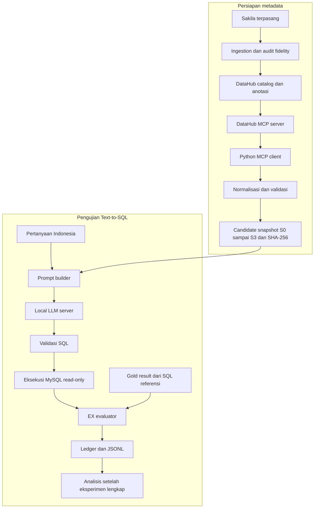

# BAB IV — Perancangan dan Implementasi Pipeline Eksperimen

**Judul penelitian:** Analisis Pengaruh Metadata terhadap Execution Accuracy pada Sistem Text-to-SQL Berbasis Large Language Model (Studi Kasus: Basis Data Sakila)

**Status naskah:** draft perancangan dan implementasi untuk bimbingan, 28 Oktober 2026. Pipeline telah menyelesaikan 36 trial pilot dan 600 trial pendahuluan. Gold/anotasi tetap draft dan laporan EX aktual disimpan lokal; tidak ada persetujuan reviewer yang dibuat otomatis. Penomoran dapat diselaraskan dengan pedoman kampus.

## 4.1 Tujuan dan Kedudukan Implementasi

Pipeline dikembangkan sebagai instrumen untuk menguji pengaruh variasi anotasi metadata terhadap Execution Accuracy (EX) pada Text-to-SQL. Masukan sistem adalah pertanyaan berbahasa Indonesia dan metadata Sakila. Keluaran LLM berupa SQL MySQL, yang kemudian divalidasi, dieksekusi melalui Python, dan dibandingkan dengan hasil SQL referensi.

Penelitian tetap menggunakan delapan tahap: Studi Literatur, Penyusunan Anotasi Metadata, Penyusunan Dataset Pengujian, Perancangan Pipeline Text-to-SQL, Implementasi Pipeline Text-to-SQL, Pengujian Text-to-SQL, Analisis Hasil, serta Penarikan Kesimpulan dan Saran. Instalasi database, pemeriksaan model, dan perhitungan EX merupakan kegiatan teknis di dalam tahapan tersebut. Implementasi aplikasi tidak dijadikan objek evaluasi produk.

Bab ini menjelaskan pembangunan dan verifikasi instrumen, termasuk pengujian pendahuluan yang secara eksplisit diizinkan peneliti sebelum review selesai. Hasil EX/statistik pendahuluan diberi label provisional dan menjadi bahan BAB V privat; kesimpulan akhir menunggu validasi ilmiah serta pengungkapan urutan kegiatan yang sebenarnya.

| Tahap penelitian | Kegiatan yang didukung pipeline | Batas pelaporan |
|---|---|---|
| Studi Literatur | Dasar Text-to-SQL, metadata dan evaluasi hasil | Sumber software tidak menggantikan seluruh tinjauan teori |
| Penyusunan Anotasi Metadata | Specification, DataHub authoring, review fakta | Candidate teruji struktur belum berarti disetujui |
| Penyusunan Dataset Pengujian | 30 utama + 9 pilot, rubric, gold dan kontrak | Eksekusi sukses tidak membuktikan makna benar |
| Perancangan Pipeline Text-to-SQL | Dua fase, interfaces, controls dan protokol | Instrumen eksperimen; bukan evaluasi produk |
| Implementasi Pipeline Text-to-SQL | Modules, configuration, safety, logging dan tests | Implemented/tested dibedakan dari reviewed |
| Pengujian Text-to-SQL | Pilot, frozen trials, SQL execution dan EX | Pendahuluan provisional; infra berbeda dari model error |
| Analisis Hasil | Paired comparisons, effect sizes, uncertainty | Bukan 600 independent questions; hasil pada BAB V |
| Penarikan Kesimpulan dan Saran | Interpretasi hasil terverifikasi dan keterbatasan | Tidak ada kesimpulan dari successful execution semata |

Roadmap engineering fase 0–10 adalah urutan dependensi pembangunan, bukan pengganti delapan tahap ini. Instalasi Sakila, resource checks dan kelayakan model tidak menjadi tahap penelitian mandiri.

## 4.2 Lingkungan Implementasi dan Basis Data

### 4.2.1 Kebutuhan dan kriteria penerimaan

Kebutuhan diturunkan dari desain eksperimen. Pipeline harus mempertahankan perlakuan metadata yang dapat diaudit, memberi satu kesempatan generation per trial, mengeksekusi SQL secara aman, dan menyimpan bukti untuk menghitung ulang evaluasi.

| ID | Kebutuhan | Komponen | Kriteria penerimaan |
|---|---|---|---|
| RF01 | Menetapkan sumber kebenaran Sakila | `db.inspect`, bootstrap | Semua base tables, kolom, PK/FK dan fingerprint isi tercatat dari instance aktual |
| RF02 | Mengelola technical/descriptive/business metadata | DataHub ingestion/annotation scripts | Metadata tersedia pada catalog dan sesuai audit/specification |
| RF03 | Mengambil konteks melalui MCP | `mcp_client`, snapshots | Tool discovery, pagination dan seluruh request/response terikat hash |
| RF04 | Membentuk empat perlakuan sebanding | Snapshot builder/validator | Technical schema identik, coverage S1/S2 sama, S3 mempertahankan S2 |
| RF05 | Mencegah gold leakage | `GenerationInput`, prompt builder | Gold tidak masuk messages; hanya evaluator menggunakannya |
| RF06 | Mengirim independent requests | Scheduler, LLM client | Tanpa history, tools, prompt cache atau error feedback |
| RF07 | Membatasi SQL tidak tepercaya | AST policy, SELECT-only account | Multi-statement dan operasi di luar scope ditolak; batas waktu/hasil aktif |
| RF08 | Menghitung EX berbasis hasil | Typed comparator | Duplikat, NULL, kolom, angka dan ordering diuji dengan pasangan sengaja berbeda |
| RF09 | Memulihkan trial secara auditable | Ledger, runner | Respons disimpan sebelum evaluasi; terminal failure tidak digenerate ulang |
| RF10 | Menganalisis pengukuran berulang | Log audit/statistics | Struktur 30×4×5 lengkap; pertanyaan tetap menjadi blok berpasangan |
| RF11 | Memisahkan review dari otomasi | A01/A02, readiness | Isian awal pending; konsolidasi tidak menghasilkan approval |

Kebutuhan nonfungsional meliputi reproduktibilitas source/configuration, provenance, kerahasiaan credentials, modularitas dan kelayakan resource. Tidak ada target layanan chatbot, frontend, vector database atau pencarian skema dinamis. Komponen tersebut tidak diperlukan untuk menjawab pertanyaan penelitian dan dapat mengubah perlakuan.

### 4.2.2 Lingkungan terverifikasi

Pemeriksaan mesin menunjukkan GPU NVIDIA RTX 3060 Laptop dengan VRAM 6.144 MiB, CPU Intel Core i9-12900H, RAM nominal 16 GB, dan Pop!_OS 24.04. Identifikasi tersebut berasal dari mesin aktual; GPU yang digunakan bukan diasumsikan sebagai RTX 3060 Ti. Python proyek menggunakan versi 3.12.3. Dependency dikunci dengan lockfile, sedangkan tooling metadata memiliki environment terpisah karena kebutuhan package ingestion berbeda dari runtime eksperimen.

| Komponen | Implementasi/bukti saat ini |
|---|---|
| Database penelitian | MySQL 8.4.11; image digest dikunci; port loopback 13306 |
| Database Sakila | Distribusi resmi, SQL diimpor tanpa modifikasi |
| Metadata catalog | DataHub Core v1.8.0; image deployment dikunci |
| MCP server | mcp-server-datahub 0.8.0 |
| MCP client SDK | 1.30.0 pada environment metadata |
| Metadata ingestion SDK | acryl-datahub 1.7.0.17 |
| Inference backend | llama.cpp b11206; revision dan image digest tercatat |
| SQL parser | SQLGlot 30.25.0 pada runtime eksperimen |
| Logging | SQLite append-only dan ekspor JSONL |
| Analisis | NumPy 2.5.4 dan Matplotlib 3.11.2 pada dependency group analisis |

Sakila terpasang memiliki 16 base tables, 90 kolom, 22 foreign keys, dan total 47.268 baris pada base tables. Views dan routines tidak dimasukkan ke konteks model. Struktur terpasang, bukan daftar tabel yang diasumsikan dari ingatan, digunakan sebagai sumber pemeriksaan.

Database penelitian terpisah dari instance mysql-dev yang sudah ada. Account eksperimen memperoleh SELECT pada base tables yang ditetapkan. Administrator hanya dipakai dalam prosedur setup administratif; account tersebut tidak digunakan untuk SQL keluaran model. Database kemudian diberi persistent `read_only` dan `super_read_only`.

Skema, DDL, isi data, versi server, dan konfigurasi session diperiksa menggunakan fingerprint. Hash data disusun dari representasi nilai bertipe dengan urutan yang ditentukan. Pemeriksaan ulang sebelum dan sesudah pilot menunjukkan database tetap sesuai baseline. Metadata catalog dapat dihentikan setelah ekspor untuk mengurangi kompetisi RAM dengan inference server.

**Bukti:** `runs/environment/initial.json`, `runs/database/import-manifest.json`, dan `runs/database/baseline.json`. Sumber objek penelitian: [dokumentasi Sakila MySQL](https://dev.mysql.com/doc/sakila/en/).

## 4.3 Arsitektur Dua Fase

Persiapan metadata dipisahkan dari inference agar kondisi metadata tidak berubah secara dinamis mengikuti pertanyaan.

MCP digunakan pada fase persiapan. Saat generation, model hanya menerima instruksi umum, metadata snapshot, pertanyaan, dan aturan keluaran. Tidak ada tools, koneksi database, gold SQL, hasil referensi, riwayat percakapan, atau hasil trial sebelumnya pada masukan model. Python menguasai seluruh akses database dan evaluasi.

### 4.3.1 Pertimbangan arsitektur

Retrieval dinamis per pertanyaan dapat mengubah cakupan metadata dan mencampur perlakuan dengan relevansi retrieval. Snapshot beku menghindari perubahan tersebut. Empat catalog terpisah merupakan alternatif, tetapi memperbesar kebutuhan resource dan risiko perbedaan konfigurasi. Implementasi memakai satu catalog secara berurutan, mengekspor setiap kondisi sebelum melanjutkan, lalu menggunakan snapshot tanpa catalog aktif selama inference.

DataHub menjadi platform pengelolaan, sedangkan MCP menjadi batas retrieval. SDK administratif menulis metadata dan dicatat sebagai ingestion/annotation administration; konten snapshot tetap diambil melalui MCP. Jika versi MCP tidak menampilkan field yang diperlukan, builder harus gagal. Alternatif yang defensibel adalah adapter MCP terdokumentasi dengan provenance, bukan pengisian REST/GraphQL tersembunyi yang disebut retrieval MCP.

Python CLI dipilih untuk batch operation, manifest, penguncian parameter dan pengujian otomatis. LLM server dipisahkan dari executor karena model bukan pengendali database. Tidak ada training atau fine-tuning. Pemeriksaan kandidat/resource merupakan kegiatan implementasi internal, bukan tahap studi perbandingan banyak model.

### 4.3.2 Kontrak antarmodul dan batas akses

| Batas | Masukan | Keluaran | Invariant |
|---|---|---|---|
| MCP → normalizer | Export, inventory, raw receipts | Schema/descriptions/business context | Hash benar; tanpa database enrichment pada builder |
| Snapshot → prompt | Assigned payload/hash, pertanyaan | Dua messages dan prompt hash | Hanya metadata berbeda antarskenario |
| LLM → runner | Checked prompt dan seed | Raw response, text, status, usage/latency | Satu request tanpa repair/history |
| Executor → comparator | ResultTable atau error | Typed rows/hash/status | SELECT-only dan duplikat tetap terpelihara |
| Runner → ledger | Assignment/dispatch/response/outcome | Append-only events | Terminal outcome unik; respons disimpan dahulu |
| Ledger → analisis | Manifest/plan/events/results | Report/tables/figures | Audit integritas dan paired structure lulus dahulu |

`GenerationInput` hanya membawa pertanyaan. Complexity, schema references dan gold merupakan informasi evaluasi/audit, bukan petunjuk tambahan untuk model. Tidak ada pemilihan tabel berdasarkan pertanyaan. Scope skema lengkap tetap diberikan pada empat kondisi.

### 4.3.3 Rancangan data dan konsistensi

Diagram diturunkan dari base tables/foreign keys aktual. `film_text` tidak diberi relasi asumtif karena tidak mempunyai foreign key terdeklarasi. Siklus staff/store yang sah tetap ditampilkan. Anotasi tidak ditulis pada record Sakila. Import resmi/checksum dipertahankan dan fingerprint dibandingkan sebelum/sesudah run; database dengan nama sama tetapi isi berbeda tidak boleh menggantikan baseline.

MySQL menyimpan objek penelitian; DataHub menyimpan metadata; filesystem menyimpan snapshot/dataset/configuration; SQLite menyimpan event; JSONL, tabel dan figure adalah ekspor/turunan. Hasil model tidak ditulis kembali menjadi metadata atau training data selama eksperimen.

## 4.4 Implementasi Metadata dan Snapshot

### 4.4.1 Ingestion dan fidelity

Technical metadata Sakila diingest ke DataHub dan dibandingkan dengan audit skema terpasang. Diagnostik connector menemukan `address.location` dilaporkan sebagai BLOB, sementara MySQL menyatakan geometry. Ketidaksesuaian ini ditangani pada intermediate ingestion yang diaudit. Metadata mentah, perubahan native type, hash input/output, dan validasi sesudah perubahan dipertahankan.

Perubahan tersebut tidak mengubah tabel atau data Sakila. Intermediate yang telah divalidasi masuk ke catalog sebelum metadata diekspor melalui MCP. Audit database langsung tidak digunakan untuk melengkapi field yang hilang dalam snapshot. Jika technical metadata yang diambil melalui MCP berbeda dari audit, snapshot builder menolak publikasi.

### 4.4.2 Empat kondisi metadata

| Kondisi | Isi konteks model | Kontrol |
|---|---|---|
| S0 | Nama tabel/kolom, native types, nullability, PK dan FK | Tanpa anotasi deskriptif/bisnis |
| S1 | S0 ditambah deskripsi singkat | 16 tabel dan 90 kolom dianotasi |
| S2 | S0 ditambah deskripsi rinci | Coverage identik dengan S1 |
| S3 | Seluruh S2 ditambah tujuh istilah bisnis dan binding | Deskripsi S2 dipertahankan identik |

Jumlah elemen deskripsi pada S1/S2 adalah 106, terdiri atas 16 tabel dan 90 kolom. Istilah bisnis pada S3 mencakup konsep lintas elemen, misalnya perbedaan judul film, salinan inventaris, dan transaksi penyewaan. Definisi tidak boleh memuat gold SQL atau solusi khusus pertanyaan. Kebenaran semantik anotasi tetap memerlukan review, meskipun pemeriksaan literal tidak menemukan salinan gold atau pertanyaan utama.

Catalog dikelola secara berurutan untuk masing-masing kondisi, lalu diekspor sebelum kondisi berikutnya diterapkan. Sistem tidak mengasumsikan DataHub menyimpan empat versi deskripsi aktif sekaligus. Pemanggilan SDK untuk menulis anotasi dicatat sebagai administrasi metadata; sumber konten snapshot tetap hasil retrieval MCP.

### 4.4.3 Retrieval dan normalisasi

Tool discovery aktual menemukan `get_entities` dan `list_schema_fields` untuk retrieval yang dibutuhkan. Pagination diperiksa sampai seluruh kolom diperoleh. Konfigurasi batas panjang deskripsi dinaikkan secara eksplisit karena server memiliki batas bawaan yang dapat memotong deskripsi.

Setiap kondisi diekspor dua kali melalui sesi MCP independen. Payload hasil normalisasi harus identik. Serialisasi JSON, urutan tabel, urutan kolom, relasi, dan deskripsi ditentukan secara konsisten. Snapshot berisi bagian `technical_schema`, `descriptions`, dan `business_context`; nama kondisi tidak dimasukkan sebagai petunjuk ke prompt.

Setiap payload mempunyai SHA-256 dan manifest provenance, termasuk referensi ekspor MCP serta hash tool inventory dan respons. Pemeriksaan set snapshot memastikan technical schema sama, coverage S1/S2 identik, dan S3 bersifat aditif terhadap S2. Snapshot saat ini masih berstatus candidate sampai review ilmiah selesai.

**Bukti:** `runs/metadata/fidelity-receipt.json`, `catalog-ingestion.json`, `mcp-tool-inventory.json`, directory `runs/metadata/exports`, serta `snapshots/candidates-v2`.

### 4.4.4 Artifact dan kontrol perlakuan

Payload mempunyai tiga bagian sama: `technical_schema`, `descriptions`, dan `business_context`. Dua bagian anotasi pada S0 berupa array kosong. S1/S2 menggunakan identifier target sama, berupa nama tabel atau `table.column`; S3 mempertahankan deskripsi S2 identik dan hanya menambah bagian bisnis. Canonical JSON memakai UTF-8, key ordering dan separator konsisten serta newline akhir. Urutan tabel, kolom, relasi dan target ditentukan normalizer yang sama.

Manifest mengikat scenario ID, nama file/hash payload, technical schema, specification, database, jumlah deskripsi/terms dan dua ekspor. Artifact tidak ditimpa. Manifest distribusi publik memakai path relatif dan mencatat hash manifest asli; payload tetap identik dengan candidate lokal. Salinan distribusi bukan bukti retrieval baru.

Validator membandingkan seluruh technical schema, bukan sekadar jumlah tabel. Penghilangan kolom, perubahan foreign key/native type, target deskripsi berbeda atau perubahan teks S2 pada S3 menyebabkan penolakan. Pemeriksaan struktural tidak membuktikan ketepatan semantik; fakta anotasi tetap direview manusia. Seluruh kondisi memakai bahasa sama.

Deskripsi rinci menambah informasi sekaligus panjang input. Token tidak disamakan melalui pemotongan. Pengaruh semantik dan panjang token tidak teridentifikasi secara terpisah oleh desain ini; keduanya dibahas sebagai bagian paket perlakuan.

## 4.5 Implementasi Dataset dan Referensi

Dataset utama terdiri atas 30 pertanyaan Indonesia: sepuluh simple, sepuluh medium, dan sepuluh complex. Pilot menggunakan sembilan pertanyaan terpisah. ID Q digunakan untuk utama, sedangkan ID P digunakan untuk pilot.

Rubric operasional ditetapkan berdasarkan struktur gold SQL: simple tanpa JOIN, grouping, subquery atau window; medium memakai JOIN/grouping/HAVING tanpa struktur complex; complex mempunyai subquery, CTE, window, set operation, atau sedikitnya tiga JOIN. Label ini merupakan rubric penelitian yang harus dijelaskan secara eksplisit; tidak diklaim identik dengan seluruh aturan benchmark lain.

Penggunaan struktur SQL sebagai dasar kesulitan terinspirasi oleh pembahasan SQL hardness dalam [Yu dkk., Spider (2018)](https://aclanthology.org/D18-1425/), yang mempertimbangkan komponen query. Spider sendiri mempunyai empat tingkat; tiga kelas dan ambang operasional di penelitian Sakila ini merupakan definisi lokal, sehingga label tidak boleh disamakan langsung dengan kategori Spider.

Public question menyimpan pertanyaan, ID, complexity, dan referensi skema untuk audit. `GenerationInput` hanya membawa teks pertanyaan. Gold disimpan pada kontrak terpisah berisi SQL, jumlah kolom, kebutuhan urutan, approximate columns jika ada, status review, dan catatan semantik.

Semua 39 referensi awal berhasil dieksekusi dan diperiksa lebar kolom, struktur kompleksitas, serta hasilnya. Pemeriksaan tersebut tidak membuktikan makna gold sudah benar. Anda bersama dosen/rekan masih perlu meninjau ambiguitas, tingkat agregasi, hubungan tabel, NULL, duplikasi, ranking, dan overlap/parafrase pilot dengan utama. Status dataset tetap draft sesuai keputusan peneliti.

Paket review menyediakan CSV pertanyaan, anotasi, istilah bisnis, cuplikan hasil bertipe, serta hash input. Keputusan reviewer tidak diisi otomatis. Hasil referensi yang tidak lagi cocok dengan hash dataset/gold ditandai stale dan tidak dipresentasikan sebagai hasil valid.

### 4.5.1 Review independen dan adjudikasi

Paket `annotations/round-01` memisahkan A01/A02. Masing-masing menilai 152 item: 30 soal utama, sembilan pilot, 106 elemen deskripsi dan tujuh istilah bisnis. Reviewer memperoleh schema, gold/kontrak, reference results dan sumber metadata, tanpa prediksi, EX atau analisis error model sebelum submission.

Soal dinilai untuk kejelasan, answerability, ketepatan gold/kontrak/complexity dan pemisahan pilot–utama. Deskripsi dinilai untuk ketepatan short/detailed, sumber dan tidak adanya petunjuk solusi. Istilah dinilai untuk definisi, binding, sumber dan leakage. Criterion diisi yes/no/uncertain, keputusan accepted/revise/rejected/uncertain, usulan koreksi pada kolom tersendiri, alasan dan tanggal aktual. Accepted mensyaratkan seluruh criterion yes tanpa usulan perubahan.

Konsolidasi memeriksa ID, immutable source fields dan hash template, kemudian memasangkan penilaian. Kolom final tetap pending meskipun reviewer setuju. Kesepakatan bukan bukti kebenaran dan bukan approval. Identitas asli disimpan privat; adjudikator menentukan koreksi berdasarkan fakta/makna, bukan keuntungan skor. Agreement merupakan deskripsi proses review pendukung, bukan outcome utama.

### 4.5.2 Perubahan sesudah pengujian pendahuluan

Peneliti mengizinkan pengujian pendahuluan ketika draft belum direview. Mode tersebut diberi `provisional`, `allow_unreviewed=true`, `main_experiment_allowed=false` dan embargo hasil publik. Jalur reviewed tetap memerlukan review nyata. Urutan kegiatan ini harus diungkapkan, tanpa menulis seolah persetujuan telah diberikan sebelum pengujian.

Jika hanya gold SQL/kontrak hasil yang dikoreksi, hasil prediksi tersimpan dapat dinilai ulang tanpa LLM. Reevaluation memerlukan adjudikasi lengkap terikat hash, approved replacement gold, 600 trial lengkap dan generation inputs/database yang tidak berubah. Original ledger tidak ditimpa. Koreksi pertanyaan, complexity yang mengubah desain, metadata, prompt atau settings memerlukan generation baru. Hasil tidak menjadi konfirmatori secara retroaktif setelah skor telah dilihat.

## 4.6 Implementasi Generation

Prompt terdiri atas dua messages yang independen untuk setiap request. System message memberikan instruksi Text-to-SQL, sementara user message menyertakan serialisasi metadata dan pertanyaan. Template sama pada seluruh kondisi; hanya isi snapshot berubah. Model diminta mengembalikan satu query MySQL read-only tanpa penjelasan.

Client memakai endpoint chat completions yang telah diperiksa pada server lokal. Sebelum generation, prompt diterapkan pada chat template backend dan ditokenisasi. Jumlah input, cadangan output, dan safety margin harus berada dalam effective context. Request yang melampaui batas ditolak sebelum generation; metadata tidak dipotong untuk menyesuaikan panjang.

Pemeriksaan kelayakan model dilakukan secara terbatas pada pertanyaan pilot terpisah. Catatan kandidat awal dipertahankan pada decision log; pemeriksaan tersebut tidak menjadi studi perbandingan model utama dan tidak memakai 30 pertanyaan benchmark untuk memilih model. Model Qwen2.5-Coder-7B-Instruct kemudian dibekukan untuk seluruh 600 trial pendahuluan.

Model pendahuluan adalah [Qwen2.5-Coder-7B-Instruct GGUF Q4_K_M resmi](https://huggingface.co/Qwen/Qwen2.5-Coder-7B-Instruct-GGUF), file berukuran 4.683.073.536 bytes, dipin pada revision dan SHA-256 dalam models/qwen25-coder-7b-q4km.json. Server memakai 24 GPU layers dan context 16.384. Semua 36 kombinasi pilot muat (maksimum 7.411 token), dan semua 120 kombinasi benchmark muat (maksimum 7.450 token) termasuk cadangan output/margin. Qualification pilot dan 600 trial pendahuluan selesai tanpa insiden infrastruktur, dengan database tidak berubah. Keberhasilan operasional ini tidak membuktikan gold sudah benar secara semantik. Tidak ada fine-tuning.

Setiap backend menyimpan model hash, revision backend, image digest, command aktual, quantization, context, template hash, serta konfigurasi eksekusi. Bukti sampler suatu model tidak boleh digunakan sebagai bukti model lain. Verification context dilakukan tanpa generation; verification sampler yang benar memerlukan request pilot nyata dari backend yang sama dengan status reviewed atau provisional yang dicatat eksplisit.

### 4.6.1 Konfigurasi request dan kapasitas konteks

Kandidat pendahuluan menggunakan temperature 0,2, top-p 0,95, top-k 40, max output 1.024, min-p 0 dan repeat penalty 1. Request meminta satu response, non-streaming, tanpa prompt cache. Context efektif 16.384 mencakup chat template, metadata, pertanyaan dan cadangan output. Seluruh 120 kombinasi question–scenario benchmark diperiksa sebelum freeze; satu contoh S3 tidak cukup untuk membuktikan semua prompt muat.

Backend menggunakan satu slot tanpa context shifting otomatis. Seed diturunkan dari question–repetition dan dipasangkan antarkondisi. Seed/temperature tidak menjamin keluaran identik lintas hardware/versi; lima independent requests juga tidak menjamin SQL berbeda. Pengulangan mengukur variasi/konsistensi dalam konfigurasi tetap, bukan memaksa keberagaman.

Client menggunakan apply-template dan tokenize yang telah ditemukan pada server sebelum `/v1/chat/completions`. Response structure, finish reason, usage dan actual sampler diperiksa pada versi terpasang. Endpoint/model identifier tidak diterima hanya berdasarkan asumsi kompatibilitas. Usage yang tidak tersedia dicatat missing tanpa token count rekaan.

### 4.6.2 Penguncian konfigurasi dan resource

GGUF dipin pada revision dan SHA-256, bukan hanya alias. Compose mengunci image digest/runtime flags. Backend evidence mengikat image, command, memory limit dan read-only model mount; drift ditolak runner. DataHub dihentikan dengan volume dipertahankan selama inference.

Loading/context verification bukan bukti ketepatan SQL. Pilot terpisah memeriksa generation, resource dan log, tanpa memilih model berdasarkan 30 soal benchmark. Source, prompt dan konfigurasi dibekukan sebelum qualification pilot pendahuluan; source tetap sama selama generation benchmark.

## 4.7 Validasi SQL, Eksekusi, dan EX

Output model diperlakukan sebagai masukan tidak tepercaya. Pembersihan format dibatasi pada whitespace dan satu code fence utuh. Query tidak ditranspilasi, ditambah klausa, diperbaiki identifier-nya, atau dikirim ulang berdasarkan error eksekusi.

SQL parser memeriksa AST MySQL, single statement, jenis query, table scope, dan fungsi yang diizinkan. Pemeriksaan tidak hanya mengandalkan awalan SELECT. Privilege database menjadi perlindungan tambahan. Connection timeout, query timeout, serta batas jumlah baris dan ukuran hasil membatasi eksekusi.

Comparator membandingkan hasil, bukan teks SQL. Jumlah dan posisi kolom mengikuti kontrak pertanyaan; alias diabaikan. Tanpa kewajiban ordering, seluruh baris dibandingkan sebagai multiset sehingga multiplicity duplikat tetap terjaga. Pertanyaan ordered dibandingkan sebagai sequence. NULL dibedakan dari kosong, nol, dan teks NULL. Nilai integer/decimal dibandingkan secara tepat; toleransi floating hanya diterapkan pada kolom yang ditetapkan sebelumnya. Approximate unordered matching memakai pencocokan satu-ke-satu.

Trial memperoleh EX=1 jika eksekusi berhasil dan hasil ekuivalen menurut kontrak. Output tidak valid, SQL ditolak, error SQL model, timeout query terkendali, atau hasil salah memperoleh EX=0. Gangguan koneksi, service, konfigurasi atau evaluator dicatat sebagai infrastructure error dan tidak otomatis memperoleh EX=0.

Untuk eksperimen utama lengkap, setiap kondisi mempunyai 150 trial:

\[
EX_s = \frac{\sum_{i=1}^{150} correct_{s,i}}{150}\times100\%.
\]

Trial yang belum selesai karena infrastruktur harus diselesaikan atau dilaporkan sebelum denominator eksperimen lengkap dinyatakan terpenuhi. Kesesuaian hasil pada satu database tidak membuktikan ekuivalensi semantik untuk seluruh kemungkinan isi database.

Keterbatasan single-database execution ini sejalan dengan pembahasan [Zhong, Yu, dan Klein (2020)](https://aclanthology.org/2020.emnlp-main.29/): query yang berbeda makna dapat kebetulan menghasilkan jawaban sama pada satu isi database. Penelitian ini tetap memakai EX pada Sakila beku sesuai scope; tidak mengklaim telah menerapkan distilled test suites atau membuktikan general semantic equivalence.

### 4.7.1 Kebijakan keselamatan dan perbandingan hasil

Privilege diverifikasi pada koneksi reader. Konfigurasi menonaktifkan local infile dan multi-statements; session memakai UTC, SQL mode yang dicatat, READ ONLY dan `max_execution_time`. AST policy memakai allowlist fungsi/tabel serta menolak DDL/DML, akses catalog di luar scope, executable comments/hints, qualified functions dan konstruksi berbahaya. Fail-closed parser dapat menolak sebagian SQL read-only yang sebenarnya sah; karena itu policy version tetap sama dan tingkat penolakan dicatat untuk interpretasi.

| Aspek hasil | Aturan implementasi | Alasan |
|---|---|---|
| Jumlah/posisi kolom | Lebar harus sesuai kontrak; nilai dibandingkan per posisi | Kolom tambahan/tertukar tidak dianggap jawaban sama |
| Alias | Nama alias tidak menentukan kecocokan | Bentuk SQL berbeda dapat menjawab hal sama |
| Duplikat | Unordered memakai multiset beserta frekuensi | Set biasa dapat memberi false positive |
| NULL | Tag terpisah dari teks, kosong dan nol | Tidak menghilangkan missingness |
| Integer/decimal | Exact rational numeric equality | Tidak ada pembulatan global yang menyamarkan error |
| Floating | Exact secara default; toleransi hanya pada approximate columns pradefinisi | Toleransi bukan perbaikan sesudah melihat mismatch |
| Tanggal/waktu/bytes | Representasi bertipe, session UTC; aware datetime dinormalisasi UTC | Tidak mengonversi sembarang tipe menjadi string |
| Row order | Multiset bila tidak diminta; sequence bila ordered=true | Urutan fisik tanpa ORDER BY bukan jawaban semantik |
| Empty result | Dua hasil kosong dengan lebar benar dapat cocok | Tetap memiliki risiko kecocokan kebetulan pada database tunggal |
| LIMIT/ties | Kontrak pertanyaan dan gold harus menentukan tie-breaking yang jelas | Pilihan baris ambigu tidak dapat diselesaikan evaluator secara ad hoc |
| Approximate unordered | One-to-one perfect matching dalam exact-column groups | Satu baris tidak boleh dipakai untuk mencocokkan banyak duplikat |

Toleransi default yang tersedia pada approximate contract adalah absolute `1e-9` dan relative `1e-12`; kolom tidak dideklarasikan approximate tetap exact. Hasil eksekusi disimpan sebagai tagged JSON, misalnya number/text/null/date/bytes, dan di-hash tanpa kehilangan precision. Hash merupakan bukti integritas artifact, bukan pengganti comparator: hasil sama secara semantik dapat mempunyai representasi hash berbeda karena urutan baris atau bentuk numerik.

Query dibatasi 10 detik melalui server setting, read timeout 15 detik, maksimal 100.000 baris dan 64 MiB hasil. Nilai ini berasal dari konfigurasi pendahuluan dan harus tetap identik antarkondisi. SQL latency mengukur wall-clock execute/fetch/bounds checking, bukan hanya server CPU time. Latency inference dipisahkan dari SQL latency. Kegagalan evaluator/budget matching bukan bukti SQL model salah dan menghentikan run untuk pemeriksaan.

## 4.8 Scheduler, Logging, dan Pemulihan

Rencana utama berisi 30 pertanyaan × 4 kondisi × 5 pengulangan, sehingga menghasilkan 600 assignment unik. Trial ID menggabungkan question, scenario, dan repetition. Urutan diacak dalam repetition blocks dengan seed yang dicatat; seed inference dipasangkan per question–repetition antarkondisi. Tidak ada conversation history yang dibawa ke request berikutnya.

Ledger SQLite menyimpan manifest, assignment, serta event secara append-only. Raw response disimpan sebelum evaluasi. Jika database gagal sesudah respons diterima, resume mengevaluasi respons yang sama. Trial model yang sudah selesai tidak memperoleh kesempatan generation baru.

Dispatch yang tidak diketahui hasilnya setelah crash memerlukan klasifikasi eksplisit oleh operator, disertai nama dan catatan insiden. Pemulihan tidak menghapus respons atau mengubah outcome yang sudah ada. Sistem tidak mengklaim exactly-once inference ketika respons hilang di jaringan/proses.

Ekspor JSONL memuat identitas trial, model/configuration, snapshot hash, prompt hash/reference, respons mentah, SQL ekstraksi, validation/execution status, error, result hash, EX, latency dan token usage. Nilai token yang tidak tersedia tidak direkayasa. Manifest menyimpan versi source/package, database, model, dataset, seed dan provenance metadata.

### 4.8.1 Randomisasi dan penguncian run

Scheduler membentuk lima repetition blocks yang masing-masing memuat semua question–scenario pairs, kemudian mengacak urutan dalam block dengan seed `20261027`. Inference seed base `27102026` diturunkan melalui hashing question–repetition. Desain ini mempertahankan pairing dan mengurangi pengaruh urutan sistematis S0 dahulu sampai S3 terakhir. Satu slot menjalankan requests berurutan; konkurensi tidak dijadikan faktor perlakuan.

Manifest menyimpan Git commit/source tree hash, Python/package versions, MySQL/import fingerprint, DataHub/MCP evidence, model hash/quantization/backend, snapshot hashes, question/gold hashes, prompt template, evaluator version, seeds dan konfigurasi. Freeze terpisah menjalankan gold preflight serta seluruh prompt budgets tanpa generation. Sesudah freeze, run wajib menghasilkan manifest yang identik; perubahan input/source menuntut run ID baru. Menjalankan ulang parameter sama hanya melanjutkan trial pending.

### 4.8.2 State trial dan kebijakan insiden

Alur normal adalah assignment → request_started → response_received → trial_completed. Respons tersimpan dipakai kembali bila database terputus sebelum evaluasi. Jika crash terjadi saat dispatch tanpa respons, sistem tidak mengetahui apakah backend sempat menghasilkan jawaban; operator harus mencatat klasifikasi insiden sebelum kesempatan baru dipertimbangkan. Insiden infrastruktur tidak dipilih berdasarkan salah/benar SQL dan tidak boleh menjadi cara memperoleh jawaban alternatif.

SQL syntax/privilege-policy errors, controlled query deadlines, wrong result dan result limits bersifat terminal model outcomes. Gangguan service/koneksi/configuration/evaluator memiliki EX null dan tidak masuk denominator evaluable trials sampai diselesaikan. Completion memerlukan seluruh assignment; analisis penuh menolak run tidak lengkap. Keunikan trial IDs, event hashes dan identitas manifest diverifikasi pada audit, bukan hanya dihitung dari jumlah baris CSV.

Minimum terminal record meliputi trial/question/scenario/repetition/complexity, timestamp, model/version/settings, snapshot ID/hash, prompt hash/reference, raw response dan raw model text, extracted SQL, validation/execution status, error, result/gold hashes, EX, latency serta token usage/source. Format cleanup dan SQL asli dapat ditelusuri secara terpisah. Credentials tidak masuk prompt atau record tersebut.

## 4.9 Verifikasi Implementasi

| Verifikasi | Bukti/status |
|---|---|
| Milestone engineering terdahulu | 133 tests lulus pada environment proyek dan pada workspace reproduksi baru |
| Penambahan jalur pendahuluan/review/reevaluation | 141 tests lulus pada source commit pendahuluan, termasuk MySQL integration dan analisis 600 fixture sintetis |
| Hardening pascarun | 144 tests lulus lokal dan workspace reproduksi publication-01; includes actual MySQL integration |
| Isolasi database, privilege, timeout dan batas hasil | Integration tests pada MySQL penelitian |
| Comparator duplikat/NULL/numerik/order | Unit tests dengan kasus sengaja benar dan salah |
| Metadata coverage dan additivity | Dua ekspor per kondisi; payload dan manifest diperiksa |
| Prompt/template/context | Pemeriksaan backend dan token budget; tidak ada truncation |
| Smoke test awal | Empat trial pilot model 3B selesai |
| Pilot engineering awal | 36 trial pada sembilan soal, memakai gold yang masih draft |
| Resume nyata | Tidak menambah task server atau event ledger pada run yang selesai |
| Draft gate | Main freeze ditolak sebelum mengirim pertanyaan ke model |
| Simulasi 600 assignment | Outage, crash, recovery eksplisit dan resume diuji tanpa LLM nyata |
| Reproduksi | Workspace baru, MySQL port 13309 dan volume terpisah; database serta empat snapshot payload identik |

Jumlah tests, fingerprint reproduksi, serta hasil pemeriksaan kandidat tambahan yang final dirujuk melalui matriks bukti pendamping. Angka pilot tidak digunakan untuk memilih pertanyaan utama yang lebih menguntungkan suatu kondisi.

## 4.10 Kesiapan dan Batas Implementasi

Readiness memisahkan pemeriksaan otomatis dari review manusia. Pemeriksaan otomatis mencakup integritas hasil pilot dan kecocokan model, backend, prompt, dataset, snapshots, database serta runtime source. Review manusia meliputi benchmark/kontrak hasil, metadata, keputusan generation, serta protokol analisis. Lulus tests tidak menghasilkan persetujuan manusia.

Sesudah review, freeze-main memeriksa seluruh 120 prompt serta gold tanpa generation dan run-main memerlukan manifest/freeze receipt identik. Jalur reviewed ini tetap menunggu review. Jalur pendahuluan terpisah sudah dibekukan dan menyelesaikan 600 terminal records; audit ledger, denominator, hash serta database consistency lulus tanpa mengubah status draft.

Rancangan analisis menggunakan skor per question–scenario dari lima pengulangan, paired permutation, enam kontras dengan Holm adjustment, dan paired question bootstrap berstrata kompleksitas. Rancangan dipilih peneliti dan di-hash sebelum generation pendahuluan; review metodologi eksternal tetap pending. Analisis pendahuluan sudah dihitung sesuai protokol tanpa mengganti uji berdasarkan hasil. Seluruh 600 trial tidak diperlakukan sebagai 600 pertanyaan independen. Input length merupakan bagian paket treatment yang dicatat dan dibahas; peningkatan metadata tidak diasumsikan meningkatkan EX.

Keterbatasan yang perlu dijelaskan adalah ukuran benchmark, reviewer yang tersedia, representativitas pertanyaan Sakila, semantik gold, kesetaraan hasil pada satu database, kemungkinan floor effect, ketergantungan hardware/backend terhadap reproducibility sampling, dan status model/protokol yang belum final. Reproduksi dari ekspor MCP yang diarsipkan tidak diklaim sebagai fresh DataHub ingestion. Penarikan kesimpulan ilmiah menunggu eksperimen utama dan analisis yang disetujui.

Sakila merupakan sample database publik. Implementasi ini tidak dapat memastikan apakah schema atau contoh query Sakila pernah muncul pada pretraining model; tidak ada klaim bahwa seluruh domain benar-benar tidak dikenal model. Potensi pengetahuan awal tersebut sama pada empat kondisi, tetapi membatasi generalisasi ke skema lain. Kondisi operasional seperti suhu/daya GPU juga dapat berubah meskipun konfigurasi tetap; urutan acak dan pencatatan latency/resource membantu interpretasi, tanpa mengklaim seluruh variasi lingkungan telah dihilangkan.

## 4.11 Struktur Repository dan Panduan Reproduksi

Proyek memakai layout `src` dan package Python bertipe. Konfigurasi Pydantic memisahkan database, DataHub, inference dan experiment. YAML/TOML non-secret disimpan bersama source; `.env.example` mendokumentasikan nama environment variables; credentials sebenarnya disimpan di directory private yang diabaikan Git. Dependency runtime dan analysis dikunci melalui `uv.lock`; DataHub tooling menggunakan environment/lock terpisah.

| Directory/module | Tanggung jawab |
|---|---|
| `db` | Policy koneksi, audit schema/data, eksekusi bounded, typed serialization |
| `metadata` | Fidelity ingestion, validasi MCP receipts, normalisasi/snapshot |
| `generation` | Download GGUF terverifikasi, backend proof, prompt/token budget, LLM client |
| `evaluation` | SQL safety, gold execution validation, result comparator dan rescore |
| `experiment` | Schedule, ledger, reviewed readiness dan runner pendahuluan/reviewed |
| `analysis` | Audit lengkap, descriptive metrics, paired inference dan PNG/PDF |
| `annotations.py` | Template A01/A02, pemeriksaan submission dan konsolidasi tanpa approval |
| `infra` | Compose terpin, administrasi/reproduksi dan audit publikasi |
| `tests` | Fixture sintetis serta real-MySQL integration tests |
| `docs`, `annotations` | Protokol, keputusan, naskah, diagram dan paket reviewer |

Reproduksi dimulai dengan clone source commit yang tercatat, Python 3.12 dan frozen dependencies. Unit tests dapat berjalan tanpa model/DataHub. Bootstrap database membuat hanya instance penelitian dan credentials lokal; integration tests memerlukan database tersebut. Metadata harus dihasilkan melalui langkah DataHub/MCP atau direplay dari arsip asli yang diaudit. Verifikasi GGUF/backend dan qualification pilot dilakukan sebelum freeze generation.

Pemeriksaan reproduksi terisolasi sebelumnya memakai workspace/venv dan MySQL baru dengan port/volume berbeda. Fingerprint schema/DDL/data serta empat payload cocok, dan 133 tes pada versi milestone tersebut lulus. Bukti ini tidak membuktikan fresh DataHub ingestion, tidak mengulang 600 inference dan tidak menjamin sampling bit-identical. Tambahan tes versi pendahuluan mempunyai bukti tersendiri; jumlah tes terbaru tidak diklaim telah dijalankan pada reproduksi lama. Reproduksi pascarun publication-01 kemudian memverifikasi source yang sudah diperkuat dengan 144 tes pada database terisolasi port 13310, tetap tanpa generation baru.

Repository publik tersedia pada [GitHub](https://github.com/RedEye1605/sakila-metadata-experiment). Source, protokol, draft benchmark/metadata serta diagram dipublikasikan; actual EX/predictions, runtime evidence dan submission tetap lokal sebelum review. BAB IV menjelaskan pembangunan instrumen; tabel hasil dan inferensi metadata merupakan materi BAB V setelah status ilmiahnya dijelaskan. Tidak ada klaim penelitian telah terbit atau mempunyai DOI.

## Referensi bukti implementasi

- [Decision log](decisions.md)
- [EX protocol](evaluation-protocol.md)
- [Rancangan analisis untuk bimbingan](analysis-plan.md)
- [Runbook](runbook.md)
- [Matriks requirement dan bukti](evidence-matrix.md)
- [Panduan review](review-guide.md)

Sumber perangkat lunak: [DataHub](https://docs.datahub.com/), [MCP Python SDK](https://github.com/modelcontextprotocol/python-sdk), dan [llama.cpp server](https://github.com/ggml-org/llama.cpp/blob/master/tools/server/README.md). Perilaku yang dinyatakan berhasil pada bab ini harus ditelusuri ke bukti versi terpasang, bukan diasumsikan hanya dari dokumentasi versi terbaru.
