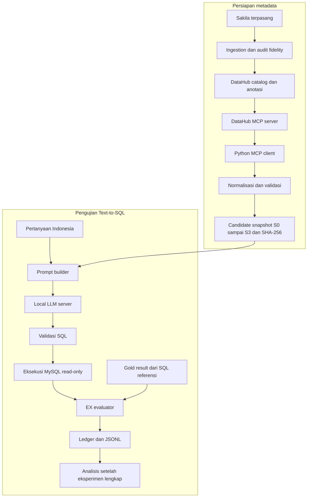

# BAB IV — Perancangan dan Implementasi Pipeline Eksperimen

**Judul penelitian:** Analisis Pengaruh Metadata terhadap Execution Accuracy pada Sistem Text-to-SQL Berbasis Large Language Model (Studi Kasus: Basis Data Sakila)

**Status naskah:** draft implementasi untuk bimbingan, 27 Oktober 2026. Pernyataan dalam bab ini dibedakan antara implementasi yang sudah diuji, kandidat konfigurasi, dan keputusan ilmiah yang masih menunggu review. Eksperimen utama 600 trial belum dijalankan. Struktur penomoran dapat diselaraskan dengan pedoman kampus tanpa mengubah substansi penelitian.

## 4.1 Tujuan dan Kedudukan Implementasi

Pipeline dikembangkan sebagai instrumen untuk menguji pengaruh variasi anotasi metadata terhadap Execution Accuracy (EX) pada Text-to-SQL. Masukan sistem adalah pertanyaan berbahasa Indonesia dan metadata Sakila. Keluaran LLM berupa SQL MySQL, yang kemudian divalidasi, dieksekusi melalui Python, dan dibandingkan dengan hasil SQL referensi.

Penelitian tetap menggunakan delapan tahap: Studi Literatur, Penyusunan Anotasi Metadata, Penyusunan Dataset Pengujian, Perancangan Pipeline Text-to-SQL, Implementasi Pipeline Text-to-SQL, Pengujian Text-to-SQL, Analisis Hasil, serta Penarikan Kesimpulan dan Saran. Instalasi database, pemeriksaan model, dan perhitungan EX merupakan kegiatan teknis di dalam tahapan tersebut. Implementasi aplikasi tidak dijadikan objek evaluasi produk.

Bab ini menjelaskan pembangunan dan verifikasi instrumen. Perbandingan EX eksperimen utama dan pengujian hipotesis belum dapat dilaporkan sebelum benchmark, metadata, model, prompt, serta protokol disetujui dan dibekukan.

## 4.2 Lingkungan Implementasi dan Basis Data

Pemeriksaan mesin menunjukkan GPU NVIDIA RTX 3060 Laptop dengan VRAM 6.144 MiB, CPU Intel Core i9-12900H, RAM nominal 16 GB, dan Pop!_OS 24.04. Identifikasi tersebut berasal dari mesin aktual; GPU yang digunakan bukan diasumsikan sebagai RTX 3060 Ti. Python proyek menggunakan versi 3.12.3. Dependency dikunci dengan lockfile, sedangkan tooling metadata memiliki environment terpisah karena kebutuhan package ingestion berbeda dari runtime eksperimen.

| Komponen | Implementasi/bukti saat ini |
|---|---|
| Database penelitian | MySQL 8.4.11; image digest dikunci; port loopback 13306 |
| Database Sakila | Distribusi resmi, SQL diimpor tanpa modifikasi |
| Metadata catalog | DataHub Core v1.8.0; image deployment dikunci |
| MCP server | mcp-server-datahub 0.8.0 |
| MCP client SDK | 1.30.0 pada environment metadata |
| Metadata ingestion SDK | acryl-datahub 1.7.0.17 |
| Inference backend | llama.cpp b11206; revision dan image digest tercatat |
| SQL parser | SQLGlot 30.25.0 pada runtime eksperimen |
| Logging | SQLite append-only dan ekspor JSONL |
| Analisis | NumPy 2.5.4 dan Matplotlib 3.11.2 pada dependency group analisis |

Sakila terpasang memiliki 16 base tables, 90 kolom, 22 foreign keys, dan total 47.268 baris pada base tables. Views dan routines tidak dimasukkan ke konteks model. Struktur terpasang, bukan daftar tabel yang diasumsikan dari ingatan, digunakan sebagai sumber pemeriksaan.

Database penelitian terpisah dari instance mysql-dev yang sudah ada. Account eksperimen memperoleh SELECT pada base tables yang ditetapkan. Administrator hanya dipakai dalam prosedur setup administratif; account tersebut tidak digunakan untuk SQL keluaran model. Database kemudian diberi persistent `read_only` dan `super_read_only`.

Skema, DDL, isi data, versi server, dan konfigurasi session diperiksa menggunakan fingerprint. Hash data disusun dari representasi nilai bertipe dengan urutan yang ditentukan. Pemeriksaan ulang sebelum dan sesudah pilot menunjukkan database tetap sesuai baseline. Metadata catalog dapat dihentikan setelah ekspor untuk mengurangi kompetisi RAM dengan inference server.

**Bukti:** `runs/environment/initial.json`, `runs/database/import-manifest.json`, dan `runs/database/baseline.json`. Sumber objek penelitian: [dokumentasi Sakila MySQL](https://dev.mysql.com/doc/sakila/en/).

## 4.3 Arsitektur Dua Fase

Persiapan metadata dipisahkan dari inference agar kondisi metadata tidak berubah secara dinamis mengikuti pertanyaan.

MCP digunakan pada fase persiapan. Saat generation, model hanya menerima instruksi umum, metadata snapshot, pertanyaan, dan aturan keluaran. Tidak ada tools, koneksi database, gold SQL, hasil referensi, riwayat percakapan, atau hasil trial sebelumnya pada masukan model. Python menguasai seluruh akses database dan evaluasi.

## 4.4 Implementasi Metadata dan Snapshot

### 4.4.1 Ingestion dan fidelity

Technical metadata Sakila diingest ke DataHub dan dibandingkan dengan audit skema terpasang. Diagnostik connector menemukan `address.location` dilaporkan sebagai BLOB, sementara MySQL menyatakan geometry. Ketidaksesuaian ini ditangani pada intermediate ingestion yang diaudit. Metadata mentah, perubahan native type, hash input/output, dan validasi sesudah perubahan dipertahankan.

Perubahan tersebut tidak mengubah tabel atau data Sakila. Intermediate yang telah divalidasi masuk ke catalog sebelum metadata diekspor melalui MCP. Audit database langsung tidak digunakan untuk melengkapi field yang hilang dalam snapshot. Jika technical metadata yang diambil melalui MCP berbeda dari audit, snapshot builder menolak publikasi.

### 4.4.2 Empat kondisi metadata

| Kondisi | Isi konteks model | Kontrol |
|---|---|---|
| S0 | Nama tabel/kolom, native types, nullability, PK dan FK | Tanpa anotasi deskriptif/bisnis |
| S1 | S0 ditambah deskripsi singkat | 16 tabel dan 90 kolom dianotasi |
| S2 | S0 ditambah deskripsi rinci | Coverage identik dengan S1 |
| S3 | Seluruh S2 ditambah tujuh istilah bisnis dan binding | Deskripsi S2 dipertahankan identik |

Jumlah elemen deskripsi pada S1/S2 adalah 106, terdiri atas 16 tabel dan 90 kolom. Istilah bisnis pada S3 mencakup konsep lintas elemen, misalnya perbedaan judul film, salinan inventaris, dan transaksi penyewaan. Definisi tidak boleh memuat gold SQL atau solusi khusus pertanyaan. Kebenaran semantik anotasi tetap memerlukan review, meskipun pemeriksaan literal tidak menemukan salinan gold atau pertanyaan utama.

Catalog dikelola secara berurutan untuk masing-masing kondisi, lalu diekspor sebelum kondisi berikutnya diterapkan. Sistem tidak mengasumsikan DataHub menyimpan empat versi deskripsi aktif sekaligus. Pemanggilan SDK untuk menulis anotasi dicatat sebagai administrasi metadata; sumber konten snapshot tetap hasil retrieval MCP.

### 4.4.3 Retrieval dan normalisasi

Tool discovery aktual menemukan `get_entities` dan `list_schema_fields` untuk retrieval yang dibutuhkan. Pagination diperiksa sampai seluruh kolom diperoleh. Konfigurasi batas panjang deskripsi dinaikkan secara eksplisit karena server memiliki batas bawaan yang dapat memotong deskripsi.

Setiap kondisi diekspor dua kali melalui sesi MCP independen. Payload hasil normalisasi harus identik. Serialisasi JSON, urutan tabel, urutan kolom, relasi, dan deskripsi ditentukan secara konsisten. Snapshot berisi bagian `technical_schema`, `descriptions`, dan `business_context`; nama kondisi tidak dimasukkan sebagai petunjuk ke prompt.

Setiap payload mempunyai SHA-256 dan manifest provenance, termasuk referensi ekspor MCP serta hash tool inventory dan respons. Pemeriksaan set snapshot memastikan technical schema sama, coverage S1/S2 identik, dan S3 bersifat aditif terhadap S2. Snapshot saat ini masih berstatus candidate sampai review ilmiah selesai.

**Bukti:** `runs/metadata/fidelity-receipt.json`, `catalog-ingestion.json`, `mcp-tool-inventory.json`, directory `runs/metadata/exports`, serta `snapshots/candidates-v2`.

## 4.5 Implementasi Dataset dan Referensi

Dataset utama terdiri atas 30 pertanyaan Indonesia: sepuluh simple, sepuluh medium, dan sepuluh complex. Pilot menggunakan sembilan pertanyaan terpisah. ID Q digunakan untuk utama, sedangkan ID P digunakan untuk pilot.

Rubric operasional ditetapkan berdasarkan struktur gold SQL: simple tanpa JOIN, grouping, subquery atau window; medium memakai JOIN/grouping/HAVING tanpa struktur complex; complex mempunyai subquery, CTE, window, set operation, atau sedikitnya tiga JOIN. Label ini merupakan rubric penelitian yang harus dijelaskan secara eksplisit; tidak diklaim identik dengan seluruh aturan benchmark lain.

Public question menyimpan pertanyaan, ID, complexity, dan referensi skema untuk audit. `GenerationInput` hanya membawa teks pertanyaan. Gold disimpan pada kontrak terpisah berisi SQL, jumlah kolom, kebutuhan urutan, approximate columns jika ada, status review, dan catatan semantik.

Semua 39 referensi awal berhasil dieksekusi dan diperiksa lebar kolom, struktur kompleksitas, serta hasilnya. Pemeriksaan tersebut tidak membuktikan makna gold sudah benar. Anda bersama dosen/rekan masih perlu meninjau ambiguitas, tingkat agregasi, hubungan tabel, NULL, duplikasi, ranking, dan overlap/parafrase pilot dengan utama. Status dataset tetap draft sesuai keputusan peneliti.

Paket review menyediakan CSV pertanyaan, anotasi, istilah bisnis, cuplikan hasil bertipe, serta hash input. Keputusan reviewer tidak diisi otomatis. Hasil referensi yang tidak lagi cocok dengan hash dataset/gold ditandai stale dan tidak dipresentasikan sebagai hasil valid.

## 4.6 Implementasi Generation

Prompt terdiri atas dua messages yang independen untuk setiap request. System message memberikan instruksi Text-to-SQL, sementara user message menyertakan serialisasi metadata dan pertanyaan. Template sama pada seluruh kondisi; hanya isi snapshot berubah. Model diminta mengembalikan satu query MySQL read-only tanpa penjelasan.

Client memakai endpoint chat completions yang telah diperiksa pada server lokal. Sebelum generation, prompt diterapkan pada chat template backend dan ditokenisasi. Jumlah input, cadangan output, dan safety margin harus berada dalam effective context. Request yang melampaui batas ditolak sebelum generation; metadata tidak dipotong untuk menyesuaikan panjang.

Kandidat awal Qwen2.5-3B-Instruct Q4_K_M telah dimuat dengan context 16.384. Seluruh 36 kombinasi prompt pilot muat; maksimum input yang terukur adalah 7.411 token, dengan cadangan output 1.024 dan margin 256. Temperature 0,2, top-p 0,95, dan top-k 40 merupakan konfigurasi pilot, belum konfigurasi final penelitian.

Kandidat tambahan yang disepakati adalah [Qwen2.5-Coder-7B-Instruct GGUF Q4_K_M dari Qwen](https://huggingface.co/Qwen/Qwen2.5-Coder-7B-Instruct-GGUF). Download dipin pada revision, ukuran 4.683.073.536 bytes, dan SHA-256. Model berhasil dimuat dengan 24 GPU layers dan context 16.384. Seluruh 36 kombinasi prompt pilot muat dengan maksimum 7.411 input tokens; verifikasi melakukan nol generation requests. Saat pemeriksaan, penggunaan VRAM total tercatat 4.483 MiB dan MemAvailable sekitar 8,39 GiB. Ini membuktikan loading dan token budget, belum stabilitas selama generation atau ketepatan SQL. Jalur pendahuluan terpisah telah diimplementasikan atas keputusan peneliti; jalur ini mengizinkan pengujian teknis dengan draft tanpa mengubah status review. Model final belum ditetapkan. Tidak ada fine-tuning maupun pengujian soal utama untuk memilih model.

Setiap backend menyimpan model hash, revision backend, image digest, command aktual, quantization, context, template hash, serta konfigurasi eksekusi. Bukti sampler suatu model tidak boleh digunakan sebagai bukti model lain. Verification context dilakukan tanpa generation; verification sampler yang benar memerlukan request pilot nyata dari backend yang sama setelah review.

## 4.7 Validasi SQL, Eksekusi, dan EX

Output model diperlakukan sebagai masukan tidak tepercaya. Pembersihan format dibatasi pada whitespace dan satu code fence utuh. Query tidak ditranspilasi, ditambah klausa, diperbaiki identifier-nya, atau dikirim ulang berdasarkan error eksekusi.

SQL parser memeriksa AST MySQL, single statement, jenis query, table scope, dan fungsi yang diizinkan. Pemeriksaan tidak hanya mengandalkan awalan SELECT. Privilege database menjadi perlindungan tambahan. Connection timeout, query timeout, serta batas jumlah baris dan ukuran hasil membatasi eksekusi.

Comparator membandingkan hasil, bukan teks SQL. Jumlah dan posisi kolom mengikuti kontrak pertanyaan; alias diabaikan. Tanpa kewajiban ordering, seluruh baris dibandingkan sebagai multiset sehingga multiplicity duplikat tetap terjaga. Pertanyaan ordered dibandingkan sebagai sequence. NULL dibedakan dari kosong, nol, dan teks NULL. Nilai integer/decimal dibandingkan secara tepat; toleransi floating hanya diterapkan pada kolom yang ditetapkan sebelumnya. Approximate unordered matching memakai pencocokan satu-ke-satu.

Trial memperoleh EX=1 jika eksekusi berhasil dan hasil ekuivalen menurut kontrak. Output tidak valid, SQL ditolak, error SQL model, timeout query terkendali, atau hasil salah memperoleh EX=0. Gangguan koneksi, service, konfigurasi atau evaluator dicatat sebagai infrastructure error dan tidak otomatis memperoleh EX=0.

Untuk eksperimen utama lengkap, setiap kondisi mempunyai 150 trial:

\[
EX_s = \frac{\sum_{i=1}^{150} correct_{s,i}}{150}\times100\%.
\]

Trial yang belum selesai karena infrastruktur harus diselesaikan atau dilaporkan sebelum denominator eksperimen lengkap dinyatakan terpenuhi. Kesesuaian hasil pada satu database tidak membuktikan ekuivalensi semantik untuk seluruh kemungkinan isi database.

## 4.8 Scheduler, Logging, dan Pemulihan

Rencana utama berisi 30 pertanyaan × 4 kondisi × 5 pengulangan, sehingga menghasilkan 600 assignment unik. Trial ID menggabungkan question, scenario, dan repetition. Urutan diacak dalam repetition blocks dengan seed yang dicatat; seed inference dipasangkan per question–repetition antarkondisi. Tidak ada conversation history yang dibawa ke request berikutnya.

Ledger SQLite menyimpan manifest, assignment, serta event secara append-only. Raw response disimpan sebelum evaluasi. Jika database gagal sesudah respons diterima, resume mengevaluasi respons yang sama. Trial model yang sudah selesai tidak memperoleh kesempatan generation baru.

Dispatch yang tidak diketahui hasilnya setelah crash memerlukan klasifikasi eksplisit oleh operator, disertai nama dan catatan insiden. Pemulihan tidak menghapus respons atau mengubah outcome yang sudah ada. Sistem tidak mengklaim exactly-once inference ketika respons hilang di jaringan/proses.

Ekspor JSONL memuat identitas trial, model/configuration, snapshot hash, prompt hash/reference, respons mentah, SQL ekstraksi, validation/execution status, error, result hash, EX, latency dan token usage. Nilai token yang tidak tersedia tidak direkayasa. Manifest menyimpan versi source/package, database, model, dataset, seed dan provenance metadata.

## 4.9 Verifikasi Implementasi

| Verifikasi | Bukti/status |
|---|---|
| Automated tests final | 133 tests lulus pada environment proyek dan pada workspace reproduksi baru |
| Isolasi database, privilege, timeout dan batas hasil | Integration tests pada MySQL penelitian |
| Comparator duplikat/NULL/numerik/order | Unit tests dengan kasus sengaja benar dan salah |
| Metadata coverage dan additivity | Dua ekspor per kondisi; payload dan manifest diperiksa |
| Prompt/template/context | Pemeriksaan backend dan token budget; tidak ada truncation |
| Smoke test awal | Empat trial pilot model 3B selesai |
| Pilot engineering awal | 36 trial pada sembilan soal, memakai gold yang masih draft |
| Resume nyata | Tidak menambah task server atau event ledger pada run yang selesai |
| Draft gate | Main freeze ditolak sebelum mengirim pertanyaan ke model |
| Simulasi 600 assignment | Outage, crash, recovery eksplisit dan resume diuji tanpa LLM nyata |
| Reproduksi | Workspace baru, MySQL port 13309 dan volume terpisah; database serta empat snapshot payload identik |

Jumlah tests, fingerprint reproduksi, serta hasil pemeriksaan kandidat tambahan yang final dirujuk melalui matriks bukti pendamping. Angka pilot tidak digunakan untuk memilih pertanyaan utama yang lebih menguntungkan suatu kondisi.

## 4.10 Kesiapan dan Batas Implementasi

Readiness memisahkan pemeriksaan otomatis dari review manusia. Pemeriksaan otomatis mencakup integritas hasil pilot dan kecocokan model, backend, prompt, dataset, snapshots, database serta runtime source. Review manusia meliputi benchmark/kontrak hasil, metadata, keputusan generation, serta protokol analisis. Lulus tests tidak menghasilkan persetujuan manusia.

Sesudah review, `freeze-main` memeriksa seluruh 120 kombinasi question–scenario dan gold execution tanpa generation. `run-main` memerlukan manifest serta freeze receipt yang tidak berubah. Saat ini freeze final dan 600 trial belum dijalankan.

Rancangan analisis menggunakan skor per question–scenario dari lima pengulangan, paired permutation, enam kontras dengan Holm adjustment, dan paired question bootstrap berstrata kompleksitas. Rancangan ini masih bahan bimbingan. Seluruh 600 trial tidak diperlakukan sebagai 600 pertanyaan independen. Input length merupakan bagian paket treatment yang dicatat dan dibahas; peningkatan metadata tidak diasumsikan meningkatkan EX.

Keterbatasan yang perlu dijelaskan adalah ukuran benchmark, reviewer yang tersedia, representativitas pertanyaan Sakila, semantik gold, kesetaraan hasil pada satu database, kemungkinan floor effect, ketergantungan hardware/backend terhadap reproducibility sampling, dan status model/protokol yang belum final. Reproduksi dari ekspor MCP yang diarsipkan tidak diklaim sebagai fresh DataHub ingestion. Penarikan kesimpulan ilmiah menunggu eksperimen utama dan analisis yang disetujui.

## Referensi bukti implementasi

- [Decision log](decisions.md)
- [EX protocol](evaluation-protocol.md)
- [Rancangan analisis untuk bimbingan](analysis-plan.md)
- [Runbook](runbook.md)
- [Matriks requirement dan bukti](evidence-matrix.md)
- [Panduan review](review-guide.md)

Sumber perangkat lunak: [DataHub](https://docs.datahub.com/), [MCP Python SDK](https://github.com/modelcontextprotocol/python-sdk), dan [llama.cpp server](https://github.com/ggml-org/llama.cpp/blob/master/tools/server/README.md). Perilaku yang dinyatakan berhasil pada bab ini harus ditelusuri ke bukti versi terpasang, bukan diasumsikan hanya dari dokumentasi versi terbaru.
