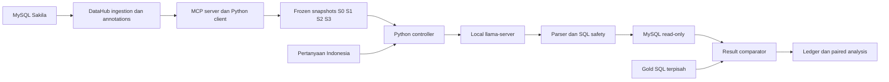

# BAB IV — PERANCANGAN DAN IMPLEMENTASI

Judul penelitian: **Analisis Pengaruh Metadata terhadap Execution Accuracy pada Sistem Text-to-SQL Berbasis Large Language Model (Studi Kasus: Basis Data Sakila)**.

## 4.1 Kedudukan sistem dalam penelitian

Pipeline berfungsi sebagai instrumen eksperimen kuantitatif untuk menguji pengaruh paket anotasi metadata terhadap Execution Accuracy (EX). Penelitian menggunakan satu model lokal yang tetap dan satu database Sakila resmi. Pengembangan aplikasi, perbandingan banyak model, fine-tuning dan evaluasi pengalaman pengguna bukan sasaran penelitian. Delapan tahap metodologi tetap meliputi studi literatur, penyusunan anotasi metadata, penyusunan dataset pengujian, perancangan pipeline, implementasi pipeline, pengujian, analisis hasil, serta kesimpulan dan saran. Instalasi database dan pemeriksaan model merupakan prasyarat teknis.

Unit berpasangan adalah pertanyaan. Tiga puluh pertanyaan yang sama diuji pada empat kondisi dengan lima request independen pada setiap pasangan. Jumlah trial utama ialah30×4×5=600, dengan150 trial per kondisi dan200 trial per kelompok kompleksitas. Lima pengulangan memperlihatkan kestabilan keluaran; pengulangan tidak mengubah jumlah pertanyaan independen menjadi600.

## 4.2 Arsitektur dan pemisahan akses

Fase persiapan metadata menggunakan DataHub sebagai katalog dan MCP sebagai jalur pengambilan metadata. Python memvalidasi schema, deskripsi, konteks bisnis serta provenance, kemudian membangun snapshot deterministic dengan hash SHA-256. MCP tidak dipanggil dinamis berdasarkan pertanyaan pada fase inference. LLM menerima instruksi umum, satu snapshot dan satu pertanyaan; model tidak diberi koneksi database, tools MCP/DataHub, gold SQL, hasil eksekusi gold, hasil eksperimen lama atau history request sebelumnya. Eksekusi dan evaluasi dimiliki Python.

## 4.3 Lingkungan implementasi

| Komponen | Versi/nilai aktual |
|---|---|
| Python | 3.12.3 |
| MySQL | 8.4.11 |
| Model | unsloth/Qwen3.5-9B-GGUF |
| Model revision | 3885219b6810b007914f3a7950a8d1b469d598a5 |
| Quantization | Q4_K - Medium |
| Backend | b11206-2b129ccfa |
| Context | 16384 |
| GPU layers | 24 |
| httpx | 0.28.1 |
| pydantic | 2.14.1 |
| pymysql | 1.2.3 |
| sqlglot | 30.25.0 |

GPU yang dicatat saat verifikasi backend: `NVIDIA GeForce RTX 3060 Laptop GPU, 6144 MiB, 4384 MiB, 51`. Observasi memori host tercantum dalam verification artifact; jangan menggantinya dengan spesifikasi laptop perkiraan. Metadata/catalog dan inference dijalankan bergantian agar tidak bersaing pada RAM. Model file SHA-256: `03b74727a860a56338e042c4420bb3f04b2fec5734175f4cb9fa853daf52b7e8`. Source commit benchmark: `ab3860c2742936073ded5b1bed66951b738b2a5f`. Source tree hash: `c7b3d08dcb9fea2c30a1068f32242e6b01102264b2418a08c289753d2dcd7395`. Versi image DataHub dan bukti ingestion/MCP disimpan melalui hash runtime/provenance pada manifest; image yang sedang populer bukan pengganti versi yang benar-benar dipakai.

## 4.4 Objek database dan kontrol isi

Sakila terpasang mempunyai 16 base tables,90 kolom,22 foreign keys dan47268 baris. Database utama memakai character set `utf8mb4`, collation `utf8mb4_0900_ai_ci` dan timezone UTC. Schema SHA-256 `0d2f73e266f5e31f0da33caaf65838625bf305012e1b876a7afc1b9f501f9e20`; data SHA-256 `dd762aea20953e74115a91c0e262a6c8b3ce511d140428bfcde6f85e1246bdc7`. Fingerprint diperiksa sebelum dan sesudah run. Data utama tidak diubah antarkondisi. Delapan variasi evaluasi berada pada clone dengan container, port dan credentials terpisah.

| Tabel | Baris | Kolom | PK |
|---|---|---|---|
| actor | 200 | 4 | actor_id |
| address | 603 | 9 | address_id |
| category | 16 | 3 | category_id |
| city | 600 | 4 | city_id |
| country | 109 | 3 | country_id |
| customer | 599 | 9 | customer_id |
| film | 1000 | 13 | film_id |
| film_actor | 5462 | 3 | actor_id, film_id |
| film_category | 1000 | 3 | film_id, category_id |
| film_text | 1000 | 3 | film_id |
| inventory | 4581 | 4 | inventory_id |
| language | 6 | 3 | language_id |
| payment | 16044 | 7 | payment_id |
| rental | 16044 | 7 | rental_id |
| staff | 2 | 11 | staff_id |
| store | 2 | 4 | store_id |

## 4.5 Variabel perlakuan dan anotasi

| Kondisi | Metadata |
|---|---|
| S0 | Technical schema: tabel, kolom, tipe, PK/FK dan relasi |
| S1 | S0 ditambah deskripsi singkat |
| S2 | Schema/coverage sama, detail lokal ditambahkan bila bersumber |
| S3 | S2 dipertahankan, ditambah tiga definisi domain bersumber |

Semua kondisi mempertahankan technical schema, urutan serialisasi, seluruh16 tabel/90 kolom dan PK/FK yang sama. S1/S2 mencakup106 table/column targets;74 deskripsi trivial dipertahankan sama untuk menghindari tambahan kalimat tanpa fakta. Detail tambahan pada S2 karena itu tidak dianggap merata pada seluruh elemen. S3 mempertahankan deskripsi S2 dan menambah definisi ketersediaan salinan, rewards bulanan serta komponen keterlambatan dari routine resmi Sakila. Ketersediaan adalah kondisi snapshot, bukan rekonstruksi historis. Rewards memakai kejadian pembayaran, bulan kalender lengkap sebelumnya, dua ambang strict, dan tidak menambah syarat status aktif. Komponen keterlambatan mengikuti perilaku executable routine, bukan saldo lengkap atau kebijakan penagihan universal.

| Kondisi | Snapshot SHA-256 |
|---|---|
| S0 | 49a0fb52333e0da4956d51a9c35bfc722b2874711422238c63e01b5916dae808 |
| S1 | a5a30dd8f8784360340348de5aff49289308b7ddd4d089c2ca36f214f50e2e01 |
| S2 | dcf1eb760dd65ce87a41ecd35183f541496f132b7726a6b7cfee924fef2f7d8e |
| S3 | 5fa53258f6f777801b3b3e3610d7ba60a1cd9b8b2af8f7d8584e9e6452098020 |

Business rules tidak memuat gold SQL, langkah join, jawaban baris atau ambang spesifik benchmark. Semua annotation source dan paired MCP export receipts dipertahankan. Kontrol identik di antara kondisi meliputi database/data, schema coverage, prompt template, bahasa, pertanyaan, model/decoder, evaluator, privileges dan timeouts. Panjang input tidak dipaksakan sama karena panjang merupakan bagian perubahan paket metadata; actual tokens dicatat.

## 4.6 Penyusunan dataset dan validasi makna

Dataset memuat10 simple,10 medium dan10 complex. Struktur canonical reference mengikuti adapter MySQL terhadap routine hardness Spider yang commit-nya dikunci:10 easy,10 medium,5 hard dan5 extra. Label menggambarkan canonical SQL, bukan minimum kompleksitas semua SQL ekuivalen dan bukan jaminan kesulitan model. Pemisahan struktur dari kebutuhan informasi terinspirasi Spider/BIRD; taxonomy lokal10 schema mapping,14 local semantics dan6 domain integration tidak disebut label resmi BIRD.

Pertanyaan menggunakan kebutuhan bisnis dalam bahasa Indonesia, tanpa footer nama kolom teknis, clause SQL atau recipe penyelesaian. Objek, metrik, filter, tanggal dan jumlah peringkat tetap disampaikan agar tugas dapat dinilai secara jelas. Definisi domain berada di metadata. Tiga soal meminta ordering/ranking, dua di antaranya top-k. Sisa ties mengikuti konvensi identifier numerik unik ascending yang sama pada seluruh kondisi; top-k tepat k atau seluruh eligible rows jika kurang dari k. Posisi kolom dan aliases tidak dipaksakan.

Reference A/B ditulis terpisah, interpretasi question-only dikunci sebelum complete-input review, kemudian seluruh30 pasangan diperiksa pada baseline dan8 variations. Seluruh56 critical mutants mempunyai observed witnesses. Reference agreement dan finite witnesses merupakan bukti engineering, bukan proof semantik universal. Review substansi dinyatakan selesai oleh peneliti melalui pernyataan yang direkam pada `2026-10-28T18:53:41.840560+00:00`; ini waktu pencatatan, bukan tanggal review yang diketahui. **Nama reviewer: [diisi peneliti]. Tanggal dan rincian pelaksanaan review: [diisi peneliti].** Tidak ada klaim dua reviewer manusia atau signed review yang belum didokumentasikan.

## 4.7 Prompt dan local inference

Instruksi dan construction logic identik untuk S0–S3. Question IDs, complexity, schema-reference hints dan kontrak private tidak diteruskan ke model. Semua120 kombinasi question/snapshot diperiksa dengan tokenizer serta chat template backend aktual, dengan reserve keluaran4096tokens dan safety margin256tokens. Input tidak dipotong diam-diam.

Temperature=0.6,top-p=0.95,top-k=20; min-p=0,repeat penalty=1,cache prompt=false,stream=false,n=1. Backend memakai satu slot, tanpa context shifting atau conversation history. Seed inference diturunkan deterministic dari base seed2026102803,question ID dan repetition; seed yang sama dipakai pada kondisi berbeda untuk question/repetition yang sama. Independent requests tidak menjamin SQL berbeda pada setiap pengulangan.

## 4.8 SQL safety dan EX

Generated SQL dianggap untrusted. Dedicated SELECT-only account, single-statement AST validation, function restrictions, timeout query10000ms, connection timeout dan batas hasil diberlakukan. Administrator hanya dipakai pada setup clone yang topology-nya diverifikasi, tidak untuk prediksi model. Raw response, mechanically extracted SQL, rejected SQL dan error tetap dicatat. Tidak ada semantic repair, execution-feedback loop atau kesempatan kedua untuk model-generated failure.

Evaluator `ex-results-v3-column-permutation` mencari satu bijeksi kolom global. `(nama,pendapatan)` dapat setara dengan `(pendapatan,nama)` jika hubungan nilai seluruh baris tetap sama. Alias diabaikan. Multiset whole rows mempertahankan duplikasi, NULL tidak disamakan dengan string/zero, numeric exact tidak dibulatkan sembarang, dan tolerance hanya berlaku pada kolom yang ditetapkan. Kontrak date/numeric memakai koordinat gold sesudah mapping. Requested row ordering tetap diperiksa. Empty outputs memerlukan jumlah kolom sama tetapi tidak membuktikan identitas semantik kolom kosong. Search-budget exhaustion merupakan evaluator/infrastructure incident dengan EX belum ditetapkan, bukan model nol.

EX trial bernilai1bila SQL berhasil dan hasil ekuivalen sesuai kontrak; invalid/unauthorized SQL atau hasil salah bernilai0. Infrastructure failures dicatat terpisah. Hasil sama pada satu database tidak membuktikan ekuivalensi universal; exact SQL string matching bukan metrik utama.

## 4.9 Controller, logging dan pelaksanaan

Trial ID deterministic memakai question/scenario/repetition. Urutan randomized dalam repetition blocks dengan seed2026102801. Ledger SQLite append-only menyimpan dispatch, durable response, incident dan terminal outcome. Restart menggunakan respons tersimpan untuk evaluasi, tidak meregenerasi model errors atau completed trials. Dispatch ambigu memerlukan rekonsiliasi operator tercatat dan tidak diklaim exactly-once inference.

Peneliti memilih Qwen3.5-9B secara langsung setelah hasil eksperimen sebelumnya diketahui, dan secara eksplisit meniadakan pilot capability serta generation smoke tambahan. Tidak ada request pilot atau smoke untuk run ini. Preflight tanpa generation memeriksa120prompt lengkap, bobot model, backend, database, reference dan evaluator. Sampler, seed serta cache diperiksa setelah setiap respons main tersimpan, memakai GET pada backend tanpa generation tambahan. Kegagalan pemeriksaan menghentikan run dan mempertahankan respons yang sudah tersimpan. Benchmark600 trial dijalankan sekali per assignment. Sesudah hasil lengkap, semua SQL tersimpan, termasuk primary failures, dieksekusi pada8 auxiliary cases tanpa generation baru. Hasil auxiliary tidak mengganti EX primer.

## 4.10 Rencana analisis dan reproduksibilitas

EX kondisi=jumlah benar/150×100%. Perhitungan tambahan memakai question dan complexity; skor per question/scenario ialah successes/5. Analisis menggunakan30 question blocks. Omnibus memakai100.000 within-question permutations; enam pairwise contrasts memakai exact sign-flip dan koreksi Holm. Effect size dinyatakan sebagai percentage points. Bootstrap10.000 whole-question samples distratifikasi menurut complexity untuk pointwise95%interval. Analysis seed=2026102802. Exchangeability/swap invariance adalah asumsi statistik; randomisasi urutan request tidak otomatis membuktikannya. Nonsignificance tidak membuktikan equivalence.

Manifest mencatat Git/source hashes, Python/packages, MySQL/data hashes, model/image/template, snapshots, questions/gold, prompt hashes, settings dan seeds. Logging mencakup latency inference/SQL terpisah, input/output tokens dari backend, validation/execution status, result/gold hashes dan EX. Keseluruhan evidence dipertahankan; output laporan tidak mengarang token atau skor yang hilang. Sumber metode: [Spider](https://aclanthology.org/D18-1425/),[BIRD](https://arxiv.org/html/2305.03111v3),dan [semantic test-suite evaluation](https://aclanthology.org/2020.emnlp-main.29/). Penelitian ini tetap studi satu database dan tidak mengklaim cakupan benchmark cross-domain tersebut.

## 4.11 Amendment pemilihan model dan batas interpretasi

Run ini merupakan replikasi dengan model pilihan peneliti sesudah hasil main sebelumnya dan pilot Qwen3-8B diketahui. Model upstream ialah `Qwen/Qwen3.5-9B`; publisher GGUF, revision dan hash bobot tercantum dalam manifest. Pernyataan peneliti dicatat pada `2026-10-29T14:59:06.162366+00:00`. Pemilihan model tidak diklaim sebagai kelulusan capability pilot atau seleksi prospektif sebelum semua hasil terdahulu. Instrumen30soal, metadata, gold, evaluator dan rencana analisis berpasangan tetap dipertahankan. Hasil lama tetap diarsipkan dan tidak ditimpa. Selisih antar-run mencakup perbedaan model/inference package, sehingga tidak dapat diatribusikan pada ukuran parameter saja.
