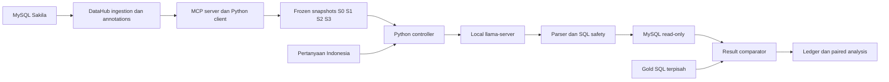

# BAB IV — PERANCANGAN DAN IMPLEMENTASI

Judul penelitian: **Analisis Pengaruh Metadata terhadap Execution Accuracy pada Sistem Text-to-SQL Berbasis Large Language Model (Studi Kasus: Basis Data Sakila)**.

## 4.1 Kedudukan sistem dalam penelitian

Pipeline berfungsi sebagai instrumen eksperimen kuantitatif untuk menguji pengaruh paket anotasi metadata terhadap Execution Accuracy (EX). Penelitian menggunakan satu model lokal yang tetap dan satu database Sakila resmi. Pengembangan aplikasi, perbandingan banyak model, fine-tuning dan evaluasi pengalaman pengguna bukan sasaran penelitian. Delapan tahap metodologi tetap meliputi studi literatur, penyusunan anotasi metadata, penyusunan dataset pengujian, perancangan pipeline, implementasi pipeline, pengujian, analisis hasil, serta kesimpulan dan saran. Instalasi database dan pemeriksaan model merupakan prasyarat teknis.

Unit berpasangan adalah pertanyaan. Tiga puluh pertanyaan yang sama diuji pada empat kondisi dengan lima request independen pada setiap pasangan. Jumlah trial utama ialah30×4×5=600, dengan150 trial per kondisi dan200 trial per kelompok kompleksitas. Lima pengulangan memperlihatkan kestabilan keluaran; pengulangan tidak mengubah jumlah pertanyaan independen menjadi600.

## 4.2 Arsitektur dan pemisahan akses



Fase persiapan metadata menggunakan DataHub sebagai katalog dan MCP sebagai jalur pengambilan metadata. Python memvalidasi schema, deskripsi, konteks bisnis serta provenance, kemudian membangun snapshot deterministic dengan hash SHA-256. MCP tidak dipanggil dinamis berdasarkan pertanyaan pada fase inference. LLM menerima instruksi umum, satu snapshot dan satu pertanyaan; model tidak diberi koneksi database, tools MCP/DataHub, gold SQL, hasil eksekusi gold, hasil eksperimen lama atau history request sebelumnya. Eksekusi dan evaluasi dimiliki Python.

## 4.3 Lingkungan implementasi

| Komponen | Versi/nilai aktual |
|---|---|
| Python | 3.12.3 |
| MySQL | 8.4.11 |
| Model | unsloth/Qwen3.5-9B-GGUF |
| Model revision | 3885219b6810b007914f3a7950a8d1b469d598a5 |
| Quantization | Q4_K - Medium |
| Backend | b11206-2b129ccfa |
| Context | 16384 |
| GPU layers | 24 |
| httpx | 0.28.1 |
| pydantic | 2.14.1 |
| pymysql | 1.2.3 |
| sqlglot | 30.25.0 |

GPU yang dicatat saat verifikasi backend: `NVIDIA GeForce RTX 3060 Laptop GPU, 6144 MiB, 4384 MiB, 51`. Observasi memori host tercantum dalam verification artifact; jangan menggantinya dengan spesifikasi laptop perkiraan. Metadata/catalog dan inference dijalankan bergantian agar tidak bersaing pada RAM. Model file SHA-256: `03b74727a860a56338e042c4420bb3f04b2fec5734175f4cb9fa853daf52b7e8`. Source commit benchmark: `ab3860c2742936073ded5b1bed66951b738b2a5f`. Source tree hash: `c7b3d08dcb9fea2c30a1068f32242e6b01102264b2418a08c289753d2dcd7395`. Versi image DataHub dan bukti ingestion/MCP disimpan melalui hash runtime/provenance pada manifest; image yang sedang populer bukan pengganti versi yang benar-benar dipakai.

## 4.4 Objek database dan kontrol isi

Sakila terpasang mempunyai 16 base tables,90 kolom,22 foreign keys dan47268 baris. Database utama memakai character set `utf8mb4`, collation `utf8mb4_0900_ai_ci` dan timezone UTC. Schema SHA-256 `0d2f73e266f5e31f0da33caaf65838625bf305012e1b876a7afc1b9f501f9e20`; data SHA-256 `dd762aea20953e74115a91c0e262a6c8b3ce511d140428bfcde6f85e1246bdc7`. Fingerprint diperiksa sebelum dan sesudah run. Data utama tidak diubah antarkondisi. Delapan variasi evaluasi berada pada clone dengan container, port dan credentials terpisah.

| Tabel | Baris | Kolom | PK |
|---|---|---|---|
| actor | 200 | 4 | actor_id |
| address | 603 | 9 | address_id |
| category | 16 | 3 | category_id |
| city | 600 | 4 | city_id |
| country | 109 | 3 | country_id |
| customer | 599 | 9 | customer_id |
| film | 1000 | 13 | film_id |
| film_actor | 5462 | 3 | actor_id, film_id |
| film_category | 1000 | 3 | film_id, category_id |
| film_text | 1000 | 3 | film_id |
| inventory | 4581 | 4 | inventory_id |
| language | 6 | 3 | language_id |
| payment | 16044 | 7 | payment_id |
| rental | 16044 | 7 | rental_id |
| staff | 2 | 11 | staff_id |
| store | 2 | 4 | store_id |

## 4.5 Variabel perlakuan dan anotasi

| Kondisi | Metadata |
|---|---|
| S0 | Technical schema: tabel, kolom, tipe, PK/FK dan relasi |
| S1 | S0 ditambah deskripsi singkat |
| S2 | Schema/coverage sama, detail lokal ditambahkan bila bersumber |
| S3 | S2 dipertahankan, ditambah tiga definisi domain bersumber |

Semua kondisi mempertahankan technical schema, urutan serialisasi, seluruh16 tabel/90 kolom dan PK/FK yang sama. S1/S2 mencakup106 table/column targets;74 deskripsi trivial dipertahankan sama untuk menghindari tambahan kalimat tanpa fakta. Detail tambahan pada S2 karena itu tidak dianggap merata pada seluruh elemen. S3 mempertahankan deskripsi S2 dan menambah definisi ketersediaan salinan, rewards bulanan serta komponen keterlambatan dari routine resmi Sakila. Ketersediaan adalah kondisi snapshot, bukan rekonstruksi historis. Rewards memakai kejadian pembayaran, bulan kalender lengkap sebelumnya, dua ambang strict, dan tidak menambah syarat status aktif. Komponen keterlambatan mengikuti perilaku executable routine, bukan saldo lengkap atau kebijakan penagihan universal.

| Kondisi | Snapshot SHA-256 |
|---|---|
| S0 | 49a0fb52333e0da4956d51a9c35bfc722b2874711422238c63e01b5916dae808 |
| S1 | a5a30dd8f8784360340348de5aff49289308b7ddd4d089c2ca36f214f50e2e01 |
| S2 | dcf1eb760dd65ce87a41ecd35183f541496f132b7726a6b7cfee924fef2f7d8e |
| S3 | 5fa53258f6f777801b3b3e3610d7ba60a1cd9b8b2af8f7d8584e9e6452098020 |

Business rules tidak memuat gold SQL, langkah join, jawaban baris atau ambang spesifik benchmark. Semua annotation source dan paired MCP export receipts dipertahankan. Kontrol identik di antara kondisi meliputi database/data, schema coverage, prompt template, bahasa, pertanyaan, model/decoder, evaluator, privileges dan timeouts. Panjang input tidak dipaksakan sama karena panjang merupakan bagian perubahan paket metadata; actual tokens dicatat.

## 4.6 Penyusunan dataset dan validasi makna

Dataset memuat10 simple,10 medium dan10 complex. Struktur canonical reference mengikuti adapter MySQL terhadap routine hardness Spider yang commit-nya dikunci:10 easy,10 medium,5 hard dan5 extra. Label menggambarkan canonical SQL, bukan minimum kompleksitas semua SQL ekuivalen dan bukan jaminan kesulitan model. Pemisahan struktur dari kebutuhan informasi terinspirasi Spider/BIRD; taxonomy lokal10 schema mapping,14 local semantics dan6 domain integration tidak disebut label resmi BIRD.

Pertanyaan menggunakan kebutuhan bisnis dalam bahasa Indonesia, tanpa footer nama kolom teknis, clause SQL atau recipe penyelesaian. Objek, metrik, filter, tanggal dan jumlah peringkat tetap disampaikan agar tugas dapat dinilai secara jelas. Definisi domain berada di metadata. Tiga soal meminta ordering/ranking, dua di antaranya top-k. Sisa ties mengikuti konvensi identifier numerik unik ascending yang sama pada seluruh kondisi; top-k tepat k atau seluruh eligible rows jika kurang dari k. Posisi kolom dan aliases tidak dipaksakan.

Reference A/B ditulis terpisah, interpretasi question-only dikunci sebelum complete-input review, kemudian seluruh30 pasangan diperiksa pada baseline dan8 variations. Seluruh56 critical mutants mempunyai observed witnesses. Reference agreement dan finite witnesses merupakan bukti engineering, bukan proof semantik universal. Review substansi dinyatakan selesai oleh peneliti melalui pernyataan yang direkam pada `2026-10-28T18:53:41.840560+00:00`; ini waktu pencatatan, bukan tanggal review yang diketahui. **Nama reviewer: [diisi peneliti]. Tanggal dan rincian pelaksanaan review: [diisi peneliti].** Tidak ada klaim dua reviewer manusia atau signed review yang belum didokumentasikan.

## 4.7 Prompt dan local inference

Instruksi dan construction logic identik untuk S0–S3. Question IDs, complexity, schema-reference hints dan kontrak private tidak diteruskan ke model. Semua120 kombinasi question/snapshot diperiksa dengan tokenizer serta chat template backend aktual, dengan reserve keluaran4096tokens dan safety margin256tokens. Input tidak dipotong diam-diam.

Temperature=0.6,top-p=0.95,top-k=20; min-p=0,repeat penalty=1,cache prompt=false,stream=false,n=1. Backend memakai satu slot, tanpa context shifting atau conversation history. Seed inference diturunkan deterministic dari base seed2026102803,question ID dan repetition; seed yang sama dipakai pada kondisi berbeda untuk question/repetition yang sama. Independent requests tidak menjamin SQL berbeda pada setiap pengulangan.

## 4.8 SQL safety dan EX

Generated SQL dianggap untrusted. Dedicated SELECT-only account, single-statement AST validation, function restrictions, timeout query10000ms, connection timeout dan batas hasil diberlakukan. Administrator hanya dipakai pada setup clone yang topology-nya diverifikasi, tidak untuk prediksi model. Raw response, mechanically extracted SQL, rejected SQL dan error tetap dicatat. Tidak ada semantic repair, execution-feedback loop atau kesempatan kedua untuk model-generated failure.

Evaluator `ex-results-v3-column-permutation` mencari satu bijeksi kolom global. `(nama,pendapatan)` dapat setara dengan `(pendapatan,nama)` jika hubungan nilai seluruh baris tetap sama. Alias diabaikan. Multiset whole rows mempertahankan duplikasi, NULL tidak disamakan dengan string/zero, numeric exact tidak dibulatkan sembarang, dan tolerance hanya berlaku pada kolom yang ditetapkan. Kontrak date/numeric memakai koordinat gold sesudah mapping. Requested row ordering tetap diperiksa. Empty outputs memerlukan jumlah kolom sama tetapi tidak membuktikan identitas semantik kolom kosong. Search-budget exhaustion merupakan evaluator/infrastructure incident dengan EX belum ditetapkan, bukan model nol.

EX trial bernilai1bila SQL berhasil dan hasil ekuivalen sesuai kontrak; invalid/unauthorized SQL atau hasil salah bernilai0. Infrastructure failures dicatat terpisah. Hasil sama pada satu database tidak membuktikan ekuivalensi universal; exact SQL string matching bukan metrik utama.

## 4.9 Controller, logging dan pelaksanaan

Trial ID deterministic memakai question/scenario/repetition. Urutan randomized dalam repetition blocks dengan seed2026102801. Ledger SQLite append-only menyimpan dispatch, durable response, incident dan terminal outcome. Restart menggunakan respons tersimpan untuk evaluasi, tidak meregenerasi model errors atau completed trials. Dispatch ambigu memerlukan rekonsiliasi operator tercatat dan tidak diklaim exactly-once inference.

Peneliti memilih Qwen3.5-9B secara langsung setelah hasil eksperimen sebelumnya diketahui, dan secara eksplisit meniadakan pilot capability serta generation smoke tambahan. Tidak ada request pilot atau smoke untuk run ini. Preflight tanpa generation memeriksa120prompt lengkap, bobot model, backend, database, reference dan evaluator. Sampler, seed serta cache diperiksa setelah setiap respons main tersimpan, memakai GET pada backend tanpa generation tambahan. Kegagalan pemeriksaan menghentikan run dan mempertahankan respons yang sudah tersimpan. Benchmark600 trial dijalankan sekali per assignment. Sesudah hasil lengkap, semua SQL tersimpan, termasuk primary failures, dieksekusi pada8 auxiliary cases tanpa generation baru. Hasil auxiliary tidak mengganti EX primer.

## 4.10 Rencana analisis dan reproduksibilitas

EX kondisi=jumlah benar/150×100%. Perhitungan tambahan memakai question dan complexity; skor per question/scenario ialah successes/5. Analisis menggunakan30 question blocks. Omnibus memakai100.000 within-question permutations; enam pairwise contrasts memakai exact sign-flip dan koreksi Holm. Effect size dinyatakan sebagai percentage points. Bootstrap10.000 whole-question samples distratifikasi menurut complexity untuk pointwise95%interval. Analysis seed=2026102802. Exchangeability/swap invariance adalah asumsi statistik; randomisasi urutan request tidak otomatis membuktikannya. Nonsignificance tidak membuktikan equivalence.

Manifest mencatat Git/source hashes, Python/packages, MySQL/data hashes, model/image/template, snapshots, questions/gold, prompt hashes, settings dan seeds. Logging mencakup latency inference/SQL terpisah, input/output tokens dari backend, validation/execution status, result/gold hashes dan EX. Keseluruhan evidence dipertahankan; output laporan tidak mengarang token atau skor yang hilang. Sumber metode: [Spider](https://aclanthology.org/D18-1425/),[BIRD](https://arxiv.org/html/2305.03111v3),dan [semantic test-suite evaluation](https://aclanthology.org/2020.emnlp-main.29/). Penelitian ini tetap studi satu database dan tidak mengklaim cakupan benchmark cross-domain tersebut.

## 4.11 Amendment pemilihan model dan batas interpretasi

Run ini merupakan replikasi dengan model pilihan peneliti sesudah hasil main sebelumnya dan pilot Qwen3-8B diketahui. Model upstream ialah `Qwen/Qwen3.5-9B`; publisher GGUF, revision dan hash bobot tercantum dalam manifest. Pernyataan peneliti dicatat pada `2026-10-29T14:59:06.162366+00:00`. Pemilihan model tidak diklaim sebagai kelulusan capability pilot atau seleksi prospektif sebelum semua hasil terdahulu. Instrumen30soal, metadata, gold, evaluator dan rencana analisis berpasangan tetap dipertahankan. Hasil lama tetap diarsipkan dan tidak ditimpa. Selisih antar-run mencakup perbedaan model/inference package, sehingga tidak dapat diatribusikan pada ukuran parameter saja.


# BAB V — HASIL DAN PEMBAHASAN

## 5.1 Kelengkapan dan integritas eksperimen

Bab ini disusun dari hasil aktual `qwen35-9b-main-01`,bukan simulasi atau hasil versi terdahulu. Seluruh600 assigned trials mempunyai terminal EX biner,150per kondisi, 200per complexity,30 pertanyaan dan 5 repetitions. Audit ledger/export, assignments, prompt/result hashes, request settings, model/source/snapshot identity serta fingerprint database berhasil. Primary database tidak berubah. Waktu outcome pertama `2026-10-29T15:23:27.674428+00:00` dan terakhir `2026-10-29T22:02:40.643890+00:00` memakai timestamp UTC.

Terdapat600 dispatch attempts dan0 infrastructure incidents pada benchmark. Incident tidak otomatis masuk EX nol. Jenis incident: `{}`. Tidak ada request pilot atau smoke tambahan; seluruh generation yang dijadwalkan adalah600trial utama. Review completion dilaporkan oleh peneliti; nama/tanggal reviewer masih perlu dilengkapi sesuai BAB IV. Tidak mengklaim dokumen review independen yang belum tersedia.

## 5.2 Execution Accuracy menurut kondisi metadata

| Kondisi | Benar | Trial | EX (%) | Selisih terhadap S0 (pp) |
|---|---|---|---|---|
| S0 | 98 | 150 | 65.33 | 0.00 |
| S1 | 111 | 150 | 74.00 | 8.67 |
| S2 | 109 | 150 | 72.67 | 7.33 |
| S3 | 121 | 150 | 80.67 | 15.33 |

Nilai EX tertinggi dalam benchmark tetap ini diperoleh S3, sebesar80.67%. Ini peringkat deskriptif dan tidak otomatis merupakan perbedaan signifikan. Penambahan anotasi dapat membantu, tidak mengubah hasil, atau mengganggu pilihan SQL. Kesimpulan tidak mensyaratkan S3 menjadi yang terbaik.

## 5.3 Hasil menurut kompleksitas

| Kondisi | Kompleksitas | Benar | Trial | EX (%) |
|---|---|---|---|---|
| S0 | complex | 19 | 50 | 38.00 |
| S0 | medium | 34 | 50 | 68.00 |
| S0 | simple | 45 | 50 | 90.00 |
| S1 | complex | 22 | 50 | 44.00 |
| S1 | medium | 40 | 50 | 80.00 |
| S1 | simple | 49 | 50 | 98.00 |
| S2 | complex | 19 | 50 | 38.00 |
| S2 | medium | 40 | 50 | 80.00 |
| S2 | simple | 50 | 50 | 100.00 |
| S3 | complex | 25 | 50 | 50.00 |
| S3 | medium | 46 | 50 | 92.00 |
| S3 | simple | 50 | 50 | 100.00 |

Setiap condition/complexity cell memuat10 pertanyaan×5 repetitions=50 trial. Label complexity merupakan profil canonical reference. Perbandingan ini deskriptif; pertanyaan kompleks tidak identik dengan kebutuhan domain, dan domain tasks tidak tersebar merata pada semua complexity levels.

## 5.4 Perbandingan berpasangan dan ukuran efek

Omnibus paired permutation menghasilkan p=0.00101999,dengan analysis seed2026102802. Hasil omnibus melewati ambang0,05 dalam model pengujian yang ditetapkan; penentuan pasangan tetap mengikuti enam kontras berkoreksi Holm.

| Kontras | Selisih EX (pp) | p exact | p Holm | 95% pointwise CI (pp) |
|---|---|---|---|---|
| S1 - S0 | 8.67 | 0.0625 | 0.25 | [1.33; 17.33] |
| S2 - S0 | 7.33 | 0.121094 | 0.328125 | [0.00; 15.33] |
| S3 - S0 | 15.33 | 0.00390625 | 0.0234375 | [6.67; 24.67] |
| S2 - S1 | -1.33 | 0.8125 | 0.8125 | [-6.67; 4.00] |
| S3 - S1 | 6.67 | 0.109375 | 0.328125 | [0.00; 14.00] |
| S3 - S2 | 8.00 | 0.03125 | 0.15625 | [2.67; 14.00] |

Enam kontras sudah ditetapkan sebelum main outcomes. Semua30 question blocks, termasuk tied/zero-difference blocks, dipertahankan. Tidak memilih uji berdasarkan p yang lebih kecil. Interval bersifat pointwise, bukan simultaneous confidence set dan bukan inversi exact tests. Bootstrap menunjukkan sensitivitas terhadap komposisi fixed benchmark di bawah resampling model; tidak menjadikan30 soal purposive sebagai sampel acak seluruh kebutuhan bisnis.

## 5.5 Konsistensi lima pengulangan

| Kondisi | Pertanyaan5/5benar | Pertanyaan0/5benar | Pertanyaan campuran |
|---|---|---|---|
| S0 | 16 | 7 | 7 |
| S1 | 20 | 5 | 5 |
| S2 | 20 | 6 | 4 |
| S3 | 20 | 2 | 8 |

Setiap baris merangkum30 pertanyaan. Konsistensi outcome berbeda dari identitas teks SQL: query berbeda dapat menghasilkan EX yang sama. Lima requests dapat menghasilkan SQL identik meskipun temperature positif. Kestabilan tidak diperlakukan sebagai tambahan jumlah pertanyaan independen.

## 5.6 Kebutuhan informasi dan aturan domain

| Kondisi | Profil | Pertanyaan | Trial | EX (%) |
|---|---|---|---|---|
| S0 | domain_integration | 6 | 30 | 6.67 |
| S0 | local_semantics | 14 | 70 | 74.29 |
| S0 | schema_mapping | 10 | 50 | 88.00 |
| S1 | domain_integration | 6 | 30 | 6.67 |
| S1 | local_semantics | 14 | 70 | 91.43 |
| S1 | schema_mapping | 10 | 50 | 90.00 |
| S2 | domain_integration | 6 | 30 | 10.00 |
| S2 | local_semantics | 14 | 70 | 90.00 |
| S2 | schema_mapping | 10 | 50 | 86.00 |
| S3 | domain_integration | 6 | 30 | 43.33 |
| S3 | local_semantics | 14 | 70 | 91.43 |
| S3 | schema_mapping | 10 | 50 | 88.00 |

Profil terdiri10 schema mapping,14 local semantics dan6 domain integration. Enam domain tasks berasal dari tiga keluarga aturan Sakila, bukan enam kebijakan independen. Profil berkaitan dengan complexity dan selection constraints; tidak digunakan untuk menambahkan significance tests baru. Efek paket metadata menggabungkan ketersediaan informasi, panjang, framing dan salience. Tidak mengklaim efek murni jumlah token atau kemampuan model-family tertentu.

## 5.7 Latency dan token

| Kondisi | Rerata inference (ms) | Median inference (ms) | Rerata SQL (ms) | Rerata input tokens | Rerata output tokens |
|---|---|---|---|---|---|
| S0 | 35034.28 | 27384.89 | 13.25 | 2652.20 | 609.03 |
| S1 | 37882.78 | 29221.23 | 13.61 | 4078.20 | 594.43 |
| S2 | 42598.20 | 29882.93 | 12.61 | 4567.20 | 656.86 |
| S3 | 43752.23 | 30933.09 | 12.17 | 4997.20 | 660.39 |

Inference latency dan SQL execution latency diukur terpisah. Ukuran ini mendukung pembahasan dan bukan target optimisasi utama. Missing values, bila ada, tercatat sebagai unavailable pada measurements.csv dan tidak diganti angka buatan. Peningkatan biaya token tidak dengan sendirinya membuktikan penyebab perbedaan EX. Load/thermal/system state pada satu mesin juga membatasi tafsir latency.

## 5.8 Kegagalan keluaran dan eksekusi SQL

| Kondisi | Error type | MySQL code | Jumlah |
|---|---|---|---|
| S0 | sql_model_error | 1054 | 2 |
| S1 | sql_model_error | 1052 | 1 |
| S1 | sql_model_error | 1054 | 3 |
| S1 | sql_model_error | 1066 | 1 |
| S2 | sql_model_error | 1052 | 1 |
| S2 | sql_model_error | 1054 | 4 |
| S2 | sql_model_error | 1066 | 1 |
| S3 | sql_model_error | 1052 | 1 |
| S3 | sql_model_error | 1054 | 5 |
| S3 | sql_model_error | 1064 | 1 |
| S3 | sql_model_error | 1690 | 3 |
| S3 | sql_model_error | None | 1 |

Query yang berhasil dieksekusi tetapi hasilnya berbeda tetap salah; syntax/execution success bukan correctness. Jumlah success-but-wrong:137trial. Validasi SQL menolak statement yang tidak diizinkan; kegagalan model adalah outcome terminal dan tidak direpair. Pengelompokan kode error bersifat deskriptif. Penjelasan mekanisme berdasarkan contoh SQL adalah analisis kualitatif pascahasil dan tidak dipakai mengganti soal/metadata/model. Ledger menyimpan raw output dan extracted SQL agar contoh dapat diperiksa ulang.

## 5.9 Pemeriksaan pada delapan variasi data

Semua600 SQL tersimpan diuji pada8 cases,termasuk SQL yang gagal di primary. Tidak ada generation atau semantic repair baru. Tabel berikut menghitung kelulusan pada primary **dan** seluruh8 auxiliary cases, bukan mengganti primary EX dengan metrik lain.

| Kondisi | Trial | Lulus seluruh9cases | Persentase | Primary benar tetapi gagal auxiliary |
|---|---|---|---|---|
| S0 | 150 | 89 | 59.33 | 9 |
| S1 | 150 | 105 | 70.00 | 6 |
| S2 | 150 | 98 | 65.33 | 11 |
| S3 | 150 | 108 | 72.00 | 13 |

Wrong variants yang dideklarasikan sebelum generation membantu memastikan cases dapat membedakan unit/grain, role, NULL/zero, kalender, numeric boundary, ranking dan tie-breaking. Finite cases tetap tidak membuktikan ekuivalensi universal. Query dengan hasil kosong atau nilai yang kebetulan sama pada satu instance tetap berpotensi memperoleh primary EX1; hasil auxiliary memberi bukti pembeda tambahan.

## 5.10 Pembahasan dan batas generalisasi

Temuan utama harus dibaca sebagai pengaruh empat paket anotasi terhadap satu local model terkuantisasi, satu database Sakila beku dan30 pertanyaan terkurasi berbahasa Indonesia. Penelitian tidak mengisolasi efek bahasa, model size, quantization atau panjang token secara tersendiri. S1/S2 memiliki coverage yang sama dan sebagian descriptions identik; detail tambahan tidak tersebar merata pada seluruh elements. Efek rata-rata dapat menyembunyikan perbedaan antarpertanyaan.

Hasil eksplorasi/diagnostik versi lama tetap menjadi sejarah engineering; prompt, soal dan comparator berubah pada revision03. Selisih skor versi lama-versi baru tidak dapat diperlakukan sebagai efek metadata saja. Studi ini bukan preregistration retrospektif. Analisis main memakai rencana yang dikunci sebelum600 outcomes; seluruh kondisi, contrasts dan non-significant findings tetap dilaporkan.

Statistical nonsignificance bukan bukti tidak ada efek; significance juga tidak menjamin manfaat praktis atau generalisasi workload. Identitas/tanggal reviewer perlu ditambahkan peneliti, tanpa mengubah tanggal pencatatan atau mengklaim signed-review evidence yang belum ada. Koreksi stimulus sesudah hasil membutuhkan versi/generation baru; gold-only correction setelah adjudication harus dilaporkan sebagai turunan dan tidak menimpa original evidence.

## 5.11 Jejak audit dan bahan penulisan

Sumber tabel: `analysis/report.json`,CSV pendamping,benchmark manifest/ledger dan `auxiliary/outcomes.jsonl`. Question/gold/prompt/snapshot hashes berada dalam manifest. Lampiran pertanyaan dan gold disertakan terpisah untuk peneliti; gold tidak pernah masuk model prompt. Semua angka pada bab ini berasal dari artifacts lengkap yang lolos integrity audit. Reviewer tidak boleh mengganti angka dengan ilustrasi atau menyebut hasil model lain sebagai hasil run ini.


# Lampiran pertanyaan dan reference SQL

Gold hanya untuk evaluator/peneliti, tidak menjadi model input.

## Q102 — simple

Pembayaran tercatat pada berapa tanggal kalender yang berbeda?

```sql
SELECT COUNT(DISTINCT DATE(payment_date)) FROM payment
```

## Q105 — simple

Berapa banyak judul film berbeda dalam persediaan seluruh toko secara keseluruhan?

```sql
SELECT COUNT(DISTINCT film_id) FROM inventory
```

## Q107 — simple

Berapa rata-rata lama satu periode sewa film dalam hari?

```sql
SELECT ROUND(AVG(rental_duration),4) FROM film
```

## Q112 — simple

Ada berapa home store berbeda yang tercatat pada pelanggan?

```sql
SELECT COUNT(DISTINCT store_id) FROM customer
```

## Q114 — simple

Berapa rata-rata biaya penggantian film dalam katalog?

```sql
SELECT ROUND(AVG(replacement_cost),4) FROM film
```

## Q116 — medium

Tampilkan nama setiap kategori film beserta jumlah judul film dalam kategori tersebut.

```sql
SELECT c.name,COUNT(fc.film_id) FROM category c LEFT JOIN film_category fc ON fc.category_id=c.category_id GROUP BY c.category_id
```

## Q117 — medium

Tampilkan nama setiap distrik beserta jumlah alamat yang tercatat di distrik tersebut.

```sql
SELECT district,COUNT(*) FROM address GROUP BY district
```

## Q118 — medium

Tampilkan nama setiap negara beserta jumlah kota yang tercatat di negara tersebut.

```sql
SELECT c.country,COUNT(ci.city_id) FROM country c LEFT JOIN city ci ON ci.country_id=c.country_id GROUP BY c.country_id
```

## Q119 — medium

Tampilkan nomor setiap staf beserta jumlah pelanggan berbeda yang penyewaan filmnya pernah diproses oleh staf tersebut.

```sql
SELECT s.staff_id,COUNT(DISTINCT r.customer_id) FROM staff s LEFT JOIN rental r ON r.staff_id=s.staff_id GROUP BY s.staff_id
```

## Q120 — medium

Berapa rata-rata durasi pemutaran film dalam menit untuk setiap klasifikasi usia penonton? Tampilkan klasifikasi tersebut beserta rata-ratanya.

```sql
SELECT rating,ROUND(AVG(length),4) FROM film GROUP BY rating
```

## Q121 — medium

Tampilkan setiap status keaktifan pelanggan yang tercatat beserta total nilai pembayaran pelanggannya.

```sql
SELECT c.active,SUM(p.amount) FROM customer c LEFT JOIN payment p ON p.customer_id=c.customer_id GROUP BY c.active
```

## Q125 — medium

Sebutkan nama depan yang dimiliki lebih dari satu pemeran, beserta jumlah pemeran untuk masing-masing nama tersebut.

```sql
SELECT first_name,COUNT(DISTINCT actor_id) FROM actor GROUP BY first_name HAVING COUNT(DISTINCT actor_id)>1
```

## Q128 — medium

Tampilkan judul, tarif satu periode sewa, dan lama periode sewa dalam hari untuk semua film dengan tarif satu periode di atas 2.00, urut dari tarif tertinggi.

```sql
SELECT title,rental_rate,rental_duration FROM film WHERE rental_rate>2.00 ORDER BY rental_rate DESC,film_id ASC
```

## Q133 — complex

Sebutkan nama kota tempat tinggal pelanggan yang tercatat tidak aktif, tanpa mengulang nama kota yang sama.

```sql
SELECT DISTINCT ci.city FROM city ci WHERE ci.city_id IN(SELECT a.city_id FROM address a JOIN customer c ON c.address_id=a.address_id WHERE c.active=0)
```

## Q134 — complex

Sebutkan judul semua film yang tidak melibatkan pemeran bernama depan PENELOPE.

```sql
SELECT title FROM film WHERE film_id NOT IN(SELECT film_id FROM film_actor WHERE actor_id IN(SELECT actor_id FROM actor WHERE first_name='PENELOPE'))
```

## Q141 — complex

Untuk satu staf yang paling banyak memproses pembayaran atas penyewaan yang diproses staf lain, tampilkan nomor staf, nomor home store staf, dan jumlah pembayaran tersebut.

```sql
SELECT s.staff_id,s.store_id,COUNT(*) FROM staff s JOIN payment p ON p.staff_id=s.staff_id JOIN rental r ON r.rental_id=p.rental_id WHERE p.staff_id<>r.staff_id GROUP BY s.staff_id ORDER BY COUNT(*) DESC,s.staff_id ASC LIMIT 1
```

## Q143 — complex

Film apa saja yang pernah disewa pelanggan tetapi tidak dimiliki home store pelanggan tersebut? Tampilkan nomor dan judul film, nomor pelanggan, serta nomor home store pelanggan.

```sql
SELECT DISTINCT c.customer_id,c.store_id,f.film_id,f.title FROM customer c JOIN rental r ON r.customer_id=c.customer_id JOIN inventory i ON i.inventory_id=r.inventory_id JOIN film f ON f.film_id=i.film_id WHERE NOT EXISTS(SELECT 1 FROM inventory h WHERE h.store_id=c.store_id AND h.film_id=i.film_id)
```

## Q146 — medium

Sebutkan nomor salinan film yang tersedia untuk disewa menurut ketentuan Sakila.

```sql
SELECT i.inventory_id FROM inventory i LEFT JOIN rental r ON r.inventory_id=i.inventory_id AND r.return_date IS NULL WHERE r.rental_id IS NULL
```

## Q147 — medium

Sebutkan nomor pelanggan yang memenuhi syarat rewards bulanan Sakila pada tanggal acuan 1 Agustus 2005, dengan ambang frekuensi 7 dan ambang nilai pembayaran 20.00.

```sql
SELECT customer_id FROM payment WHERE payment_date>='2005-07-01' AND payment_date<'2005-08-01' GROUP BY customer_id HAVING COUNT(*)>7 AND SUM(amount)>20.00
```

## Q148 — complex

Tampilkan judul setiap film dalam katalog beserta jumlah salinan yang tersedia di toko 1 menurut ketentuan Sakila.

```sql
SELECT f.title,COUNT(CASE WHEN i.inventory_id IS NOT NULL AND r.rental_id IS NULL THEN i.inventory_id END) FROM film f LEFT JOIN inventory i ON i.film_id=f.film_id AND i.store_id=1 LEFT JOIN rental r ON r.inventory_id=i.inventory_id AND r.return_date IS NULL GROUP BY f.film_id
```

## Q149 — complex

Tampilkan nama negara yang memiliki penerima rewards bulanan Sakila beserta jumlah penerima di setiap negara, untuk tanggal acuan 1 Agustus 2005 dengan ambang frekuensi 7 dan ambang nilai pembayaran 20.00.

```sql
SELECT co.country,COUNT(*) FROM customer c JOIN address a ON a.address_id=c.address_id JOIN city ci ON ci.city_id=a.city_id JOIN country co ON co.country_id=ci.country_id WHERE c.customer_id IN(SELECT customer_id FROM payment WHERE payment_date>='2005-07-01' AND payment_date<'2005-08-01' GROUP BY customer_id HAVING COUNT(*)>7 AND SUM(amount)>20.00) GROUP BY co.country_id
```

## Q150 — complex

Untuk setiap pelanggan, tampilkan nomor pelanggan beserta nilai komponen keterlambatan menurut rutin Sakila pada tanggal acuan 1 Maret 2006.

```sql
SELECT c.customer_id,COALESCE(SUM(GREATEST(COALESCE(DATEDIFF(r.return_date,r.rental_date)-CAST(f.rental_duration AS SIGNED),0),0)),0) FROM customer c LEFT JOIN rental r ON r.customer_id=c.customer_id AND r.rental_date<='2006-03-01 00:00:00' LEFT JOIN inventory i ON i.inventory_id=r.inventory_id LEFT JOIN film f ON f.film_id=i.film_id GROUP BY c.customer_id
```

## Q151 — complex

Sebutkan nomor penyewaan yang memberikan komponen keterlambatan positif menurut rutin Sakila pada tanggal acuan 1 Maret 2006, beserta nomor pelanggan dan nilai komponen tersebut.

```sql
SELECT r.rental_id,r.customer_id,DATEDIFF(r.return_date,r.rental_date)-f.rental_duration FROM rental r JOIN inventory i ON i.inventory_id=r.inventory_id JOIN film f ON f.film_id=i.film_id WHERE r.rental_date<='2006-03-01 00:00:00' AND DATEDIFF(r.return_date,r.rental_date)>f.rental_duration
```

## Q152 — complex

Tampilkan nomor dan nama depan sepuluh pelanggan dengan ragam kategori film sewaan terbanyak di antara pelanggan yang pernah menyewa film dari sedikitnya tiga kategori berbeda, beserta jumlah kategori dan jumlah judul film berbeda yang pernah disewa. Dahulukan jumlah kategori terbanyak, lalu jumlah judul terbanyak.

```sql
SELECT c.customer_id,c.first_name,COUNT(DISTINCT fc.category_id),COUNT(DISTINCT i.film_id) FROM customer c JOIN rental r ON r.customer_id=c.customer_id JOIN inventory i ON i.inventory_id=r.inventory_id LEFT JOIN film_category fc ON fc.film_id=i.film_id GROUP BY c.customer_id HAVING COUNT(DISTINCT fc.category_id)>=3 ORDER BY COUNT(DISTINCT fc.category_id) DESC,COUNT(DISTINCT i.film_id) DESC,c.customer_id ASC LIMIT 10
```

## Q154 — complex

Tampilkan nomor, nama depan, dan nama belakang pemeran beserta nomor dan nama setiap kategori film yang pernah dibintanginya.

```sql
SELECT DISTINCT a.actor_id,a.first_name,a.last_name,c.category_id,c.name FROM actor a JOIN film_actor fa ON fa.actor_id=a.actor_id JOIN film_category fc ON fc.film_id=fa.film_id JOIN category c ON c.category_id=fc.category_id
```

## Q155 — simple

Berapa banyak film yang durasi pemutarannya lebih dari dua jam?

```sql
SELECT COUNT(*) FROM film WHERE length>120
```

## Q156 — simple

Berapa banyak pelanggan yang tercatat tidak aktif?

```sql
SELECT COUNT(*) FROM customer WHERE active=0
```

## Q157 — simple

Sebutkan nomor semua pelanggan dengan home store 1.

```sql
SELECT customer_id FROM customer WHERE store_id=1
```

## Q159 — simple

Berapa banyak pembayaran yang nilainya melebihi 10.00?

```sql
SELECT COUNT(*) FROM payment WHERE amount>10.00
```

## Q160 — simple

Sebutkan judul semua film dengan klasifikasi usia PG-13.

```sql
SELECT title FROM film WHERE rating='PG-13'
```


# Lampiran technical schema aktual

## actor

```json
{
  "columns": [
    {
      "data_type": "smallint unsigned",
      "name": "actor_id",
      "nullable": false,
      "ordinal_position": 1
    },
    {
      "data_type": "varchar(45)",
      "name": "first_name",
      "nullable": false,
      "ordinal_position": 2
    },
    {
      "data_type": "varchar(45)",
      "name": "last_name",
      "nullable": false,
      "ordinal_position": 3
    },
    {
      "data_type": "timestamp",
      "name": "last_update",
      "nullable": false,
      "ordinal_position": 4
    }
  ],
  "engine": "InnoDB",
  "foreign_keys": [],
  "name": "actor",
  "object_type": "BASE TABLE",
  "primary_key": [
    "actor_id"
  ]
}
```

## address

```json
{
  "columns": [
    {
      "data_type": "smallint unsigned",
      "name": "address_id",
      "nullable": false,
      "ordinal_position": 1
    },
    {
      "data_type": "varchar(50)",
      "name": "address",
      "nullable": false,
      "ordinal_position": 2
    },
    {
      "data_type": "varchar(50)",
      "name": "address2",
      "nullable": true,
      "ordinal_position": 3
    },
    {
      "data_type": "varchar(20)",
      "name": "district",
      "nullable": false,
      "ordinal_position": 4
    },
    {
      "data_type": "smallint unsigned",
      "name": "city_id",
      "nullable": false,
      "ordinal_position": 5
    },
    {
      "data_type": "varchar(10)",
      "name": "postal_code",
      "nullable": true,
      "ordinal_position": 6
    },
    {
      "data_type": "varchar(20)",
      "name": "phone",
      "nullable": false,
      "ordinal_position": 7
    },
    {
      "data_type": "geometry",
      "name": "location",
      "nullable": false,
      "ordinal_position": 8
    },
    {
      "data_type": "timestamp",
      "name": "last_update",
      "nullable": false,
      "ordinal_position": 9
    }
  ],
  "engine": "InnoDB",
  "foreign_keys": [
    {
      "delete_rule": "RESTRICT",
      "name": "fk_address_city",
      "source_columns": [
        "city_id"
      ],
      "target_columns": [
        "city_id"
      ],
      "target_schema": "sakila",
      "target_table": "city",
      "update_rule": "CASCADE"
    }
  ],
  "name": "address",
  "object_type": "BASE TABLE",
  "primary_key": [
    "address_id"
  ]
}
```

## category

```json
{
  "columns": [
    {
      "data_type": "tinyint unsigned",
      "name": "category_id",
      "nullable": false,
      "ordinal_position": 1
    },
    {
      "data_type": "varchar(25)",
      "name": "name",
      "nullable": false,
      "ordinal_position": 2
    },
    {
      "data_type": "timestamp",
      "name": "last_update",
      "nullable": false,
      "ordinal_position": 3
    }
  ],
  "engine": "InnoDB",
  "foreign_keys": [],
  "name": "category",
  "object_type": "BASE TABLE",
  "primary_key": [
    "category_id"
  ]
}
```

## city

```json
{
  "columns": [
    {
      "data_type": "smallint unsigned",
      "name": "city_id",
      "nullable": false,
      "ordinal_position": 1
    },
    {
      "data_type": "varchar(50)",
      "name": "city",
      "nullable": false,
      "ordinal_position": 2
    },
    {
      "data_type": "smallint unsigned",
      "name": "country_id",
      "nullable": false,
      "ordinal_position": 3
    },
    {
      "data_type": "timestamp",
      "name": "last_update",
      "nullable": false,
      "ordinal_position": 4
    }
  ],
  "engine": "InnoDB",
  "foreign_keys": [
    {
      "delete_rule": "RESTRICT",
      "name": "fk_city_country",
      "source_columns": [
        "country_id"
      ],
      "target_columns": [
        "country_id"
      ],
      "target_schema": "sakila",
      "target_table": "country",
      "update_rule": "CASCADE"
    }
  ],
  "name": "city",
  "object_type": "BASE TABLE",
  "primary_key": [
    "city_id"
  ]
}
```

## country

```json
{
  "columns": [
    {
      "data_type": "smallint unsigned",
      "name": "country_id",
      "nullable": false,
      "ordinal_position": 1
    },
    {
      "data_type": "varchar(50)",
      "name": "country",
      "nullable": false,
      "ordinal_position": 2
    },
    {
      "data_type": "timestamp",
      "name": "last_update",
      "nullable": false,
      "ordinal_position": 3
    }
  ],
  "engine": "InnoDB",
  "foreign_keys": [],
  "name": "country",
  "object_type": "BASE TABLE",
  "primary_key": [
    "country_id"
  ]
}
```

## customer

```json
{
  "columns": [
    {
      "data_type": "smallint unsigned",
      "name": "customer_id",
      "nullable": false,
      "ordinal_position": 1
    },
    {
      "data_type": "tinyint unsigned",
      "name": "store_id",
      "nullable": false,
      "ordinal_position": 2
    },
    {
      "data_type": "varchar(45)",
      "name": "first_name",
      "nullable": false,
      "ordinal_position": 3
    },
    {
      "data_type": "varchar(45)",
      "name": "last_name",
      "nullable": false,
      "ordinal_position": 4
    },
    {
      "data_type": "varchar(50)",
      "name": "email",
      "nullable": true,
      "ordinal_position": 5
    },
    {
      "data_type": "smallint unsigned",
      "name": "address_id",
      "nullable": false,
      "ordinal_position": 6
    },
    {
      "data_type": "tinyint(1)",
      "name": "active",
      "nullable": false,
      "ordinal_position": 7
    },
    {
      "data_type": "datetime",
      "name": "create_date",
      "nullable": false,
      "ordinal_position": 8
    },
    {
      "data_type": "timestamp",
      "name": "last_update",
      "nullable": true,
      "ordinal_position": 9
    }
  ],
  "engine": "InnoDB",
  "foreign_keys": [
    {
      "delete_rule": "RESTRICT",
      "name": "fk_customer_address",
      "source_columns": [
        "address_id"
      ],
      "target_columns": [
        "address_id"
      ],
      "target_schema": "sakila",
      "target_table": "address",
      "update_rule": "CASCADE"
    },
    {
      "delete_rule": "RESTRICT",
      "name": "fk_customer_store",
      "source_columns": [
        "store_id"
      ],
      "target_columns": [
        "store_id"
      ],
      "target_schema": "sakila",
      "target_table": "store",
      "update_rule": "CASCADE"
    }
  ],
  "name": "customer",
  "object_type": "BASE TABLE",
  "primary_key": [
    "customer_id"
  ]
}
```

## film

```json
{
  "columns": [
    {
      "data_type": "smallint unsigned",
      "name": "film_id",
      "nullable": false,
      "ordinal_position": 1
    },
    {
      "data_type": "varchar(128)",
      "name": "title",
      "nullable": false,
      "ordinal_position": 2
    },
    {
      "data_type": "text",
      "name": "description",
      "nullable": true,
      "ordinal_position": 3
    },
    {
      "data_type": "year",
      "name": "release_year",
      "nullable": true,
      "ordinal_position": 4
    },
    {
      "data_type": "tinyint unsigned",
      "name": "language_id",
      "nullable": false,
      "ordinal_position": 5
    },
    {
      "data_type": "tinyint unsigned",
      "name": "original_language_id",
      "nullable": true,
      "ordinal_position": 6
    },
    {
      "data_type": "tinyint unsigned",
      "name": "rental_duration",
      "nullable": false,
      "ordinal_position": 7
    },
    {
      "data_type": "decimal(4,2)",
      "name": "rental_rate",
      "nullable": false,
      "ordinal_position": 8
    },
    {
      "data_type": "smallint unsigned",
      "name": "length",
      "nullable": true,
      "ordinal_position": 9
    },
    {
      "data_type": "decimal(5,2)",
      "name": "replacement_cost",
      "nullable": false,
      "ordinal_position": 10
    },
    {
      "data_type": "enum('G','PG','PG-13','R','NC-17')",
      "name": "rating",
      "nullable": true,
      "ordinal_position": 11
    },
    {
      "data_type": "set('Trailers','Commentaries','Deleted Scenes','Behind the Scenes')",
      "name": "special_features",
      "nullable": true,
      "ordinal_position": 12
    },
    {
      "data_type": "timestamp",
      "name": "last_update",
      "nullable": false,
      "ordinal_position": 13
    }
  ],
  "engine": "InnoDB",
  "foreign_keys": [
    {
      "delete_rule": "RESTRICT",
      "name": "fk_film_language",
      "source_columns": [
        "language_id"
      ],
      "target_columns": [
        "language_id"
      ],
      "target_schema": "sakila",
      "target_table": "language",
      "update_rule": "CASCADE"
    },
    {
      "delete_rule": "RESTRICT",
      "name": "fk_film_language_original",
      "source_columns": [
        "original_language_id"
      ],
      "target_columns": [
        "language_id"
      ],
      "target_schema": "sakila",
      "target_table": "language",
      "update_rule": "CASCADE"
    }
  ],
  "name": "film",
  "object_type": "BASE TABLE",
  "primary_key": [
    "film_id"
  ]
}
```

## film_actor

```json
{
  "columns": [
    {
      "data_type": "smallint unsigned",
      "name": "actor_id",
      "nullable": false,
      "ordinal_position": 1
    },
    {
      "data_type": "smallint unsigned",
      "name": "film_id",
      "nullable": false,
      "ordinal_position": 2
    },
    {
      "data_type": "timestamp",
      "name": "last_update",
      "nullable": false,
      "ordinal_position": 3
    }
  ],
  "engine": "InnoDB",
  "foreign_keys": [
    {
      "delete_rule": "RESTRICT",
      "name": "fk_film_actor_actor",
      "source_columns": [
        "actor_id"
      ],
      "target_columns": [
        "actor_id"
      ],
      "target_schema": "sakila",
      "target_table": "actor",
      "update_rule": "CASCADE"
    },
    {
      "delete_rule": "RESTRICT",
      "name": "fk_film_actor_film",
      "source_columns": [
        "film_id"
      ],
      "target_columns": [
        "film_id"
      ],
      "target_schema": "sakila",
      "target_table": "film",
      "update_rule": "CASCADE"
    }
  ],
  "name": "film_actor",
  "object_type": "BASE TABLE",
  "primary_key": [
    "actor_id",
    "film_id"
  ]
}
```

## film_category

```json
{
  "columns": [
    {
      "data_type": "smallint unsigned",
      "name": "film_id",
      "nullable": false,
      "ordinal_position": 1
    },
    {
      "data_type": "tinyint unsigned",
      "name": "category_id",
      "nullable": false,
      "ordinal_position": 2
    },
    {
      "data_type": "timestamp",
      "name": "last_update",
      "nullable": false,
      "ordinal_position": 3
    }
  ],
  "engine": "InnoDB",
  "foreign_keys": [
    {
      "delete_rule": "RESTRICT",
      "name": "fk_film_category_category",
      "source_columns": [
        "category_id"
      ],
      "target_columns": [
        "category_id"
      ],
      "target_schema": "sakila",
      "target_table": "category",
      "update_rule": "CASCADE"
    },
    {
      "delete_rule": "RESTRICT",
      "name": "fk_film_category_film",
      "source_columns": [
        "film_id"
      ],
      "target_columns": [
        "film_id"
      ],
      "target_schema": "sakila",
      "target_table": "film",
      "update_rule": "CASCADE"
    }
  ],
  "name": "film_category",
  "object_type": "BASE TABLE",
  "primary_key": [
    "film_id",
    "category_id"
  ]
}
```

## film_text

```json
{
  "columns": [
    {
      "data_type": "smallint unsigned",
      "name": "film_id",
      "nullable": false,
      "ordinal_position": 1
    },
    {
      "data_type": "varchar(255)",
      "name": "title",
      "nullable": false,
      "ordinal_position": 2
    },
    {
      "data_type": "text",
      "name": "description",
      "nullable": true,
      "ordinal_position": 3
    }
  ],
  "engine": "InnoDB",
  "foreign_keys": [],
  "name": "film_text",
  "object_type": "BASE TABLE",
  "primary_key": [
    "film_id"
  ]
}
```

## inventory

```json
{
  "columns": [
    {
      "data_type": "mediumint unsigned",
      "name": "inventory_id",
      "nullable": false,
      "ordinal_position": 1
    },
    {
      "data_type": "smallint unsigned",
      "name": "film_id",
      "nullable": false,
      "ordinal_position": 2
    },
    {
      "data_type": "tinyint unsigned",
      "name": "store_id",
      "nullable": false,
      "ordinal_position": 3
    },
    {
      "data_type": "timestamp",
      "name": "last_update",
      "nullable": false,
      "ordinal_position": 4
    }
  ],
  "engine": "InnoDB",
  "foreign_keys": [
    {
      "delete_rule": "RESTRICT",
      "name": "fk_inventory_film",
      "source_columns": [
        "film_id"
      ],
      "target_columns": [
        "film_id"
      ],
      "target_schema": "sakila",
      "target_table": "film",
      "update_rule": "CASCADE"
    },
    {
      "delete_rule": "RESTRICT",
      "name": "fk_inventory_store",
      "source_columns": [
        "store_id"
      ],
      "target_columns": [
        "store_id"
      ],
      "target_schema": "sakila",
      "target_table": "store",
      "update_rule": "CASCADE"
    }
  ],
  "name": "inventory",
  "object_type": "BASE TABLE",
  "primary_key": [
    "inventory_id"
  ]
}
```

## language

```json
{
  "columns": [
    {
      "data_type": "tinyint unsigned",
      "name": "language_id",
      "nullable": false,
      "ordinal_position": 1
    },
    {
      "data_type": "char(20)",
      "name": "name",
      "nullable": false,
      "ordinal_position": 2
    },
    {
      "data_type": "timestamp",
      "name": "last_update",
      "nullable": false,
      "ordinal_position": 3
    }
  ],
  "engine": "InnoDB",
  "foreign_keys": [],
  "name": "language",
  "object_type": "BASE TABLE",
  "primary_key": [
    "language_id"
  ]
}
```

## payment

```json
{
  "columns": [
    {
      "data_type": "smallint unsigned",
      "name": "payment_id",
      "nullable": false,
      "ordinal_position": 1
    },
    {
      "data_type": "smallint unsigned",
      "name": "customer_id",
      "nullable": false,
      "ordinal_position": 2
    },
    {
      "data_type": "tinyint unsigned",
      "name": "staff_id",
      "nullable": false,
      "ordinal_position": 3
    },
    {
      "data_type": "int",
      "name": "rental_id",
      "nullable": true,
      "ordinal_position": 4
    },
    {
      "data_type": "decimal(5,2)",
      "name": "amount",
      "nullable": false,
      "ordinal_position": 5
    },
    {
      "data_type": "datetime",
      "name": "payment_date",
      "nullable": false,
      "ordinal_position": 6
    },
    {
      "data_type": "timestamp",
      "name": "last_update",
      "nullable": true,
      "ordinal_position": 7
    }
  ],
  "engine": "InnoDB",
  "foreign_keys": [
    {
      "delete_rule": "RESTRICT",
      "name": "fk_payment_customer",
      "source_columns": [
        "customer_id"
      ],
      "target_columns": [
        "customer_id"
      ],
      "target_schema": "sakila",
      "target_table": "customer",
      "update_rule": "CASCADE"
    },
    {
      "delete_rule": "SET NULL",
      "name": "fk_payment_rental",
      "source_columns": [
        "rental_id"
      ],
      "target_columns": [
        "rental_id"
      ],
      "target_schema": "sakila",
      "target_table": "rental",
      "update_rule": "CASCADE"
    },
    {
      "delete_rule": "RESTRICT",
      "name": "fk_payment_staff",
      "source_columns": [
        "staff_id"
      ],
      "target_columns": [
        "staff_id"
      ],
      "target_schema": "sakila",
      "target_table": "staff",
      "update_rule": "CASCADE"
    }
  ],
  "name": "payment",
  "object_type": "BASE TABLE",
  "primary_key": [
    "payment_id"
  ]
}
```

## rental

```json
{
  "columns": [
    {
      "data_type": "int",
      "name": "rental_id",
      "nullable": false,
      "ordinal_position": 1
    },
    {
      "data_type": "datetime",
      "name": "rental_date",
      "nullable": false,
      "ordinal_position": 2
    },
    {
      "data_type": "mediumint unsigned",
      "name": "inventory_id",
      "nullable": false,
      "ordinal_position": 3
    },
    {
      "data_type": "smallint unsigned",
      "name": "customer_id",
      "nullable": false,
      "ordinal_position": 4
    },
    {
      "data_type": "datetime",
      "name": "return_date",
      "nullable": true,
      "ordinal_position": 5
    },
    {
      "data_type": "tinyint unsigned",
      "name": "staff_id",
      "nullable": false,
      "ordinal_position": 6
    },
    {
      "data_type": "timestamp",
      "name": "last_update",
      "nullable": false,
      "ordinal_position": 7
    }
  ],
  "engine": "InnoDB",
  "foreign_keys": [
    {
      "delete_rule": "RESTRICT",
      "name": "fk_rental_customer",
      "source_columns": [
        "customer_id"
      ],
      "target_columns": [
        "customer_id"
      ],
      "target_schema": "sakila",
      "target_table": "customer",
      "update_rule": "CASCADE"
    },
    {
      "delete_rule": "RESTRICT",
      "name": "fk_rental_inventory",
      "source_columns": [
        "inventory_id"
      ],
      "target_columns": [
        "inventory_id"
      ],
      "target_schema": "sakila",
      "target_table": "inventory",
      "update_rule": "CASCADE"
    },
    {
      "delete_rule": "RESTRICT",
      "name": "fk_rental_staff",
      "source_columns": [
        "staff_id"
      ],
      "target_columns": [
        "staff_id"
      ],
      "target_schema": "sakila",
      "target_table": "staff",
      "update_rule": "CASCADE"
    }
  ],
  "name": "rental",
  "object_type": "BASE TABLE",
  "primary_key": [
    "rental_id"
  ]
}
```

## staff

```json
{
  "columns": [
    {
      "data_type": "tinyint unsigned",
      "name": "staff_id",
      "nullable": false,
      "ordinal_position": 1
    },
    {
      "data_type": "varchar(45)",
      "name": "first_name",
      "nullable": false,
      "ordinal_position": 2
    },
    {
      "data_type": "varchar(45)",
      "name": "last_name",
      "nullable": false,
      "ordinal_position": 3
    },
    {
      "data_type": "smallint unsigned",
      "name": "address_id",
      "nullable": false,
      "ordinal_position": 4
    },
    {
      "data_type": "blob",
      "name": "picture",
      "nullable": true,
      "ordinal_position": 5
    },
    {
      "data_type": "varchar(50)",
      "name": "email",
      "nullable": true,
      "ordinal_position": 6
    },
    {
      "data_type": "tinyint unsigned",
      "name": "store_id",
      "nullable": false,
      "ordinal_position": 7
    },
    {
      "data_type": "tinyint(1)",
      "name": "active",
      "nullable": false,
      "ordinal_position": 8
    },
    {
      "data_type": "varchar(16)",
      "name": "username",
      "nullable": false,
      "ordinal_position": 9
    },
    {
      "data_type": "varchar(40)",
      "name": "password",
      "nullable": true,
      "ordinal_position": 10
    },
    {
      "data_type": "timestamp",
      "name": "last_update",
      "nullable": false,
      "ordinal_position": 11
    }
  ],
  "engine": "InnoDB",
  "foreign_keys": [
    {
      "delete_rule": "RESTRICT",
      "name": "fk_staff_address",
      "source_columns": [
        "address_id"
      ],
      "target_columns": [
        "address_id"
      ],
      "target_schema": "sakila",
      "target_table": "address",
      "update_rule": "CASCADE"
    },
    {
      "delete_rule": "RESTRICT",
      "name": "fk_staff_store",
      "source_columns": [
        "store_id"
      ],
      "target_columns": [
        "store_id"
      ],
      "target_schema": "sakila",
      "target_table": "store",
      "update_rule": "CASCADE"
    }
  ],
  "name": "staff",
  "object_type": "BASE TABLE",
  "primary_key": [
    "staff_id"
  ]
}
```

## store

```json
{
  "columns": [
    {
      "data_type": "tinyint unsigned",
      "name": "store_id",
      "nullable": false,
      "ordinal_position": 1
    },
    {
      "data_type": "tinyint unsigned",
      "name": "manager_staff_id",
      "nullable": false,
      "ordinal_position": 2
    },
    {
      "data_type": "smallint unsigned",
      "name": "address_id",
      "nullable": false,
      "ordinal_position": 3
    },
    {
      "data_type": "timestamp",
      "name": "last_update",
      "nullable": false,
      "ordinal_position": 4
    }
  ],
  "engine": "InnoDB",
  "foreign_keys": [
    {
      "delete_rule": "RESTRICT",
      "name": "fk_store_address",
      "source_columns": [
        "address_id"
      ],
      "target_columns": [
        "address_id"
      ],
      "target_schema": "sakila",
      "target_table": "address",
      "update_rule": "CASCADE"
    },
    {
      "delete_rule": "RESTRICT",
      "name": "fk_store_staff",
      "source_columns": [
        "manager_staff_id"
      ],
      "target_columns": [
        "staff_id"
      ],
      "target_schema": "sakila",
      "target_table": "staff",
      "update_rule": "CASCADE"
    }
  ],
  "name": "store",
  "object_type": "BASE TABLE",
  "primary_key": [
    "store_id"
  ]
}
```


# Metadata snapshots dan prompt aktual

## S0

SHA-256: `49a0fb52333e0da4956d51a9c35bfc722b2874711422238c63e01b5916dae808`

```json
{
  "business_context": [],
  "descriptions": [],
  "technical_schema": {
    "database": "sakila",
    "tables": [
      {
        "columns": [
          {
            "name": "actor_id",
            "nullable": false,
            "type": "SMALLINT UNSIGNED"
          },
          {
            "name": "first_name",
            "nullable": false,
            "type": "VARCHAR(45)"
          },
          {
            "name": "last_name",
            "nullable": false,
            "type": "VARCHAR(45)"
          },
          {
            "name": "last_update",
            "nullable": false,
            "type": "TIMESTAMP"
          }
        ],
        "foreign_keys": [],
        "name": "actor",
        "primary_key": [
          "actor_id"
        ]
      },
      {
        "columns": [
          {
            "name": "address",
            "nullable": false,
            "type": "VARCHAR(50)"
          },
          {
            "name": "address2",
            "nullable": true,
            "type": "VARCHAR(50)"
          },
          {
            "name": "address_id",
            "nullable": false,
            "type": "SMALLINT UNSIGNED"
          },
          {
            "name": "city_id",
            "nullable": false,
            "type": "SMALLINT UNSIGNED"
          },
          {
            "name": "district",
            "nullable": false,
            "type": "VARCHAR(20)"
          },
          {
            "name": "last_update",
            "nullable": false,
            "type": "TIMESTAMP"
          },
          {
            "name": "location",
            "nullable": false,
            "type": "GEOMETRY"
          },
          {
            "name": "phone",
            "nullable": false,
            "type": "VARCHAR(20)"
          },
          {
            "name": "postal_code",
            "nullable": true,
            "type": "VARCHAR(10)"
          }
        ],
        "foreign_keys": [
          {
            "name": "fk_address_city",
            "source_columns": [
              "city_id"
            ],
            "target_columns": [
              "city_id"
            ],
            "target_table": "city"
          }
        ],
        "name": "address",
        "primary_key": [
          "address_id"
        ]
      },
      {
        "columns": [
          {
            "name": "category_id",
            "nullable": false,
            "type": "TINYINT UNSIGNED"
          },
          {
            "name": "last_update",
            "nullable": false,
            "type": "TIMESTAMP"
          },
          {
            "name": "name",
            "nullable": false,
            "type": "VARCHAR(25)"
          }
        ],
        "foreign_keys": [],
        "name": "category",
        "primary_key": [
          "category_id"
        ]
      },
      {
        "columns": [
          {
            "name": "city",
            "nullable": false,
            "type": "VARCHAR(50)"
          },
          {
            "name": "city_id",
            "nullable": false,
            "type": "SMALLINT UNSIGNED"
          },
          {
            "name": "country_id",
            "nullable": false,
            "type": "SMALLINT UNSIGNED"
          },
          {
            "name": "last_update",
            "nullable": false,
            "type": "TIMESTAMP"
          }
        ],
        "foreign_keys": [
          {
            "name": "fk_city_country",
            "source_columns": [
              "country_id"
            ],
            "target_columns": [
              "country_id"
            ],
            "target_table": "country"
          }
        ],
        "name": "city",
        "primary_key": [
          "city_id"
        ]
      },
      {
        "columns": [
          {
            "name": "country",
            "nullable": false,
            "type": "VARCHAR(50)"
          },
          {
            "name": "country_id",
            "nullable": false,
            "type": "SMALLINT UNSIGNED"
          },
          {
            "name": "last_update",
            "nullable": false,
            "type": "TIMESTAMP"
          }
        ],
        "foreign_keys": [],
        "name": "country",
        "primary_key": [
          "country_id"
        ]
      },
      {
        "columns": [
          {
            "name": "active",
            "nullable": false,
            "type": "TINYINT(1)"
          },
          {
            "name": "address_id",
            "nullable": false,
            "type": "SMALLINT UNSIGNED"
          },
          {
            "name": "create_date",
            "nullable": false,
            "type": "DATETIME"
          },
          {
            "name": "customer_id",
            "nullable": false,
            "type": "SMALLINT UNSIGNED"
          },
          {
            "name": "email",
            "nullable": true,
            "type": "VARCHAR(50)"
          },
          {
            "name": "first_name",
            "nullable": false,
            "type": "VARCHAR(45)"
          },
          {
            "name": "last_name",
            "nullable": false,
            "type": "VARCHAR(45)"
          },
          {
            "name": "last_update",
            "nullable": true,
            "type": "TIMESTAMP"
          },
          {
            "name": "store_id",
            "nullable": false,
            "type": "TINYINT UNSIGNED"
          }
        ],
        "foreign_keys": [
          {
            "name": "fk_customer_address",
            "source_columns": [
              "address_id"
            ],
            "target_columns": [
              "address_id"
            ],
            "target_table": "address"
          },
          {
            "name": "fk_customer_store",
            "source_columns": [
              "store_id"
            ],
            "target_columns": [
              "store_id"
            ],
            "target_table": "store"
          }
        ],
        "name": "customer",
        "primary_key": [
          "customer_id"
        ]
      },
      {
        "columns": [
          {
            "name": "description",
            "nullable": true,
            "type": "TEXT"
          },
          {
            "name": "film_id",
            "nullable": false,
            "type": "SMALLINT UNSIGNED"
          },
          {
            "name": "language_id",
            "nullable": false,
            "type": "TINYINT UNSIGNED"
          },
          {
            "name": "last_update",
            "nullable": false,
            "type": "TIMESTAMP"
          },
          {
            "name": "length",
            "nullable": true,
            "type": "SMALLINT UNSIGNED"
          },
          {
            "name": "original_language_id",
            "nullable": true,
            "type": "TINYINT UNSIGNED"
          },
          {
            "name": "rating",
            "nullable": true,
            "type": "ENUM('G', 'PG', 'PG-13', 'R', 'NC-17')"
          },
          {
            "name": "release_year",
            "nullable": true,
            "type": "YEAR"
          },
          {
            "name": "rental_duration",
            "nullable": false,
            "type": "TINYINT UNSIGNED"
          },
          {
            "name": "rental_rate",
            "nullable": false,
            "type": "DECIMAL(4, 2)"
          },
          {
            "name": "replacement_cost",
            "nullable": false,
            "type": "DECIMAL(5, 2)"
          },
          {
            "name": "special_features",
            "nullable": true,
            "type": "SET('Trailers', 'Commentaries', 'Deleted Scenes', 'Behind the Scenes')"
          },
          {
            "name": "title",
            "nullable": false,
            "type": "VARCHAR(128)"
          }
        ],
        "foreign_keys": [
          {
            "name": "fk_film_language",
            "source_columns": [
              "language_id"
            ],
            "target_columns": [
              "language_id"
            ],
            "target_table": "language"
          },
          {
            "name": "fk_film_language_original",
            "source_columns": [
              "original_language_id"
            ],
            "target_columns": [
              "language_id"
            ],
            "target_table": "language"
          }
        ],
        "name": "film",
        "primary_key": [
          "film_id"
        ]
      },
      {
        "columns": [
          {
            "name": "actor_id",
            "nullable": false,
            "type": "SMALLINT UNSIGNED"
          },
          {
            "name": "film_id",
            "nullable": false,
            "type": "SMALLINT UNSIGNED"
          },
          {
            "name": "last_update",
            "nullable": false,
            "type": "TIMESTAMP"
          }
        ],
        "foreign_keys": [
          {
            "name": "fk_film_actor_actor",
            "source_columns": [
              "actor_id"
            ],
            "target_columns": [
              "actor_id"
            ],
            "target_table": "actor"
          },
          {
            "name": "fk_film_actor_film",
            "source_columns": [
              "film_id"
            ],
            "target_columns": [
              "film_id"
            ],
            "target_table": "film"
          }
        ],
        "name": "film_actor",
        "primary_key": [
          "actor_id",
          "film_id"
        ]
      },
      {
        "columns": [
          {
            "name": "category_id",
            "nullable": false,
            "type": "TINYINT UNSIGNED"
          },
          {
            "name": "film_id",
            "nullable": false,
            "type": "SMALLINT UNSIGNED"
          },
          {
            "name": "last_update",
            "nullable": false,
            "type": "TIMESTAMP"
          }
        ],
        "foreign_keys": [
          {
            "name": "fk_film_category_category",
            "source_columns": [
              "category_id"
            ],
            "target_columns": [
              "category_id"
            ],
            "target_table": "category"
          },
          {
            "name": "fk_film_category_film",
            "source_columns": [
              "film_id"
            ],
            "target_columns": [
              "film_id"
            ],
            "target_table": "film"
          }
        ],
        "name": "film_category",
        "primary_key": [
          "category_id",
          "film_id"
        ]
      },
      {
        "columns": [
          {
            "name": "description",
            "nullable": true,
            "type": "TEXT"
          },
          {
            "name": "film_id",
            "nullable": false,
            "type": "SMALLINT UNSIGNED"
          },
          {
            "name": "title",
            "nullable": false,
            "type": "VARCHAR(255)"
          }
        ],
        "foreign_keys": [],
        "name": "film_text",
        "primary_key": [
          "film_id"
        ]
      },
      {
        "columns": [
          {
            "name": "film_id",
            "nullable": false,
            "type": "SMALLINT UNSIGNED"
          },
          {
            "name": "inventory_id",
            "nullable": false,
            "type": "MEDIUMINT UNSIGNED"
          },
          {
            "name": "last_update",
            "nullable": false,
            "type": "TIMESTAMP"
          },
          {
            "name": "store_id",
            "nullable": false,
            "type": "TINYINT UNSIGNED"
          }
        ],
        "foreign_keys": [
          {
            "name": "fk_inventory_film",
            "source_columns": [
              "film_id"
            ],
            "target_columns": [
              "film_id"
            ],
            "target_table": "film"
          },
          {
            "name": "fk_inventory_store",
            "source_columns": [
              "store_id"
            ],
            "target_columns": [
              "store_id"
            ],
            "target_table": "store"
          }
        ],
        "name": "inventory",
        "primary_key": [
          "inventory_id"
        ]
      },
      {
        "columns": [
          {
            "name": "language_id",
            "nullable": false,
            "type": "TINYINT UNSIGNED"
          },
          {
            "name": "last_update",
            "nullable": false,
            "type": "TIMESTAMP"
          },
          {
            "name": "name",
            "nullable": false,
            "type": "CHAR(20)"
          }
        ],
        "foreign_keys": [],
        "name": "language",
        "primary_key": [
          "language_id"
        ]
      },
      {
        "columns": [
          {
            "name": "amount",
            "nullable": false,
            "type": "DECIMAL(5, 2)"
          },
          {
            "name": "customer_id",
            "nullable": false,
            "type": "SMALLINT UNSIGNED"
          },
          {
            "name": "last_update",
            "nullable": true,
            "type": "TIMESTAMP"
          },
          {
            "name": "payment_date",
            "nullable": false,
            "type": "DATETIME"
          },
          {
            "name": "payment_id",
            "nullable": false,
            "type": "SMALLINT UNSIGNED"
          },
          {
            "name": "rental_id",
            "nullable": true,
            "type": "INT"
          },
          {
            "name": "staff_id",
            "nullable": false,
            "type": "TINYINT UNSIGNED"
          }
        ],
        "foreign_keys": [
          {
            "name": "fk_payment_customer",
            "source_columns": [
              "customer_id"
            ],
            "target_columns": [
              "customer_id"
            ],
            "target_table": "customer"
          },
          {
            "name": "fk_payment_rental",
            "source_columns": [
              "rental_id"
            ],
            "target_columns": [
              "rental_id"
            ],
            "target_table": "rental"
          },
          {
            "name": "fk_payment_staff",
            "source_columns": [
              "staff_id"
            ],
            "target_columns": [
              "staff_id"
            ],
            "target_table": "staff"
          }
        ],
        "name": "payment",
        "primary_key": [
          "payment_id"
        ]
      },
      {
        "columns": [
          {
            "name": "customer_id",
            "nullable": false,
            "type": "SMALLINT UNSIGNED"
          },
          {
            "name": "inventory_id",
            "nullable": false,
            "type": "MEDIUMINT UNSIGNED"
          },
          {
            "name": "last_update",
            "nullable": false,
            "type": "TIMESTAMP"
          },
          {
            "name": "rental_date",
            "nullable": false,
            "type": "DATETIME"
          },
          {
            "name": "rental_id",
            "nullable": false,
            "type": "INT"
          },
          {
            "name": "return_date",
            "nullable": true,
            "type": "DATETIME"
          },
          {
            "name": "staff_id",
            "nullable": false,
            "type": "TINYINT UNSIGNED"
          }
        ],
        "foreign_keys": [
          {
            "name": "fk_rental_customer",
            "source_columns": [
              "customer_id"
            ],
            "target_columns": [
              "customer_id"
            ],
            "target_table": "customer"
          },
          {
            "name": "fk_rental_inventory",
            "source_columns": [
              "inventory_id"
            ],
            "target_columns": [
              "inventory_id"
            ],
            "target_table": "inventory"
          },
          {
            "name": "fk_rental_staff",
            "source_columns": [
              "staff_id"
            ],
            "target_columns": [
              "staff_id"
            ],
            "target_table": "staff"
          }
        ],
        "name": "rental",
        "primary_key": [
          "rental_id"
        ]
      },
      {
        "columns": [
          {
            "name": "active",
            "nullable": false,
            "type": "TINYINT(1)"
          },
          {
            "name": "address_id",
            "nullable": false,
            "type": "SMALLINT UNSIGNED"
          },
          {
            "name": "email",
            "nullable": true,
            "type": "VARCHAR(50)"
          },
          {
            "name": "first_name",
            "nullable": false,
            "type": "VARCHAR(45)"
          },
          {
            "name": "last_name",
            "nullable": false,
            "type": "VARCHAR(45)"
          },
          {
            "name": "last_update",
            "nullable": false,
            "type": "TIMESTAMP"
          },
          {
            "name": "password",
            "nullable": true,
            "type": "VARCHAR(40)"
          },
          {
            "name": "picture",
            "nullable": true,
            "type": "BLOB"
          },
          {
            "name": "staff_id",
            "nullable": false,
            "type": "TINYINT UNSIGNED"
          },
          {
            "name": "store_id",
            "nullable": false,
            "type": "TINYINT UNSIGNED"
          },
          {
            "name": "username",
            "nullable": false,
            "type": "VARCHAR(16)"
          }
        ],
        "foreign_keys": [
          {
            "name": "fk_staff_address",
            "source_columns": [
              "address_id"
            ],
            "target_columns": [
              "address_id"
            ],
            "target_table": "address"
          },
          {
            "name": "fk_staff_store",
            "source_columns": [
              "store_id"
            ],
            "target_columns": [
              "store_id"
            ],
            "target_table": "store"
          }
        ],
        "name": "staff",
        "primary_key": [
          "staff_id"
        ]
      },
      {
        "columns": [
          {
            "name": "address_id",
            "nullable": false,
            "type": "SMALLINT UNSIGNED"
          },
          {
            "name": "last_update",
            "nullable": false,
            "type": "TIMESTAMP"
          },
          {
            "name": "manager_staff_id",
            "nullable": false,
            "type": "TINYINT UNSIGNED"
          },
          {
            "name": "store_id",
            "nullable": false,
            "type": "TINYINT UNSIGNED"
          }
        ],
        "foreign_keys": [
          {
            "name": "fk_store_address",
            "source_columns": [
              "address_id"
            ],
            "target_columns": [
              "address_id"
            ],
            "target_table": "address"
          },
          {
            "name": "fk_store_staff",
            "source_columns": [
              "manager_staff_id"
            ],
            "target_columns": [
              "staff_id"
            ],
            "target_table": "staff"
          }
        ],
        "name": "store",
        "primary_key": [
          "store_id"
        ]
      }
    ]
  }
}
```

## S1

SHA-256: `a5a30dd8f8784360340348de5aff49289308b7ddd4d089c2ca36f214f50e2e01`

```json
{
  "business_context": [],
  "descriptions": [
    {
      "description": "Daftar pemeran film.",
      "target": "actor"
    },
    {
      "description": "ID unik aktor.",
      "target": "actor.actor_id"
    },
    {
      "description": "Nama depan aktor.",
      "target": "actor.first_name"
    },
    {
      "description": "Nama belakang aktor.",
      "target": "actor.last_name"
    },
    {
      "description": "Waktu pembaruan rekaman.",
      "target": "actor.last_update"
    },
    {
      "description": "Alamat pelanggan, staf, dan toko.",
      "target": "address"
    },
    {
      "description": "Baris utama alamat.",
      "target": "address.address"
    },
    {
      "description": "Baris tambahan alamat.",
      "target": "address.address2"
    },
    {
      "description": "ID unik alamat.",
      "target": "address.address_id"
    },
    {
      "description": "ID kota terkait.",
      "target": "address.city_id"
    },
    {
      "description": "Distrik atau wilayah alamat.",
      "target": "address.district"
    },
    {
      "description": "Waktu pembaruan rekaman.",
      "target": "address.last_update"
    },
    {
      "description": "Geometri lokasi alamat.",
      "target": "address.location"
    },
    {
      "description": "Nomor telepon alamat.",
      "target": "address.phone"
    },
    {
      "description": "Kode pos alamat.",
      "target": "address.postal_code"
    },
    {
      "description": "Daftar kategori film.",
      "target": "category"
    },
    {
      "description": "ID unik kategori.",
      "target": "category.category_id"
    },
    {
      "description": "Waktu pembaruan rekaman.",
      "target": "category.last_update"
    },
    {
      "description": "Nama kategori film.",
      "target": "category.name"
    },
    {
      "description": "Daftar kota.",
      "target": "city"
    },
    {
      "description": "Nama kota.",
      "target": "city.city"
    },
    {
      "description": "ID unik kota.",
      "target": "city.city_id"
    },
    {
      "description": "ID negara terkait.",
      "target": "city.country_id"
    },
    {
      "description": "Waktu pembaruan rekaman.",
      "target": "city.last_update"
    },
    {
      "description": "Daftar negara.",
      "target": "country"
    },
    {
      "description": "Nama negara.",
      "target": "country.country"
    },
    {
      "description": "ID unik negara.",
      "target": "country.country_id"
    },
    {
      "description": "Waktu pembaruan rekaman.",
      "target": "country.last_update"
    },
    {
      "description": "Daftar pelanggan penyewaan.",
      "target": "customer"
    },
    {
      "description": "Penanda pelanggan aktif.",
      "target": "customer.active"
    },
    {
      "description": "ID alamat terkait.",
      "target": "customer.address_id"
    },
    {
      "description": "Waktu pencatatan pelanggan.",
      "target": "customer.create_date"
    },
    {
      "description": "ID unik pelanggan.",
      "target": "customer.customer_id"
    },
    {
      "description": "Alamat email pelanggan.",
      "target": "customer.email"
    },
    {
      "description": "Nama depan pelanggan.",
      "target": "customer.first_name"
    },
    {
      "description": "Nama belakang pelanggan.",
      "target": "customer.last_name"
    },
    {
      "description": "Waktu pembaruan rekaman.",
      "target": "customer.last_update"
    },
    {
      "description": "ID home store pelanggan.",
      "target": "customer.store_id"
    },
    {
      "description": "Katalog judul film.",
      "target": "film"
    },
    {
      "description": "Ringkasan cerita film.",
      "target": "film.description"
    },
    {
      "description": "ID unik film.",
      "target": "film.film_id"
    },
    {
      "description": "ID bahasa film.",
      "target": "film.language_id"
    },
    {
      "description": "Waktu pembaruan rekaman.",
      "target": "film.last_update"
    },
    {
      "description": "Durasi film dalam menit.",
      "target": "film.length"
    },
    {
      "description": "ID bahasa asli film.",
      "target": "film.original_language_id"
    },
    {
      "description": "Klasifikasi rating penonton film.",
      "target": "film.rating"
    },
    {
      "description": "Tahun rilis film.",
      "target": "film.release_year"
    },
    {
      "description": "Periode sewa film dalam hari.",
      "target": "film.rental_duration"
    },
    {
      "description": "Tarif sewa film per periode.",
      "target": "film.rental_rate"
    },
    {
      "description": "Nilai penggantian film.",
      "target": "film.replacement_cost"
    },
    {
      "description": "Fitur tambahan DVD film.",
      "target": "film.special_features"
    },
    {
      "description": "Judul film.",
      "target": "film.title"
    },
    {
      "description": "Hubungan film dengan pemerannya.",
      "target": "film_actor"
    },
    {
      "description": "ID aktor terkait.",
      "target": "film_actor.actor_id"
    },
    {
      "description": "ID film terkait.",
      "target": "film_actor.film_id"
    },
    {
      "description": "Waktu pembaruan rekaman.",
      "target": "film_actor.last_update"
    },
    {
      "description": "Hubungan film dengan kategori.",
      "target": "film_category"
    },
    {
      "description": "ID kategori terkait.",
      "target": "film_category.category_id"
    },
    {
      "description": "ID film terkait.",
      "target": "film_category.film_id"
    },
    {
      "description": "Waktu pembaruan rekaman.",
      "target": "film_category.last_update"
    },
    {
      "description": "Teks film untuk pencarian.",
      "target": "film_text"
    },
    {
      "description": "Ringkasan pada teks pencarian film.",
      "target": "film_text.description"
    },
    {
      "description": "ID film pada teks pencarian.",
      "target": "film_text.film_id"
    },
    {
      "description": "Judul pada teks pencarian film.",
      "target": "film_text.title"
    },
    {
      "description": "Salinan film pada toko.",
      "target": "inventory"
    },
    {
      "description": "ID film terkait.",
      "target": "inventory.film_id"
    },
    {
      "description": "ID unik salinan inventaris.",
      "target": "inventory.inventory_id"
    },
    {
      "description": "Waktu pembaruan rekaman.",
      "target": "inventory.last_update"
    },
    {
      "description": "ID toko salinan inventaris.",
      "target": "inventory.store_id"
    },
    {
      "description": "Daftar bahasa film.",
      "target": "language"
    },
    {
      "description": "ID unik bahasa.",
      "target": "language.language_id"
    },
    {
      "description": "Waktu pembaruan rekaman.",
      "target": "language.last_update"
    },
    {
      "description": "Nama bahasa.",
      "target": "language.name"
    },
    {
      "description": "Catatan pembayaran pelanggan.",
      "target": "payment"
    },
    {
      "description": "Nilai pembayaran pelanggan.",
      "target": "payment.amount"
    },
    {
      "description": "ID pelanggan pemilik pembayaran.",
      "target": "payment.customer_id"
    },
    {
      "description": "Waktu pembaruan rekaman.",
      "target": "payment.last_update"
    },
    {
      "description": "Waktu pembayaran diproses.",
      "target": "payment.payment_date"
    },
    {
      "description": "ID unik pembayaran.",
      "target": "payment.payment_id"
    },
    {
      "description": "ID penyewaan terkait pembayaran.",
      "target": "payment.rental_id"
    },
    {
      "description": "ID staf pemroses pembayaran.",
      "target": "payment.staff_id"
    },
    {
      "description": "Catatan transaksi penyewaan.",
      "target": "rental"
    },
    {
      "description": "ID pelanggan terkait.",
      "target": "rental.customer_id"
    },
    {
      "description": "ID salinan yang disewa.",
      "target": "rental.inventory_id"
    },
    {
      "description": "Waktu pembaruan rekaman.",
      "target": "rental.last_update"
    },
    {
      "description": "Waktu transaksi penyewaan.",
      "target": "rental.rental_date"
    },
    {
      "description": "ID unik penyewaan.",
      "target": "rental.rental_id"
    },
    {
      "description": "Waktu pengembalian tercatat.",
      "target": "rental.return_date"
    },
    {
      "description": "ID staf pemroses penyewaan.",
      "target": "rental.staff_id"
    },
    {
      "description": "Daftar staf penyewaan.",
      "target": "staff"
    },
    {
      "description": "Penanda staf aktif.",
      "target": "staff.active"
    },
    {
      "description": "ID alamat terkait.",
      "target": "staff.address_id"
    },
    {
      "description": "Alamat email staf.",
      "target": "staff.email"
    },
    {
      "description": "Nama depan staf.",
      "target": "staff.first_name"
    },
    {
      "description": "Nama belakang staf.",
      "target": "staff.last_name"
    },
    {
      "description": "Waktu pembaruan rekaman.",
      "target": "staff.last_update"
    },
    {
      "description": "Nilai autentikasi akun staf.",
      "target": "staff.password"
    },
    {
      "description": "Data foto staf.",
      "target": "staff.picture"
    },
    {
      "description": "ID unik staf.",
      "target": "staff.staff_id"
    },
    {
      "description": "ID home store staf.",
      "target": "staff.store_id"
    },
    {
      "description": "Nama akun login staf.",
      "target": "staff.username"
    },
    {
      "description": "Daftar toko penyewaan.",
      "target": "store"
    },
    {
      "description": "ID alamat terkait.",
      "target": "store.address_id"
    },
    {
      "description": "Waktu pembaruan rekaman.",
      "target": "store.last_update"
    },
    {
      "description": "ID staf manajer toko.",
      "target": "store.manager_staff_id"
    },
    {
      "description": "ID unik toko.",
      "target": "store.store_id"
    }
  ],
  "technical_schema": {
    "database": "sakila",
    "tables": [
      {
        "columns": [
          {
            "name": "actor_id",
            "nullable": false,
            "type": "SMALLINT UNSIGNED"
          },
          {
            "name": "first_name",
            "nullable": false,
            "type": "VARCHAR(45)"
          },
          {
            "name": "last_name",
            "nullable": false,
            "type": "VARCHAR(45)"
          },
          {
            "name": "last_update",
            "nullable": false,
            "type": "TIMESTAMP"
          }
        ],
        "foreign_keys": [],
        "name": "actor",
        "primary_key": [
          "actor_id"
        ]
      },
      {
        "columns": [
          {
            "name": "address",
            "nullable": false,
            "type": "VARCHAR(50)"
          },
          {
            "name": "address2",
            "nullable": true,
            "type": "VARCHAR(50)"
          },
          {
            "name": "address_id",
            "nullable": false,
            "type": "SMALLINT UNSIGNED"
          },
          {
            "name": "city_id",
            "nullable": false,
            "type": "SMALLINT UNSIGNED"
          },
          {
            "name": "district",
            "nullable": false,
            "type": "VARCHAR(20)"
          },
          {
            "name": "last_update",
            "nullable": false,
            "type": "TIMESTAMP"
          },
          {
            "name": "location",
            "nullable": false,
            "type": "GEOMETRY"
          },
          {
            "name": "phone",
            "nullable": false,
            "type": "VARCHAR(20)"
          },
          {
            "name": "postal_code",
            "nullable": true,
            "type": "VARCHAR(10)"
          }
        ],
        "foreign_keys": [
          {
            "name": "fk_address_city",
            "source_columns": [
              "city_id"
            ],
            "target_columns": [
              "city_id"
            ],
            "target_table": "city"
          }
        ],
        "name": "address",
        "primary_key": [
          "address_id"
        ]
      },
      {
        "columns": [
          {
            "name": "category_id",
            "nullable": false,
            "type": "TINYINT UNSIGNED"
          },
          {
            "name": "last_update",
            "nullable": false,
            "type": "TIMESTAMP"
          },
          {
            "name": "name",
            "nullable": false,
            "type": "VARCHAR(25)"
          }
        ],
        "foreign_keys": [],
        "name": "category",
        "primary_key": [
          "category_id"
        ]
      },
      {
        "columns": [
          {
            "name": "city",
            "nullable": false,
            "type": "VARCHAR(50)"
          },
          {
            "name": "city_id",
            "nullable": false,
            "type": "SMALLINT UNSIGNED"
          },
          {
            "name": "country_id",
            "nullable": false,
            "type": "SMALLINT UNSIGNED"
          },
          {
            "name": "last_update",
            "nullable": false,
            "type": "TIMESTAMP"
          }
        ],
        "foreign_keys": [
          {
            "name": "fk_city_country",
            "source_columns": [
              "country_id"
            ],
            "target_columns": [
              "country_id"
            ],
            "target_table": "country"
          }
        ],
        "name": "city",
        "primary_key": [
          "city_id"
        ]
      },
      {
        "columns": [
          {
            "name": "country",
            "nullable": false,
            "type": "VARCHAR(50)"
          },
          {
            "name": "country_id",
            "nullable": false,
            "type": "SMALLINT UNSIGNED"
          },
          {
            "name": "last_update",
            "nullable": false,
            "type": "TIMESTAMP"
          }
        ],
        "foreign_keys": [],
        "name": "country",
        "primary_key": [
          "country_id"
        ]
      },
      {
        "columns": [
          {
            "name": "active",
            "nullable": false,
            "type": "TINYINT(1)"
          },
          {
            "name": "address_id",
            "nullable": false,
            "type": "SMALLINT UNSIGNED"
          },
          {
            "name": "create_date",
            "nullable": false,
            "type": "DATETIME"
          },
          {
            "name": "customer_id",
            "nullable": false,
            "type": "SMALLINT UNSIGNED"
          },
          {
            "name": "email",
            "nullable": true,
            "type": "VARCHAR(50)"
          },
          {
            "name": "first_name",
            "nullable": false,
            "type": "VARCHAR(45)"
          },
          {
            "name": "last_name",
            "nullable": false,
            "type": "VARCHAR(45)"
          },
          {
            "name": "last_update",
            "nullable": true,
            "type": "TIMESTAMP"
          },
          {
            "name": "store_id",
            "nullable": false,
            "type": "TINYINT UNSIGNED"
          }
        ],
        "foreign_keys": [
          {
            "name": "fk_customer_address",
            "source_columns": [
              "address_id"
            ],
            "target_columns": [
              "address_id"
            ],
            "target_table": "address"
          },
          {
            "name": "fk_customer_store",
            "source_columns": [
              "store_id"
            ],
            "target_columns": [
              "store_id"
            ],
            "target_table": "store"
          }
        ],
        "name": "customer",
        "primary_key": [
          "customer_id"
        ]
      },
      {
        "columns": [
          {
            "name": "description",
            "nullable": true,
            "type": "TEXT"
          },
          {
            "name": "film_id",
            "nullable": false,
            "type": "SMALLINT UNSIGNED"
          },
          {
            "name": "language_id",
            "nullable": false,
            "type": "TINYINT UNSIGNED"
          },
          {
            "name": "last_update",
            "nullable": false,
            "type": "TIMESTAMP"
          },
          {
            "name": "length",
            "nullable": true,
            "type": "SMALLINT UNSIGNED"
          },
          {
            "name": "original_language_id",
            "nullable": true,
            "type": "TINYINT UNSIGNED"
          },
          {
            "name": "rating",
            "nullable": true,
            "type": "ENUM('G', 'PG', 'PG-13', 'R', 'NC-17')"
          },
          {
            "name": "release_year",
            "nullable": true,
            "type": "YEAR"
          },
          {
            "name": "rental_duration",
            "nullable": false,
            "type": "TINYINT UNSIGNED"
          },
          {
            "name": "rental_rate",
            "nullable": false,
            "type": "DECIMAL(4, 2)"
          },
          {
            "name": "replacement_cost",
            "nullable": false,
            "type": "DECIMAL(5, 2)"
          },
          {
            "name": "special_features",
            "nullable": true,
            "type": "SET('Trailers', 'Commentaries', 'Deleted Scenes', 'Behind the Scenes')"
          },
          {
            "name": "title",
            "nullable": false,
            "type": "VARCHAR(128)"
          }
        ],
        "foreign_keys": [
          {
            "name": "fk_film_language",
            "source_columns": [
              "language_id"
            ],
            "target_columns": [
              "language_id"
            ],
            "target_table": "language"
          },
          {
            "name": "fk_film_language_original",
            "source_columns": [
              "original_language_id"
            ],
            "target_columns": [
              "language_id"
            ],
            "target_table": "language"
          }
        ],
        "name": "film",
        "primary_key": [
          "film_id"
        ]
      },
      {
        "columns": [
          {
            "name": "actor_id",
            "nullable": false,
            "type": "SMALLINT UNSIGNED"
          },
          {
            "name": "film_id",
            "nullable": false,
            "type": "SMALLINT UNSIGNED"
          },
          {
            "name": "last_update",
            "nullable": false,
            "type": "TIMESTAMP"
          }
        ],
        "foreign_keys": [
          {
            "name": "fk_film_actor_actor",
            "source_columns": [
              "actor_id"
            ],
            "target_columns": [
              "actor_id"
            ],
            "target_table": "actor"
          },
          {
            "name": "fk_film_actor_film",
            "source_columns": [
              "film_id"
            ],
            "target_columns": [
              "film_id"
            ],
            "target_table": "film"
          }
        ],
        "name": "film_actor",
        "primary_key": [
          "actor_id",
          "film_id"
        ]
      },
      {
        "columns": [
          {
            "name": "category_id",
            "nullable": false,
            "type": "TINYINT UNSIGNED"
          },
          {
            "name": "film_id",
            "nullable": false,
            "type": "SMALLINT UNSIGNED"
          },
          {
            "name": "last_update",
            "nullable": false,
            "type": "TIMESTAMP"
          }
        ],
        "foreign_keys": [
          {
            "name": "fk_film_category_category",
            "source_columns": [
              "category_id"
            ],
            "target_columns": [
              "category_id"
            ],
            "target_table": "category"
          },
          {
            "name": "fk_film_category_film",
            "source_columns": [
              "film_id"
            ],
            "target_columns": [
              "film_id"
            ],
            "target_table": "film"
          }
        ],
        "name": "film_category",
        "primary_key": [
          "category_id",
          "film_id"
        ]
      },
      {
        "columns": [
          {
            "name": "description",
            "nullable": true,
            "type": "TEXT"
          },
          {
            "name": "film_id",
            "nullable": false,
            "type": "SMALLINT UNSIGNED"
          },
          {
            "name": "title",
            "nullable": false,
            "type": "VARCHAR(255)"
          }
        ],
        "foreign_keys": [],
        "name": "film_text",
        "primary_key": [
          "film_id"
        ]
      },
      {
        "columns": [
          {
            "name": "film_id",
            "nullable": false,
            "type": "SMALLINT UNSIGNED"
          },
          {
            "name": "inventory_id",
            "nullable": false,
            "type": "MEDIUMINT UNSIGNED"
          },
          {
            "name": "last_update",
            "nullable": false,
            "type": "TIMESTAMP"
          },
          {
            "name": "store_id",
            "nullable": false,
            "type": "TINYINT UNSIGNED"
          }
        ],
        "foreign_keys": [
          {
            "name": "fk_inventory_film",
            "source_columns": [
              "film_id"
            ],
            "target_columns": [
              "film_id"
            ],
            "target_table": "film"
          },
          {
            "name": "fk_inventory_store",
            "source_columns": [
              "store_id"
            ],
            "target_columns": [
              "store_id"
            ],
            "target_table": "store"
          }
        ],
        "name": "inventory",
        "primary_key": [
          "inventory_id"
        ]
      },
      {
        "columns": [
          {
            "name": "language_id",
            "nullable": false,
            "type": "TINYINT UNSIGNED"
          },
          {
            "name": "last_update",
            "nullable": false,
            "type": "TIMESTAMP"
          },
          {
            "name": "name",
            "nullable": false,
            "type": "CHAR(20)"
          }
        ],
        "foreign_keys": [],
        "name": "language",
        "primary_key": [
          "language_id"
        ]
      },
      {
        "columns": [
          {
            "name": "amount",
            "nullable": false,
            "type": "DECIMAL(5, 2)"
          },
          {
            "name": "customer_id",
            "nullable": false,
            "type": "SMALLINT UNSIGNED"
          },
          {
            "name": "last_update",
            "nullable": true,
            "type": "TIMESTAMP"
          },
          {
            "name": "payment_date",
            "nullable": false,
            "type": "DATETIME"
          },
          {
            "name": "payment_id",
            "nullable": false,
            "type": "SMALLINT UNSIGNED"
          },
          {
            "name": "rental_id",
            "nullable": true,
            "type": "INT"
          },
          {
            "name": "staff_id",
            "nullable": false,
            "type": "TINYINT UNSIGNED"
          }
        ],
        "foreign_keys": [
          {
            "name": "fk_payment_customer",
            "source_columns": [
              "customer_id"
            ],
            "target_columns": [
              "customer_id"
            ],
            "target_table": "customer"
          },
          {
            "name": "fk_payment_rental",
            "source_columns": [
              "rental_id"
            ],
            "target_columns": [
              "rental_id"
            ],
            "target_table": "rental"
          },
          {
            "name": "fk_payment_staff",
            "source_columns": [
              "staff_id"
            ],
            "target_columns": [
              "staff_id"
            ],
            "target_table": "staff"
          }
        ],
        "name": "payment",
        "primary_key": [
          "payment_id"
        ]
      },
      {
        "columns": [
          {
            "name": "customer_id",
            "nullable": false,
            "type": "SMALLINT UNSIGNED"
          },
          {
            "name": "inventory_id",
            "nullable": false,
            "type": "MEDIUMINT UNSIGNED"
          },
          {
            "name": "last_update",
            "nullable": false,
            "type": "TIMESTAMP"
          },
          {
            "name": "rental_date",
            "nullable": false,
            "type": "DATETIME"
          },
          {
            "name": "rental_id",
            "nullable": false,
            "type": "INT"
          },
          {
            "name": "return_date",
            "nullable": true,
            "type": "DATETIME"
          },
          {
            "name": "staff_id",
            "nullable": false,
            "type": "TINYINT UNSIGNED"
          }
        ],
        "foreign_keys": [
          {
            "name": "fk_rental_customer",
            "source_columns": [
              "customer_id"
            ],
            "target_columns": [
              "customer_id"
            ],
            "target_table": "customer"
          },
          {
            "name": "fk_rental_inventory",
            "source_columns": [
              "inventory_id"
            ],
            "target_columns": [
              "inventory_id"
            ],
            "target_table": "inventory"
          },
          {
            "name": "fk_rental_staff",
            "source_columns": [
              "staff_id"
            ],
            "target_columns": [
              "staff_id"
            ],
            "target_table": "staff"
          }
        ],
        "name": "rental",
        "primary_key": [
          "rental_id"
        ]
      },
      {
        "columns": [
          {
            "name": "active",
            "nullable": false,
            "type": "TINYINT(1)"
          },
          {
            "name": "address_id",
            "nullable": false,
            "type": "SMALLINT UNSIGNED"
          },
          {
            "name": "email",
            "nullable": true,
            "type": "VARCHAR(50)"
          },
          {
            "name": "first_name",
            "nullable": false,
            "type": "VARCHAR(45)"
          },
          {
            "name": "last_name",
            "nullable": false,
            "type": "VARCHAR(45)"
          },
          {
            "name": "last_update",
            "nullable": false,
            "type": "TIMESTAMP"
          },
          {
            "name": "password",
            "nullable": true,
            "type": "VARCHAR(40)"
          },
          {
            "name": "picture",
            "nullable": true,
            "type": "BLOB"
          },
          {
            "name": "staff_id",
            "nullable": false,
            "type": "TINYINT UNSIGNED"
          },
          {
            "name": "store_id",
            "nullable": false,
            "type": "TINYINT UNSIGNED"
          },
          {
            "name": "username",
            "nullable": false,
            "type": "VARCHAR(16)"
          }
        ],
        "foreign_keys": [
          {
            "name": "fk_staff_address",
            "source_columns": [
              "address_id"
            ],
            "target_columns": [
              "address_id"
            ],
            "target_table": "address"
          },
          {
            "name": "fk_staff_store",
            "source_columns": [
              "store_id"
            ],
            "target_columns": [
              "store_id"
            ],
            "target_table": "store"
          }
        ],
        "name": "staff",
        "primary_key": [
          "staff_id"
        ]
      },
      {
        "columns": [
          {
            "name": "address_id",
            "nullable": false,
            "type": "SMALLINT UNSIGNED"
          },
          {
            "name": "last_update",
            "nullable": false,
            "type": "TIMESTAMP"
          },
          {
            "name": "manager_staff_id",
            "nullable": false,
            "type": "TINYINT UNSIGNED"
          },
          {
            "name": "store_id",
            "nullable": false,
            "type": "TINYINT UNSIGNED"
          }
        ],
        "foreign_keys": [
          {
            "name": "fk_store_address",
            "source_columns": [
              "address_id"
            ],
            "target_columns": [
              "address_id"
            ],
            "target_table": "address"
          },
          {
            "name": "fk_store_staff",
            "source_columns": [
              "manager_staff_id"
            ],
            "target_columns": [
              "staff_id"
            ],
            "target_table": "staff"
          }
        ],
        "name": "store",
        "primary_key": [
          "store_id"
        ]
      }
    ]
  }
}
```

## S2

SHA-256: `dcf1eb760dd65ce87a41ecd35183f541496f132b7726a6b7cfee924fef2f7d8e`

```json
{
  "business_context": [],
  "descriptions": [
    {
      "description": "Daftar pemeran film.",
      "target": "actor"
    },
    {
      "description": "ID unik aktor.",
      "target": "actor.actor_id"
    },
    {
      "description": "Nama depan aktor.",
      "target": "actor.first_name"
    },
    {
      "description": "Nama belakang aktor.",
      "target": "actor.last_name"
    },
    {
      "description": "Waktu pembaruan rekaman.",
      "target": "actor.last_update"
    },
    {
      "description": "Alamat pelanggan, staf, dan toko. Setiap rekaman menyimpan satu alamat yang dapat dirujuk entitas lain.",
      "target": "address"
    },
    {
      "description": "Baris utama alamat.",
      "target": "address.address"
    },
    {
      "description": "Baris tambahan alamat. Nilai tambahan dapat tidak diisi.",
      "target": "address.address2"
    },
    {
      "description": "ID unik alamat.",
      "target": "address.address_id"
    },
    {
      "description": "ID kota terkait.",
      "target": "address.city_id"
    },
    {
      "description": "Distrik atau wilayah alamat. Wilayah ini disimpan terpisah dari nama kota dan negara.",
      "target": "address.district"
    },
    {
      "description": "Waktu pembaruan rekaman.",
      "target": "address.last_update"
    },
    {
      "description": "Geometri lokasi alamat.",
      "target": "address.location"
    },
    {
      "description": "Nomor telepon alamat.",
      "target": "address.phone"
    },
    {
      "description": "Kode pos alamat. Kode disimpan sebagai teks; nol di awal merupakan bagian dari kode.",
      "target": "address.postal_code"
    },
    {
      "description": "Daftar kategori film.",
      "target": "category"
    },
    {
      "description": "ID unik kategori.",
      "target": "category.category_id"
    },
    {
      "description": "Waktu pembaruan rekaman.",
      "target": "category.last_update"
    },
    {
      "description": "Nama kategori film.",
      "target": "category.name"
    },
    {
      "description": "Daftar kota.",
      "target": "city"
    },
    {
      "description": "Nama kota.",
      "target": "city.city"
    },
    {
      "description": "ID unik kota.",
      "target": "city.city_id"
    },
    {
      "description": "ID negara terkait.",
      "target": "city.country_id"
    },
    {
      "description": "Waktu pembaruan rekaman.",
      "target": "city.last_update"
    },
    {
      "description": "Daftar negara.",
      "target": "country"
    },
    {
      "description": "Nama negara.",
      "target": "country.country"
    },
    {
      "description": "ID unik negara.",
      "target": "country.country_id"
    },
    {
      "description": "Waktu pembaruan rekaman.",
      "target": "country.last_update"
    },
    {
      "description": "Daftar pelanggan penyewaan. Setiap baris merepresentasikan satu pelanggan yang terdaftar.",
      "target": "customer"
    },
    {
      "description": "Penanda pelanggan aktif. Menonaktifkan rekaman merupakan alternatif menghapus pelanggan; status yang tercatat tidak menggambarkan status historis setiap transaksi.",
      "target": "customer.active"
    },
    {
      "description": "ID alamat terkait.",
      "target": "customer.address_id"
    },
    {
      "description": "Waktu pencatatan pelanggan. Tanggal dan waktu saat pelanggan ditambahkan ke sistem; berbeda dari tanggal transaksi pelanggan.",
      "target": "customer.create_date"
    },
    {
      "description": "ID unik pelanggan.",
      "target": "customer.customer_id"
    },
    {
      "description": "Alamat email pelanggan.",
      "target": "customer.email"
    },
    {
      "description": "Nama depan pelanggan.",
      "target": "customer.first_name"
    },
    {
      "description": "Nama belakang pelanggan.",
      "target": "customer.last_name"
    },
    {
      "description": "Waktu pembaruan rekaman.",
      "target": "customer.last_update"
    },
    {
      "description": "ID home store pelanggan. Menunjuk home store tempat pelanggan umumnya berbelanja; pelanggan dapat menyewa dari toko lain.",
      "target": "customer.store_id"
    },
    {
      "description": "Katalog judul film. Satu rekaman merepresentasikan satu judul dalam katalog.",
      "target": "film"
    },
    {
      "description": "Ringkasan cerita film. Teks memuat sinopsis atau ringkasan alur cerita.",
      "target": "film.description"
    },
    {
      "description": "ID unik film.",
      "target": "film.film_id"
    },
    {
      "description": "ID bahasa film. Mengacu pada bahasa versi film yang tercatat dalam katalog.",
      "target": "film.language_id"
    },
    {
      "description": "Waktu pembaruan rekaman.",
      "target": "film.last_update"
    },
    {
      "description": "Durasi film dalam menit.",
      "target": "film.length"
    },
    {
      "description": "ID bahasa asli film. Dipakai ketika versi film dialihsuarakan ke bahasa baru; referensi bahasa asal dapat tidak diisi.",
      "target": "film.original_language_id"
    },
    {
      "description": "Klasifikasi rating penonton film. Kode yang tersedia adalah G, PG, PG-13, R, dan NC-17.",
      "target": "film.rating"
    },
    {
      "description": "Tahun rilis film.",
      "target": "film.release_year"
    },
    {
      "description": "Periode sewa film dalam hari.",
      "target": "film.rental_duration"
    },
    {
      "description": "Tarif sewa film per periode. Tarif berlaku untuk periode yang ditentukan pada rental_duration, bukan jumlah pembayaran yang telah diterima.",
      "target": "film.rental_rate"
    },
    {
      "description": "Nilai penggantian film. Biaya yang ditetapkan bila film tidak dikembalikan atau dikembalikan rusak; nilai konfigurasi bukan bukti pembayaran telah terjadi.",
      "target": "film.replacement_cost"
    },
    {
      "description": "Fitur tambahan DVD film. Satu DVD dapat mencantumkan beberapa fitur dari Trailers, Commentaries, Deleted Scenes, dan Behind the Scenes.",
      "target": "film.special_features"
    },
    {
      "description": "Judul film.",
      "target": "film.title"
    },
    {
      "description": "Hubungan film dengan pemerannya. Setiap pasangan film dan aktor mencatat keterlibatan aktor pada film tersebut.",
      "target": "film_actor"
    },
    {
      "description": "ID aktor terkait.",
      "target": "film_actor.actor_id"
    },
    {
      "description": "ID film terkait.",
      "target": "film_actor.film_id"
    },
    {
      "description": "Waktu pembaruan rekaman.",
      "target": "film_actor.last_update"
    },
    {
      "description": "Hubungan film dengan kategori. Setiap pasangan film dan kategori mencatat keanggotaan kategori film.",
      "target": "film_category"
    },
    {
      "description": "ID kategori terkait.",
      "target": "film_category.category_id"
    },
    {
      "description": "ID film terkait.",
      "target": "film_category.film_id"
    },
    {
      "description": "Waktu pembaruan rekaman.",
      "target": "film_category.last_update"
    },
    {
      "description": "Teks film untuk pencarian. Berisi teks yang digunakan untuk pencarian judul dan sinopsis film.",
      "target": "film_text"
    },
    {
      "description": "Ringkasan pada teks pencarian film.",
      "target": "film_text.description"
    },
    {
      "description": "ID film pada teks pencarian.",
      "target": "film_text.film_id"
    },
    {
      "description": "Judul pada teks pencarian film.",
      "target": "film_text.title"
    },
    {
      "description": "Salinan film pada toko. Satu rekaman merepresentasikan satu salinan fisik dari satu judul pada satu toko.",
      "target": "inventory"
    },
    {
      "description": "ID film terkait.",
      "target": "inventory.film_id"
    },
    {
      "description": "ID unik salinan inventaris.",
      "target": "inventory.inventory_id"
    },
    {
      "description": "Waktu pembaruan rekaman.",
      "target": "inventory.last_update"
    },
    {
      "description": "ID toko salinan inventaris.",
      "target": "inventory.store_id"
    },
    {
      "description": "Daftar bahasa film.",
      "target": "language"
    },
    {
      "description": "ID unik bahasa.",
      "target": "language.language_id"
    },
    {
      "description": "Waktu pembaruan rekaman.",
      "target": "language.last_update"
    },
    {
      "description": "Nama bahasa.",
      "target": "language.name"
    },
    {
      "description": "Catatan pembayaran pelanggan. Satu rekaman merepresentasikan satu kejadian pembayaran oleh pelanggan.",
      "target": "payment"
    },
    {
      "description": "Nilai pembayaran pelanggan.",
      "target": "payment.amount"
    },
    {
      "description": "ID pelanggan pemilik pembayaran. Pelanggan yang saldonya dikenai pembayaran ini.",
      "target": "payment.customer_id"
    },
    {
      "description": "Waktu pembaruan rekaman.",
      "target": "payment.last_update"
    },
    {
      "description": "Waktu pembayaran diproses. Memuat tanggal dan waktu pemrosesan kejadian pembayaran.",
      "target": "payment.payment_date"
    },
    {
      "description": "ID unik pembayaran.",
      "target": "payment.payment_id"
    },
    {
      "description": "ID penyewaan terkait pembayaran. Referensi rental bersifat opsional; pembayaran dapat terkait biaya belum dilunasi tanpa alokasi langsung ke satu rental. Referensi kosong sendiri tidak menentukan jenis pembayaran.",
      "target": "payment.rental_id"
    },
    {
      "description": "ID staf pemroses pembayaran.",
      "target": "payment.staff_id"
    },
    {
      "description": "Catatan transaksi penyewaan. Satu rekaman merepresentasikan satu kejadian penyewaan atas satu salinan inventaris.",
      "target": "rental"
    },
    {
      "description": "ID pelanggan terkait.",
      "target": "rental.customer_id"
    },
    {
      "description": "ID salinan yang disewa.",
      "target": "rental.inventory_id"
    },
    {
      "description": "Waktu pembaruan rekaman.",
      "target": "rental.last_update"
    },
    {
      "description": "Waktu transaksi penyewaan. Memuat tanggal dan waktu awal kejadian penyewaan.",
      "target": "rental.rental_date"
    },
    {
      "description": "ID unik penyewaan.",
      "target": "rental.rental_id"
    },
    {
      "description": "Waktu pengembalian tercatat. Nilai dapat kosong jika waktu pengembalian belum dicatat.",
      "target": "rental.return_date"
    },
    {
      "description": "ID staf pemroses penyewaan.",
      "target": "rental.staff_id"
    },
    {
      "description": "Daftar staf penyewaan. Setiap baris merepresentasikan satu anggota staf.",
      "target": "staff"
    },
    {
      "description": "Penanda staf aktif. Rekaman staf yang meninggalkan pekerjaan dipertahankan dengan status tidak aktif; ini status yang tercatat, bukan rekonstruksi masa lalu.",
      "target": "staff.active"
    },
    {
      "description": "ID alamat terkait.",
      "target": "staff.address_id"
    },
    {
      "description": "Alamat email staf.",
      "target": "staff.email"
    },
    {
      "description": "Nama depan staf.",
      "target": "staff.first_name"
    },
    {
      "description": "Nama belakang staf.",
      "target": "staff.last_name"
    },
    {
      "description": "Waktu pembaruan rekaman.",
      "target": "staff.last_update"
    },
    {
      "description": "Nilai autentikasi akun staf.",
      "target": "staff.password"
    },
    {
      "description": "Data foto staf.",
      "target": "staff.picture"
    },
    {
      "description": "ID unik staf.",
      "target": "staff.staff_id"
    },
    {
      "description": "ID home store staf. Menunjuk home store penugasan staf; staf dapat bekerja di toko lain.",
      "target": "staff.store_id"
    },
    {
      "description": "Nama akun login staf. Digunakan untuk login staf ke sistem penyewaan.",
      "target": "staff.username"
    },
    {
      "description": "Daftar toko penyewaan.",
      "target": "store"
    },
    {
      "description": "ID alamat terkait.",
      "target": "store.address_id"
    },
    {
      "description": "Waktu pembaruan rekaman.",
      "target": "store.last_update"
    },
    {
      "description": "ID staf manajer toko. Staf yang ditetapkan sebagai manajer untuk rekaman toko ini.",
      "target": "store.manager_staff_id"
    },
    {
      "description": "ID unik toko.",
      "target": "store.store_id"
    }
  ],
  "technical_schema": {
    "database": "sakila",
    "tables": [
      {
        "columns": [
          {
            "name": "actor_id",
            "nullable": false,
            "type": "SMALLINT UNSIGNED"
          },
          {
            "name": "first_name",
            "nullable": false,
            "type": "VARCHAR(45)"
          },
          {
            "name": "last_name",
            "nullable": false,
            "type": "VARCHAR(45)"
          },
          {
            "name": "last_update",
            "nullable": false,
            "type": "TIMESTAMP"
          }
        ],
        "foreign_keys": [],
        "name": "actor",
        "primary_key": [
          "actor_id"
        ]
      },
      {
        "columns": [
          {
            "name": "address",
            "nullable": false,
            "type": "VARCHAR(50)"
          },
          {
            "name": "address2",
            "nullable": true,
            "type": "VARCHAR(50)"
          },
          {
            "name": "address_id",
            "nullable": false,
            "type": "SMALLINT UNSIGNED"
          },
          {
            "name": "city_id",
            "nullable": false,
            "type": "SMALLINT UNSIGNED"
          },
          {
            "name": "district",
            "nullable": false,
            "type": "VARCHAR(20)"
          },
          {
            "name": "last_update",
            "nullable": false,
            "type": "TIMESTAMP"
          },
          {
            "name": "location",
            "nullable": false,
            "type": "GEOMETRY"
          },
          {
            "name": "phone",
            "nullable": false,
            "type": "VARCHAR(20)"
          },
          {
            "name": "postal_code",
            "nullable": true,
            "type": "VARCHAR(10)"
          }
        ],
        "foreign_keys": [
          {
            "name": "fk_address_city",
            "source_columns": [
              "city_id"
            ],
            "target_columns": [
              "city_id"
            ],
            "target_table": "city"
          }
        ],
        "name": "address",
        "primary_key": [
          "address_id"
        ]
      },
      {
        "columns": [
          {
            "name": "category_id",
            "nullable": false,
            "type": "TINYINT UNSIGNED"
          },
          {
            "name": "last_update",
            "nullable": false,
            "type": "TIMESTAMP"
          },
          {
            "name": "name",
            "nullable": false,
            "type": "VARCHAR(25)"
          }
        ],
        "foreign_keys": [],
        "name": "category",
        "primary_key": [
          "category_id"
        ]
      },
      {
        "columns": [
          {
            "name": "city",
            "nullable": false,
            "type": "VARCHAR(50)"
          },
          {
            "name": "city_id",
            "nullable": false,
            "type": "SMALLINT UNSIGNED"
          },
          {
            "name": "country_id",
            "nullable": false,
            "type": "SMALLINT UNSIGNED"
          },
          {
            "name": "last_update",
            "nullable": false,
            "type": "TIMESTAMP"
          }
        ],
        "foreign_keys": [
          {
            "name": "fk_city_country",
            "source_columns": [
              "country_id"
            ],
            "target_columns": [
              "country_id"
            ],
            "target_table": "country"
          }
        ],
        "name": "city",
        "primary_key": [
          "city_id"
        ]
      },
      {
        "columns": [
          {
            "name": "country",
            "nullable": false,
            "type": "VARCHAR(50)"
          },
          {
            "name": "country_id",
            "nullable": false,
            "type": "SMALLINT UNSIGNED"
          },
          {
            "name": "last_update",
            "nullable": false,
            "type": "TIMESTAMP"
          }
        ],
        "foreign_keys": [],
        "name": "country",
        "primary_key": [
          "country_id"
        ]
      },
      {
        "columns": [
          {
            "name": "active",
            "nullable": false,
            "type": "TINYINT(1)"
          },
          {
            "name": "address_id",
            "nullable": false,
            "type": "SMALLINT UNSIGNED"
          },
          {
            "name": "create_date",
            "nullable": false,
            "type": "DATETIME"
          },
          {
            "name": "customer_id",
            "nullable": false,
            "type": "SMALLINT UNSIGNED"
          },
          {
            "name": "email",
            "nullable": true,
            "type": "VARCHAR(50)"
          },
          {
            "name": "first_name",
            "nullable": false,
            "type": "VARCHAR(45)"
          },
          {
            "name": "last_name",
            "nullable": false,
            "type": "VARCHAR(45)"
          },
          {
            "name": "last_update",
            "nullable": true,
            "type": "TIMESTAMP"
          },
          {
            "name": "store_id",
            "nullable": false,
            "type": "TINYINT UNSIGNED"
          }
        ],
        "foreign_keys": [
          {
            "name": "fk_customer_address",
            "source_columns": [
              "address_id"
            ],
            "target_columns": [
              "address_id"
            ],
            "target_table": "address"
          },
          {
            "name": "fk_customer_store",
            "source_columns": [
              "store_id"
            ],
            "target_columns": [
              "store_id"
            ],
            "target_table": "store"
          }
        ],
        "name": "customer",
        "primary_key": [
          "customer_id"
        ]
      },
      {
        "columns": [
          {
            "name": "description",
            "nullable": true,
            "type": "TEXT"
          },
          {
            "name": "film_id",
            "nullable": false,
            "type": "SMALLINT UNSIGNED"
          },
          {
            "name": "language_id",
            "nullable": false,
            "type": "TINYINT UNSIGNED"
          },
          {
            "name": "last_update",
            "nullable": false,
            "type": "TIMESTAMP"
          },
          {
            "name": "length",
            "nullable": true,
            "type": "SMALLINT UNSIGNED"
          },
          {
            "name": "original_language_id",
            "nullable": true,
            "type": "TINYINT UNSIGNED"
          },
          {
            "name": "rating",
            "nullable": true,
            "type": "ENUM('G', 'PG', 'PG-13', 'R', 'NC-17')"
          },
          {
            "name": "release_year",
            "nullable": true,
            "type": "YEAR"
          },
          {
            "name": "rental_duration",
            "nullable": false,
            "type": "TINYINT UNSIGNED"
          },
          {
            "name": "rental_rate",
            "nullable": false,
            "type": "DECIMAL(4, 2)"
          },
          {
            "name": "replacement_cost",
            "nullable": false,
            "type": "DECIMAL(5, 2)"
          },
          {
            "name": "special_features",
            "nullable": true,
            "type": "SET('Trailers', 'Commentaries', 'Deleted Scenes', 'Behind the Scenes')"
          },
          {
            "name": "title",
            "nullable": false,
            "type": "VARCHAR(128)"
          }
        ],
        "foreign_keys": [
          {
            "name": "fk_film_language",
            "source_columns": [
              "language_id"
            ],
            "target_columns": [
              "language_id"
            ],
            "target_table": "language"
          },
          {
            "name": "fk_film_language_original",
            "source_columns": [
              "original_language_id"
            ],
            "target_columns": [
              "language_id"
            ],
            "target_table": "language"
          }
        ],
        "name": "film",
        "primary_key": [
          "film_id"
        ]
      },
      {
        "columns": [
          {
            "name": "actor_id",
            "nullable": false,
            "type": "SMALLINT UNSIGNED"
          },
          {
            "name": "film_id",
            "nullable": false,
            "type": "SMALLINT UNSIGNED"
          },
          {
            "name": "last_update",
            "nullable": false,
            "type": "TIMESTAMP"
          }
        ],
        "foreign_keys": [
          {
            "name": "fk_film_actor_actor",
            "source_columns": [
              "actor_id"
            ],
            "target_columns": [
              "actor_id"
            ],
            "target_table": "actor"
          },
          {
            "name": "fk_film_actor_film",
            "source_columns": [
              "film_id"
            ],
            "target_columns": [
              "film_id"
            ],
            "target_table": "film"
          }
        ],
        "name": "film_actor",
        "primary_key": [
          "actor_id",
          "film_id"
        ]
      },
      {
        "columns": [
          {
            "name": "category_id",
            "nullable": false,
            "type": "TINYINT UNSIGNED"
          },
          {
            "name": "film_id",
            "nullable": false,
            "type": "SMALLINT UNSIGNED"
          },
          {
            "name": "last_update",
            "nullable": false,
            "type": "TIMESTAMP"
          }
        ],
        "foreign_keys": [
          {
            "name": "fk_film_category_category",
            "source_columns": [
              "category_id"
            ],
            "target_columns": [
              "category_id"
            ],
            "target_table": "category"
          },
          {
            "name": "fk_film_category_film",
            "source_columns": [
              "film_id"
            ],
            "target_columns": [
              "film_id"
            ],
            "target_table": "film"
          }
        ],
        "name": "film_category",
        "primary_key": [
          "category_id",
          "film_id"
        ]
      },
      {
        "columns": [
          {
            "name": "description",
            "nullable": true,
            "type": "TEXT"
          },
          {
            "name": "film_id",
            "nullable": false,
            "type": "SMALLINT UNSIGNED"
          },
          {
            "name": "title",
            "nullable": false,
            "type": "VARCHAR(255)"
          }
        ],
        "foreign_keys": [],
        "name": "film_text",
        "primary_key": [
          "film_id"
        ]
      },
      {
        "columns": [
          {
            "name": "film_id",
            "nullable": false,
            "type": "SMALLINT UNSIGNED"
          },
          {
            "name": "inventory_id",
            "nullable": false,
            "type": "MEDIUMINT UNSIGNED"
          },
          {
            "name": "last_update",
            "nullable": false,
            "type": "TIMESTAMP"
          },
          {
            "name": "store_id",
            "nullable": false,
            "type": "TINYINT UNSIGNED"
          }
        ],
        "foreign_keys": [
          {
            "name": "fk_inventory_film",
            "source_columns": [
              "film_id"
            ],
            "target_columns": [
              "film_id"
            ],
            "target_table": "film"
          },
          {
            "name": "fk_inventory_store",
            "source_columns": [
              "store_id"
            ],
            "target_columns": [
              "store_id"
            ],
            "target_table": "store"
          }
        ],
        "name": "inventory",
        "primary_key": [
          "inventory_id"
        ]
      },
      {
        "columns": [
          {
            "name": "language_id",
            "nullable": false,
            "type": "TINYINT UNSIGNED"
          },
          {
            "name": "last_update",
            "nullable": false,
            "type": "TIMESTAMP"
          },
          {
            "name": "name",
            "nullable": false,
            "type": "CHAR(20)"
          }
        ],
        "foreign_keys": [],
        "name": "language",
        "primary_key": [
          "language_id"
        ]
      },
      {
        "columns": [
          {
            "name": "amount",
            "nullable": false,
            "type": "DECIMAL(5, 2)"
          },
          {
            "name": "customer_id",
            "nullable": false,
            "type": "SMALLINT UNSIGNED"
          },
          {
            "name": "last_update",
            "nullable": true,
            "type": "TIMESTAMP"
          },
          {
            "name": "payment_date",
            "nullable": false,
            "type": "DATETIME"
          },
          {
            "name": "payment_id",
            "nullable": false,
            "type": "SMALLINT UNSIGNED"
          },
          {
            "name": "rental_id",
            "nullable": true,
            "type": "INT"
          },
          {
            "name": "staff_id",
            "nullable": false,
            "type": "TINYINT UNSIGNED"
          }
        ],
        "foreign_keys": [
          {
            "name": "fk_payment_customer",
            "source_columns": [
              "customer_id"
            ],
            "target_columns": [
              "customer_id"
            ],
            "target_table": "customer"
          },
          {
            "name": "fk_payment_rental",
            "source_columns": [
              "rental_id"
            ],
            "target_columns": [
              "rental_id"
            ],
            "target_table": "rental"
          },
          {
            "name": "fk_payment_staff",
            "source_columns": [
              "staff_id"
            ],
            "target_columns": [
              "staff_id"
            ],
            "target_table": "staff"
          }
        ],
        "name": "payment",
        "primary_key": [
          "payment_id"
        ]
      },
      {
        "columns": [
          {
            "name": "customer_id",
            "nullable": false,
            "type": "SMALLINT UNSIGNED"
          },
          {
            "name": "inventory_id",
            "nullable": false,
            "type": "MEDIUMINT UNSIGNED"
          },
          {
            "name": "last_update",
            "nullable": false,
            "type": "TIMESTAMP"
          },
          {
            "name": "rental_date",
            "nullable": false,
            "type": "DATETIME"
          },
          {
            "name": "rental_id",
            "nullable": false,
            "type": "INT"
          },
          {
            "name": "return_date",
            "nullable": true,
            "type": "DATETIME"
          },
          {
            "name": "staff_id",
            "nullable": false,
            "type": "TINYINT UNSIGNED"
          }
        ],
        "foreign_keys": [
          {
            "name": "fk_rental_customer",
            "source_columns": [
              "customer_id"
            ],
            "target_columns": [
              "customer_id"
            ],
            "target_table": "customer"
          },
          {
            "name": "fk_rental_inventory",
            "source_columns": [
              "inventory_id"
            ],
            "target_columns": [
              "inventory_id"
            ],
            "target_table": "inventory"
          },
          {
            "name": "fk_rental_staff",
            "source_columns": [
              "staff_id"
            ],
            "target_columns": [
              "staff_id"
            ],
            "target_table": "staff"
          }
        ],
        "name": "rental",
        "primary_key": [
          "rental_id"
        ]
      },
      {
        "columns": [
          {
            "name": "active",
            "nullable": false,
            "type": "TINYINT(1)"
          },
          {
            "name": "address_id",
            "nullable": false,
            "type": "SMALLINT UNSIGNED"
          },
          {
            "name": "email",
            "nullable": true,
            "type": "VARCHAR(50)"
          },
          {
            "name": "first_name",
            "nullable": false,
            "type": "VARCHAR(45)"
          },
          {
            "name": "last_name",
            "nullable": false,
            "type": "VARCHAR(45)"
          },
          {
            "name": "last_update",
            "nullable": false,
            "type": "TIMESTAMP"
          },
          {
            "name": "password",
            "nullable": true,
            "type": "VARCHAR(40)"
          },
          {
            "name": "picture",
            "nullable": true,
            "type": "BLOB"
          },
          {
            "name": "staff_id",
            "nullable": false,
            "type": "TINYINT UNSIGNED"
          },
          {
            "name": "store_id",
            "nullable": false,
            "type": "TINYINT UNSIGNED"
          },
          {
            "name": "username",
            "nullable": false,
            "type": "VARCHAR(16)"
          }
        ],
        "foreign_keys": [
          {
            "name": "fk_staff_address",
            "source_columns": [
              "address_id"
            ],
            "target_columns": [
              "address_id"
            ],
            "target_table": "address"
          },
          {
            "name": "fk_staff_store",
            "source_columns": [
              "store_id"
            ],
            "target_columns": [
              "store_id"
            ],
            "target_table": "store"
          }
        ],
        "name": "staff",
        "primary_key": [
          "staff_id"
        ]
      },
      {
        "columns": [
          {
            "name": "address_id",
            "nullable": false,
            "type": "SMALLINT UNSIGNED"
          },
          {
            "name": "last_update",
            "nullable": false,
            "type": "TIMESTAMP"
          },
          {
            "name": "manager_staff_id",
            "nullable": false,
            "type": "TINYINT UNSIGNED"
          },
          {
            "name": "store_id",
            "nullable": false,
            "type": "TINYINT UNSIGNED"
          }
        ],
        "foreign_keys": [
          {
            "name": "fk_store_address",
            "source_columns": [
              "address_id"
            ],
            "target_columns": [
              "address_id"
            ],
            "target_table": "address"
          },
          {
            "name": "fk_store_staff",
            "source_columns": [
              "manager_staff_id"
            ],
            "target_columns": [
              "staff_id"
            ],
            "target_table": "staff"
          }
        ],
        "name": "store",
        "primary_key": [
          "store_id"
        ]
      }
    ]
  }
}
```

## S3

SHA-256: `5fa53258f6f777801b3b3e3610d7ba60a1cd9b8b2af8f7d8584e9e6452098020`

```json
{
  "business_context": [
    {
      "applies_to": [
        "inventory",
        "rental.return_date"
      ],
      "definition": "Salinan inventaris tersedia apabila belum pernah disewa atau semua catatan penyewaannya sudah mempunyai waktu pengembalian. Adanya satu catatan penyewaan tanpa waktu pengembalian membuat salinan itu tidak tersedia. Ini keadaan menurut catatan snapshot; tidak merekonstruksi ketersediaan pada tanggal historis. Judul yang tidak memiliki inventaris berbeda dari salinan yang sedang tidak tersedia.",
      "name": "Ketersediaan salinan inventaris Sakila"
    },
    {
      "applies_to": [
        "customer",
        "payment"
      ],
      "definition": "Kelayakan rewards dinilai untuk satu bulan kalender penuh sebelum tanggal acuan laporan. Frekuensi yang dinilai adalah banyaknya kejadian pembayaran, termasuk pembayaran yang tidak terkait langsung dengan rental, dan ukuran nominalnya adalah total nilai pembayaran. Kedua ukuran masing-masing harus lebih besar daripada ambang yang diberikan; sama dengan ambang belum memenuhi syarat. Status aktif pelanggan bukan syarat tambahan pada definisi ini. Kelayakan tidak berarti pemeringkatan pelanggan. Tanggal acuan eksplisit membekukan tanggal sistem laporan untuk eksperimen; routine asli menggunakan tanggal sistem.",
      "name": "Kelayakan rewards bulanan Sakila"
    },
    {
      "applies_to": [
        "film.rental_duration",
        "rental"
      ],
      "definition": "Komponen keterlambatan yang dihitung rutin Sakila memberi satu unit nominal untuk setiap kelebihan hari kalender pengembalian atas periode sewa katalog. Selisih hari memakai tanggal kalender yang tersimpan, bukan pembulatan durasi jam. Kontribusi tidak negatif; penyewaan tanpa waktu pengembalian menyumbang nol pada komponen ini. Awal penyewaan yang tepat pada tanggal dan waktu acuan ikut dihitung; tanggal acuan tanpa jam berarti pukul 00:00:00. Batas ini tidak memotong waktu pengembalian. Komponen pelanggan adalah total kontribusi rental yang masuk cakupan; pelanggan tanpa rental yang masuk cakupan mendapat komponen nol. Komponen ini bukan saldo lengkap, bukan nominal yang sudah dibayar, dan tidak memuat biaya penggantian film. Ini definisi komponen executable rutin sampel, bukan kebijakan penagihan umum.",
      "name": "Komponen keterlambatan menurut rutin Sakila"
    }
  ],
  "descriptions": [
    {
      "description": "Daftar pemeran film.",
      "target": "actor"
    },
    {
      "description": "ID unik aktor.",
      "target": "actor.actor_id"
    },
    {
      "description": "Nama depan aktor.",
      "target": "actor.first_name"
    },
    {
      "description": "Nama belakang aktor.",
      "target": "actor.last_name"
    },
    {
      "description": "Waktu pembaruan rekaman.",
      "target": "actor.last_update"
    },
    {
      "description": "Alamat pelanggan, staf, dan toko. Setiap rekaman menyimpan satu alamat yang dapat dirujuk entitas lain.",
      "target": "address"
    },
    {
      "description": "Baris utama alamat.",
      "target": "address.address"
    },
    {
      "description": "Baris tambahan alamat. Nilai tambahan dapat tidak diisi.",
      "target": "address.address2"
    },
    {
      "description": "ID unik alamat.",
      "target": "address.address_id"
    },
    {
      "description": "ID kota terkait.",
      "target": "address.city_id"
    },
    {
      "description": "Distrik atau wilayah alamat. Wilayah ini disimpan terpisah dari nama kota dan negara.",
      "target": "address.district"
    },
    {
      "description": "Waktu pembaruan rekaman.",
      "target": "address.last_update"
    },
    {
      "description": "Geometri lokasi alamat.",
      "target": "address.location"
    },
    {
      "description": "Nomor telepon alamat.",
      "target": "address.phone"
    },
    {
      "description": "Kode pos alamat. Kode disimpan sebagai teks; nol di awal merupakan bagian dari kode.",
      "target": "address.postal_code"
    },
    {
      "description": "Daftar kategori film.",
      "target": "category"
    },
    {
      "description": "ID unik kategori.",
      "target": "category.category_id"
    },
    {
      "description": "Waktu pembaruan rekaman.",
      "target": "category.last_update"
    },
    {
      "description": "Nama kategori film.",
      "target": "category.name"
    },
    {
      "description": "Daftar kota.",
      "target": "city"
    },
    {
      "description": "Nama kota.",
      "target": "city.city"
    },
    {
      "description": "ID unik kota.",
      "target": "city.city_id"
    },
    {
      "description": "ID negara terkait.",
      "target": "city.country_id"
    },
    {
      "description": "Waktu pembaruan rekaman.",
      "target": "city.last_update"
    },
    {
      "description": "Daftar negara.",
      "target": "country"
    },
    {
      "description": "Nama negara.",
      "target": "country.country"
    },
    {
      "description": "ID unik negara.",
      "target": "country.country_id"
    },
    {
      "description": "Waktu pembaruan rekaman.",
      "target": "country.last_update"
    },
    {
      "description": "Daftar pelanggan penyewaan. Setiap baris merepresentasikan satu pelanggan yang terdaftar.",
      "target": "customer"
    },
    {
      "description": "Penanda pelanggan aktif. Menonaktifkan rekaman merupakan alternatif menghapus pelanggan; status yang tercatat tidak menggambarkan status historis setiap transaksi.",
      "target": "customer.active"
    },
    {
      "description": "ID alamat terkait.",
      "target": "customer.address_id"
    },
    {
      "description": "Waktu pencatatan pelanggan. Tanggal dan waktu saat pelanggan ditambahkan ke sistem; berbeda dari tanggal transaksi pelanggan.",
      "target": "customer.create_date"
    },
    {
      "description": "ID unik pelanggan.",
      "target": "customer.customer_id"
    },
    {
      "description": "Alamat email pelanggan.",
      "target": "customer.email"
    },
    {
      "description": "Nama depan pelanggan.",
      "target": "customer.first_name"
    },
    {
      "description": "Nama belakang pelanggan.",
      "target": "customer.last_name"
    },
    {
      "description": "Waktu pembaruan rekaman.",
      "target": "customer.last_update"
    },
    {
      "description": "ID home store pelanggan. Menunjuk home store tempat pelanggan umumnya berbelanja; pelanggan dapat menyewa dari toko lain.",
      "target": "customer.store_id"
    },
    {
      "description": "Katalog judul film. Satu rekaman merepresentasikan satu judul dalam katalog.",
      "target": "film"
    },
    {
      "description": "Ringkasan cerita film. Teks memuat sinopsis atau ringkasan alur cerita.",
      "target": "film.description"
    },
    {
      "description": "ID unik film.",
      "target": "film.film_id"
    },
    {
      "description": "ID bahasa film. Mengacu pada bahasa versi film yang tercatat dalam katalog.",
      "target": "film.language_id"
    },
    {
      "description": "Waktu pembaruan rekaman.",
      "target": "film.last_update"
    },
    {
      "description": "Durasi film dalam menit.",
      "target": "film.length"
    },
    {
      "description": "ID bahasa asli film. Dipakai ketika versi film dialihsuarakan ke bahasa baru; referensi bahasa asal dapat tidak diisi.",
      "target": "film.original_language_id"
    },
    {
      "description": "Klasifikasi rating penonton film. Kode yang tersedia adalah G, PG, PG-13, R, dan NC-17.",
      "target": "film.rating"
    },
    {
      "description": "Tahun rilis film.",
      "target": "film.release_year"
    },
    {
      "description": "Periode sewa film dalam hari.",
      "target": "film.rental_duration"
    },
    {
      "description": "Tarif sewa film per periode. Tarif berlaku untuk periode yang ditentukan pada rental_duration, bukan jumlah pembayaran yang telah diterima.",
      "target": "film.rental_rate"
    },
    {
      "description": "Nilai penggantian film. Biaya yang ditetapkan bila film tidak dikembalikan atau dikembalikan rusak; nilai konfigurasi bukan bukti pembayaran telah terjadi.",
      "target": "film.replacement_cost"
    },
    {
      "description": "Fitur tambahan DVD film. Satu DVD dapat mencantumkan beberapa fitur dari Trailers, Commentaries, Deleted Scenes, dan Behind the Scenes.",
      "target": "film.special_features"
    },
    {
      "description": "Judul film.",
      "target": "film.title"
    },
    {
      "description": "Hubungan film dengan pemerannya. Setiap pasangan film dan aktor mencatat keterlibatan aktor pada film tersebut.",
      "target": "film_actor"
    },
    {
      "description": "ID aktor terkait.",
      "target": "film_actor.actor_id"
    },
    {
      "description": "ID film terkait.",
      "target": "film_actor.film_id"
    },
    {
      "description": "Waktu pembaruan rekaman.",
      "target": "film_actor.last_update"
    },
    {
      "description": "Hubungan film dengan kategori. Setiap pasangan film dan kategori mencatat keanggotaan kategori film.",
      "target": "film_category"
    },
    {
      "description": "ID kategori terkait.",
      "target": "film_category.category_id"
    },
    {
      "description": "ID film terkait.",
      "target": "film_category.film_id"
    },
    {
      "description": "Waktu pembaruan rekaman.",
      "target": "film_category.last_update"
    },
    {
      "description": "Teks film untuk pencarian. Berisi teks yang digunakan untuk pencarian judul dan sinopsis film.",
      "target": "film_text"
    },
    {
      "description": "Ringkasan pada teks pencarian film.",
      "target": "film_text.description"
    },
    {
      "description": "ID film pada teks pencarian.",
      "target": "film_text.film_id"
    },
    {
      "description": "Judul pada teks pencarian film.",
      "target": "film_text.title"
    },
    {
      "description": "Salinan film pada toko. Satu rekaman merepresentasikan satu salinan fisik dari satu judul pada satu toko.",
      "target": "inventory"
    },
    {
      "description": "ID film terkait.",
      "target": "inventory.film_id"
    },
    {
      "description": "ID unik salinan inventaris.",
      "target": "inventory.inventory_id"
    },
    {
      "description": "Waktu pembaruan rekaman.",
      "target": "inventory.last_update"
    },
    {
      "description": "ID toko salinan inventaris.",
      "target": "inventory.store_id"
    },
    {
      "description": "Daftar bahasa film.",
      "target": "language"
    },
    {
      "description": "ID unik bahasa.",
      "target": "language.language_id"
    },
    {
      "description": "Waktu pembaruan rekaman.",
      "target": "language.last_update"
    },
    {
      "description": "Nama bahasa.",
      "target": "language.name"
    },
    {
      "description": "Catatan pembayaran pelanggan. Satu rekaman merepresentasikan satu kejadian pembayaran oleh pelanggan.",
      "target": "payment"
    },
    {
      "description": "Nilai pembayaran pelanggan.",
      "target": "payment.amount"
    },
    {
      "description": "ID pelanggan pemilik pembayaran. Pelanggan yang saldonya dikenai pembayaran ini.",
      "target": "payment.customer_id"
    },
    {
      "description": "Waktu pembaruan rekaman.",
      "target": "payment.last_update"
    },
    {
      "description": "Waktu pembayaran diproses. Memuat tanggal dan waktu pemrosesan kejadian pembayaran.",
      "target": "payment.payment_date"
    },
    {
      "description": "ID unik pembayaran.",
      "target": "payment.payment_id"
    },
    {
      "description": "ID penyewaan terkait pembayaran. Referensi rental bersifat opsional; pembayaran dapat terkait biaya belum dilunasi tanpa alokasi langsung ke satu rental. Referensi kosong sendiri tidak menentukan jenis pembayaran.",
      "target": "payment.rental_id"
    },
    {
      "description": "ID staf pemroses pembayaran.",
      "target": "payment.staff_id"
    },
    {
      "description": "Catatan transaksi penyewaan. Satu rekaman merepresentasikan satu kejadian penyewaan atas satu salinan inventaris.",
      "target": "rental"
    },
    {
      "description": "ID pelanggan terkait.",
      "target": "rental.customer_id"
    },
    {
      "description": "ID salinan yang disewa.",
      "target": "rental.inventory_id"
    },
    {
      "description": "Waktu pembaruan rekaman.",
      "target": "rental.last_update"
    },
    {
      "description": "Waktu transaksi penyewaan. Memuat tanggal dan waktu awal kejadian penyewaan.",
      "target": "rental.rental_date"
    },
    {
      "description": "ID unik penyewaan.",
      "target": "rental.rental_id"
    },
    {
      "description": "Waktu pengembalian tercatat. Nilai dapat kosong jika waktu pengembalian belum dicatat.",
      "target": "rental.return_date"
    },
    {
      "description": "ID staf pemroses penyewaan.",
      "target": "rental.staff_id"
    },
    {
      "description": "Daftar staf penyewaan. Setiap baris merepresentasikan satu anggota staf.",
      "target": "staff"
    },
    {
      "description": "Penanda staf aktif. Rekaman staf yang meninggalkan pekerjaan dipertahankan dengan status tidak aktif; ini status yang tercatat, bukan rekonstruksi masa lalu.",
      "target": "staff.active"
    },
    {
      "description": "ID alamat terkait.",
      "target": "staff.address_id"
    },
    {
      "description": "Alamat email staf.",
      "target": "staff.email"
    },
    {
      "description": "Nama depan staf.",
      "target": "staff.first_name"
    },
    {
      "description": "Nama belakang staf.",
      "target": "staff.last_name"
    },
    {
      "description": "Waktu pembaruan rekaman.",
      "target": "staff.last_update"
    },
    {
      "description": "Nilai autentikasi akun staf.",
      "target": "staff.password"
    },
    {
      "description": "Data foto staf.",
      "target": "staff.picture"
    },
    {
      "description": "ID unik staf.",
      "target": "staff.staff_id"
    },
    {
      "description": "ID home store staf. Menunjuk home store penugasan staf; staf dapat bekerja di toko lain.",
      "target": "staff.store_id"
    },
    {
      "description": "Nama akun login staf. Digunakan untuk login staf ke sistem penyewaan.",
      "target": "staff.username"
    },
    {
      "description": "Daftar toko penyewaan.",
      "target": "store"
    },
    {
      "description": "ID alamat terkait.",
      "target": "store.address_id"
    },
    {
      "description": "Waktu pembaruan rekaman.",
      "target": "store.last_update"
    },
    {
      "description": "ID staf manajer toko. Staf yang ditetapkan sebagai manajer untuk rekaman toko ini.",
      "target": "store.manager_staff_id"
    },
    {
      "description": "ID unik toko.",
      "target": "store.store_id"
    }
  ],
  "technical_schema": {
    "database": "sakila",
    "tables": [
      {
        "columns": [
          {
            "name": "actor_id",
            "nullable": false,
            "type": "SMALLINT UNSIGNED"
          },
          {
            "name": "first_name",
            "nullable": false,
            "type": "VARCHAR(45)"
          },
          {
            "name": "last_name",
            "nullable": false,
            "type": "VARCHAR(45)"
          },
          {
            "name": "last_update",
            "nullable": false,
            "type": "TIMESTAMP"
          }
        ],
        "foreign_keys": [],
        "name": "actor",
        "primary_key": [
          "actor_id"
        ]
      },
      {
        "columns": [
          {
            "name": "address",
            "nullable": false,
            "type": "VARCHAR(50)"
          },
          {
            "name": "address2",
            "nullable": true,
            "type": "VARCHAR(50)"
          },
          {
            "name": "address_id",
            "nullable": false,
            "type": "SMALLINT UNSIGNED"
          },
          {
            "name": "city_id",
            "nullable": false,
            "type": "SMALLINT UNSIGNED"
          },
          {
            "name": "district",
            "nullable": false,
            "type": "VARCHAR(20)"
          },
          {
            "name": "last_update",
            "nullable": false,
            "type": "TIMESTAMP"
          },
          {
            "name": "location",
            "nullable": false,
            "type": "GEOMETRY"
          },
          {
            "name": "phone",
            "nullable": false,
            "type": "VARCHAR(20)"
          },
          {
            "name": "postal_code",
            "nullable": true,
            "type": "VARCHAR(10)"
          }
        ],
        "foreign_keys": [
          {
            "name": "fk_address_city",
            "source_columns": [
              "city_id"
            ],
            "target_columns": [
              "city_id"
            ],
            "target_table": "city"
          }
        ],
        "name": "address",
        "primary_key": [
          "address_id"
        ]
      },
      {
        "columns": [
          {
            "name": "category_id",
            "nullable": false,
            "type": "TINYINT UNSIGNED"
          },
          {
            "name": "last_update",
            "nullable": false,
            "type": "TIMESTAMP"
          },
          {
            "name": "name",
            "nullable": false,
            "type": "VARCHAR(25)"
          }
        ],
        "foreign_keys": [],
        "name": "category",
        "primary_key": [
          "category_id"
        ]
      },
      {
        "columns": [
          {
            "name": "city",
            "nullable": false,
            "type": "VARCHAR(50)"
          },
          {
            "name": "city_id",
            "nullable": false,
            "type": "SMALLINT UNSIGNED"
          },
          {
            "name": "country_id",
            "nullable": false,
            "type": "SMALLINT UNSIGNED"
          },
          {
            "name": "last_update",
            "nullable": false,
            "type": "TIMESTAMP"
          }
        ],
        "foreign_keys": [
          {
            "name": "fk_city_country",
            "source_columns": [
              "country_id"
            ],
            "target_columns": [
              "country_id"
            ],
            "target_table": "country"
          }
        ],
        "name": "city",
        "primary_key": [
          "city_id"
        ]
      },
      {
        "columns": [
          {
            "name": "country",
            "nullable": false,
            "type": "VARCHAR(50)"
          },
          {
            "name": "country_id",
            "nullable": false,
            "type": "SMALLINT UNSIGNED"
          },
          {
            "name": "last_update",
            "nullable": false,
            "type": "TIMESTAMP"
          }
        ],
        "foreign_keys": [],
        "name": "country",
        "primary_key": [
          "country_id"
        ]
      },
      {
        "columns": [
          {
            "name": "active",
            "nullable": false,
            "type": "TINYINT(1)"
          },
          {
            "name": "address_id",
            "nullable": false,
            "type": "SMALLINT UNSIGNED"
          },
          {
            "name": "create_date",
            "nullable": false,
            "type": "DATETIME"
          },
          {
            "name": "customer_id",
            "nullable": false,
            "type": "SMALLINT UNSIGNED"
          },
          {
            "name": "email",
            "nullable": true,
            "type": "VARCHAR(50)"
          },
          {
            "name": "first_name",
            "nullable": false,
            "type": "VARCHAR(45)"
          },
          {
            "name": "last_name",
            "nullable": false,
            "type": "VARCHAR(45)"
          },
          {
            "name": "last_update",
            "nullable": true,
            "type": "TIMESTAMP"
          },
          {
            "name": "store_id",
            "nullable": false,
            "type": "TINYINT UNSIGNED"
          }
        ],
        "foreign_keys": [
          {
            "name": "fk_customer_address",
            "source_columns": [
              "address_id"
            ],
            "target_columns": [
              "address_id"
            ],
            "target_table": "address"
          },
          {
            "name": "fk_customer_store",
            "source_columns": [
              "store_id"
            ],
            "target_columns": [
              "store_id"
            ],
            "target_table": "store"
          }
        ],
        "name": "customer",
        "primary_key": [
          "customer_id"
        ]
      },
      {
        "columns": [
          {
            "name": "description",
            "nullable": true,
            "type": "TEXT"
          },
          {
            "name": "film_id",
            "nullable": false,
            "type": "SMALLINT UNSIGNED"
          },
          {
            "name": "language_id",
            "nullable": false,
            "type": "TINYINT UNSIGNED"
          },
          {
            "name": "last_update",
            "nullable": false,
            "type": "TIMESTAMP"
          },
          {
            "name": "length",
            "nullable": true,
            "type": "SMALLINT UNSIGNED"
          },
          {
            "name": "original_language_id",
            "nullable": true,
            "type": "TINYINT UNSIGNED"
          },
          {
            "name": "rating",
            "nullable": true,
            "type": "ENUM('G', 'PG', 'PG-13', 'R', 'NC-17')"
          },
          {
            "name": "release_year",
            "nullable": true,
            "type": "YEAR"
          },
          {
            "name": "rental_duration",
            "nullable": false,
            "type": "TINYINT UNSIGNED"
          },
          {
            "name": "rental_rate",
            "nullable": false,
            "type": "DECIMAL(4, 2)"
          },
          {
            "name": "replacement_cost",
            "nullable": false,
            "type": "DECIMAL(5, 2)"
          },
          {
            "name": "special_features",
            "nullable": true,
            "type": "SET('Trailers', 'Commentaries', 'Deleted Scenes', 'Behind the Scenes')"
          },
          {
            "name": "title",
            "nullable": false,
            "type": "VARCHAR(128)"
          }
        ],
        "foreign_keys": [
          {
            "name": "fk_film_language",
            "source_columns": [
              "language_id"
            ],
            "target_columns": [
              "language_id"
            ],
            "target_table": "language"
          },
          {
            "name": "fk_film_language_original",
            "source_columns": [
              "original_language_id"
            ],
            "target_columns": [
              "language_id"
            ],
            "target_table": "language"
          }
        ],
        "name": "film",
        "primary_key": [
          "film_id"
        ]
      },
      {
        "columns": [
          {
            "name": "actor_id",
            "nullable": false,
            "type": "SMALLINT UNSIGNED"
          },
          {
            "name": "film_id",
            "nullable": false,
            "type": "SMALLINT UNSIGNED"
          },
          {
            "name": "last_update",
            "nullable": false,
            "type": "TIMESTAMP"
          }
        ],
        "foreign_keys": [
          {
            "name": "fk_film_actor_actor",
            "source_columns": [
              "actor_id"
            ],
            "target_columns": [
              "actor_id"
            ],
            "target_table": "actor"
          },
          {
            "name": "fk_film_actor_film",
            "source_columns": [
              "film_id"
            ],
            "target_columns": [
              "film_id"
            ],
            "target_table": "film"
          }
        ],
        "name": "film_actor",
        "primary_key": [
          "actor_id",
          "film_id"
        ]
      },
      {
        "columns": [
          {
            "name": "category_id",
            "nullable": false,
            "type": "TINYINT UNSIGNED"
          },
          {
            "name": "film_id",
            "nullable": false,
            "type": "SMALLINT UNSIGNED"
          },
          {
            "name": "last_update",
            "nullable": false,
            "type": "TIMESTAMP"
          }
        ],
        "foreign_keys": [
          {
            "name": "fk_film_category_category",
            "source_columns": [
              "category_id"
            ],
            "target_columns": [
              "category_id"
            ],
            "target_table": "category"
          },
          {
            "name": "fk_film_category_film",
            "source_columns": [
              "film_id"
            ],
            "target_columns": [
              "film_id"
            ],
            "target_table": "film"
          }
        ],
        "name": "film_category",
        "primary_key": [
          "category_id",
          "film_id"
        ]
      },
      {
        "columns": [
          {
            "name": "description",
            "nullable": true,
            "type": "TEXT"
          },
          {
            "name": "film_id",
            "nullable": false,
            "type": "SMALLINT UNSIGNED"
          },
          {
            "name": "title",
            "nullable": false,
            "type": "VARCHAR(255)"
          }
        ],
        "foreign_keys": [],
        "name": "film_text",
        "primary_key": [
          "film_id"
        ]
      },
      {
        "columns": [
          {
            "name": "film_id",
            "nullable": false,
            "type": "SMALLINT UNSIGNED"
          },
          {
            "name": "inventory_id",
            "nullable": false,
            "type": "MEDIUMINT UNSIGNED"
          },
          {
            "name": "last_update",
            "nullable": false,
            "type": "TIMESTAMP"
          },
          {
            "name": "store_id",
            "nullable": false,
            "type": "TINYINT UNSIGNED"
          }
        ],
        "foreign_keys": [
          {
            "name": "fk_inventory_film",
            "source_columns": [
              "film_id"
            ],
            "target_columns": [
              "film_id"
            ],
            "target_table": "film"
          },
          {
            "name": "fk_inventory_store",
            "source_columns": [
              "store_id"
            ],
            "target_columns": [
              "store_id"
            ],
            "target_table": "store"
          }
        ],
        "name": "inventory",
        "primary_key": [
          "inventory_id"
        ]
      },
      {
        "columns": [
          {
            "name": "language_id",
            "nullable": false,
            "type": "TINYINT UNSIGNED"
          },
          {
            "name": "last_update",
            "nullable": false,
            "type": "TIMESTAMP"
          },
          {
            "name": "name",
            "nullable": false,
            "type": "CHAR(20)"
          }
        ],
        "foreign_keys": [],
        "name": "language",
        "primary_key": [
          "language_id"
        ]
      },
      {
        "columns": [
          {
            "name": "amount",
            "nullable": false,
            "type": "DECIMAL(5, 2)"
          },
          {
            "name": "customer_id",
            "nullable": false,
            "type": "SMALLINT UNSIGNED"
          },
          {
            "name": "last_update",
            "nullable": true,
            "type": "TIMESTAMP"
          },
          {
            "name": "payment_date",
            "nullable": false,
            "type": "DATETIME"
          },
          {
            "name": "payment_id",
            "nullable": false,
            "type": "SMALLINT UNSIGNED"
          },
          {
            "name": "rental_id",
            "nullable": true,
            "type": "INT"
          },
          {
            "name": "staff_id",
            "nullable": false,
            "type": "TINYINT UNSIGNED"
          }
        ],
        "foreign_keys": [
          {
            "name": "fk_payment_customer",
            "source_columns": [
              "customer_id"
            ],
            "target_columns": [
              "customer_id"
            ],
            "target_table": "customer"
          },
          {
            "name": "fk_payment_rental",
            "source_columns": [
              "rental_id"
            ],
            "target_columns": [
              "rental_id"
            ],
            "target_table": "rental"
          },
          {
            "name": "fk_payment_staff",
            "source_columns": [
              "staff_id"
            ],
            "target_columns": [
              "staff_id"
            ],
            "target_table": "staff"
          }
        ],
        "name": "payment",
        "primary_key": [
          "payment_id"
        ]
      },
      {
        "columns": [
          {
            "name": "customer_id",
            "nullable": false,
            "type": "SMALLINT UNSIGNED"
          },
          {
            "name": "inventory_id",
            "nullable": false,
            "type": "MEDIUMINT UNSIGNED"
          },
          {
            "name": "last_update",
            "nullable": false,
            "type": "TIMESTAMP"
          },
          {
            "name": "rental_date",
            "nullable": false,
            "type": "DATETIME"
          },
          {
            "name": "rental_id",
            "nullable": false,
            "type": "INT"
          },
          {
            "name": "return_date",
            "nullable": true,
            "type": "DATETIME"
          },
          {
            "name": "staff_id",
            "nullable": false,
            "type": "TINYINT UNSIGNED"
          }
        ],
        "foreign_keys": [
          {
            "name": "fk_rental_customer",
            "source_columns": [
              "customer_id"
            ],
            "target_columns": [
              "customer_id"
            ],
            "target_table": "customer"
          },
          {
            "name": "fk_rental_inventory",
            "source_columns": [
              "inventory_id"
            ],
            "target_columns": [
              "inventory_id"
            ],
            "target_table": "inventory"
          },
          {
            "name": "fk_rental_staff",
            "source_columns": [
              "staff_id"
            ],
            "target_columns": [
              "staff_id"
            ],
            "target_table": "staff"
          }
        ],
        "name": "rental",
        "primary_key": [
          "rental_id"
        ]
      },
      {
        "columns": [
          {
            "name": "active",
            "nullable": false,
            "type": "TINYINT(1)"
          },
          {
            "name": "address_id",
            "nullable": false,
            "type": "SMALLINT UNSIGNED"
          },
          {
            "name": "email",
            "nullable": true,
            "type": "VARCHAR(50)"
          },
          {
            "name": "first_name",
            "nullable": false,
            "type": "VARCHAR(45)"
          },
          {
            "name": "last_name",
            "nullable": false,
            "type": "VARCHAR(45)"
          },
          {
            "name": "last_update",
            "nullable": false,
            "type": "TIMESTAMP"
          },
          {
            "name": "password",
            "nullable": true,
            "type": "VARCHAR(40)"
          },
          {
            "name": "picture",
            "nullable": true,
            "type": "BLOB"
          },
          {
            "name": "staff_id",
            "nullable": false,
            "type": "TINYINT UNSIGNED"
          },
          {
            "name": "store_id",
            "nullable": false,
            "type": "TINYINT UNSIGNED"
          },
          {
            "name": "username",
            "nullable": false,
            "type": "VARCHAR(16)"
          }
        ],
        "foreign_keys": [
          {
            "name": "fk_staff_address",
            "source_columns": [
              "address_id"
            ],
            "target_columns": [
              "address_id"
            ],
            "target_table": "address"
          },
          {
            "name": "fk_staff_store",
            "source_columns": [
              "store_id"
            ],
            "target_columns": [
              "store_id"
            ],
            "target_table": "store"
          }
        ],
        "name": "staff",
        "primary_key": [
          "staff_id"
        ]
      },
      {
        "columns": [
          {
            "name": "address_id",
            "nullable": false,
            "type": "SMALLINT UNSIGNED"
          },
          {
            "name": "last_update",
            "nullable": false,
            "type": "TIMESTAMP"
          },
          {
            "name": "manager_staff_id",
            "nullable": false,
            "type": "TINYINT UNSIGNED"
          },
          {
            "name": "store_id",
            "nullable": false,
            "type": "TINYINT UNSIGNED"
          }
        ],
        "foreign_keys": [
          {
            "name": "fk_store_address",
            "source_columns": [
              "address_id"
            ],
            "target_columns": [
              "address_id"
            ],
            "target_table": "address"
          },
          {
            "name": "fk_store_staff",
            "source_columns": [
              "manager_staff_id"
            ],
            "target_columns": [
              "staff_id"
            ],
            "target_table": "staff"
          }
        ],
        "name": "store",
        "primary_key": [
          "store_id"
        ]
      }
    ]
  }
}
```

## Common prompt template

```text
You are a Text-to-SQL assistant for a fixed MySQL Sakila database.
Generate one read-only MySQL query using only the supplied schema and metadata.
Interpret domain terms according to the supplied metadata. Do not invent business policies.
Return SQL only, without explanations, comments, or multiple statements.
Select exactly the business outputs requested by the question. Column sequence and aliases are immaterial.
Return all matching entities unless the question asks for a fixed number of ranked results.
Unless the question requests ranked or ordered output, row order is immaterial.
For ranked or ordered output, apply all requested sorting criteria first. Break any remaining tie by the result entity's stored unique numeric identifier ascending. For a result involving several entity identities, use their identifiers in the order those entities are mentioned in the question. A tie-break identifier need not be projected unless the question requests it.
For a requested top k, return exactly k rows, or all eligible rows when fewer exist. Do not expand k to include ties.
Use stored date/time components without timezone conversion; format calendar dates as YYYY-MM-DD and months as YYYY-MM.
Round displayed averages and ratios to four decimal places. Do not round intermediate comparison thresholds.
Unless an explicit domain definition specifies otherwise, preserve groups with NULL grouping values, ignore missing numeric observations in aggregates, and keep an all-missing sum NULL.
For summaries of every member of an entity population, retain members with no matching events and report their event count as zero.

```
